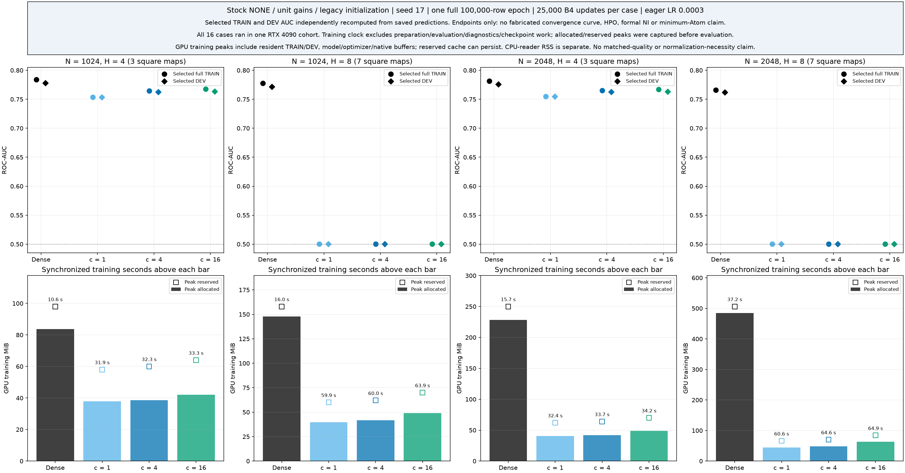

# Linear-Atom pilot: sixteen one-epoch endpoints

English (canonical) | [日本語](higgs-linear-atom-results.ja.md)

**Completed bounded exploratory screen, 2026-11-06.** All sixteen cases completed
one epoch and passed independent saved-evidence admission. H4 CST learned useful
ranking at every tested Atom count. All six H8 CST cases ended with constant,
bias-only FP32 predictions, while the matching Dense controls learned. These are
one-epoch, seed-17 observations under one initialization/optimizer recipe; they do
not identify an intrinsic Atom minimum or the order of the required Atom count.

## Fixed experiment and source boundary

The [Stage A design](higgs-linear-atom-scaling.md) and
[Stage B learning protocol](higgs-linear-atom-learning.md) define the experiment.
The measured consumer is `d00a98bc97ec1cc6be4e2ebdfbea114758b2fca3`, using external
public torchcst `97580582ed28c4e494bf5c2656bbe94a85c544c3`. This additive result pack
changes no scientific module or frozen registry. Their PREPARED declarations
remain historical; this note records the later completed Stage B evidence.

Widths N=1024/2048 and hidden depths H=4/8 give L=H−1=3/7 bias-free square maps.
Trainable Dense input/output maps have dimensions 28→N and N→2; each hidden map
is followed by ReLU. Every CST map has exactly A=cN atoms, c=1/4/16. Normalization
is NONE, gains are one, and the legacy initializer is unchanged. Stock q1 AdamW,
LR 0.0003, B4, FP32, TF32 off and eager execution apply to every case. Each case
starts fresh and sees the same prescribed first-epoch order: 100,000 TRAIN rows,
25,000 updates. All sixteen total 400,000 task updates; inherited synthetic
qualification updates are separate and are not learning evidence.

TRAIN rows [1,000,000,1,100,000) fit normalization; DEV rows
[1,100,000,1,150,000) supply these development metrics. Feature statistics are
fit on TRAIN only. DEV has already informed earlier exploratory studies and is
not a fresh confirmation set. No future confirmation or official-test payload
was staged or scored. No LR search, seed replication or minimum-c search ran.

All cases share one RTX 4090 cohort: CC 8.9, 128 SM, 25,262,096,384 device bytes;
Python 3.12.9, Torch 2.11.0+cu126, CUDA 12.6, Triton 3.6.0, NumPy 2.0.2,
driver 570.133.20. This is an environment-specific result.

## All sixteen endpoints

The table uses the same saved epoch-1 state for full TRAIN and DEV evaluation,
with exact reload/prediction checks. AUC uses the saved FP32 logit difference.
Full precision, TRAIN CE/accuracy, all evaluation/restore times and checkpoint
SHAs are in [the unchanged endpoint CSV](results/higgs-linear-atom-stageB/selected-quality-resources.csv).

| N | H | Method / A per map | Parameters | TRAIN AUC | DEV CE | DEV accuracy % | DEV AUC | Train s | Alloc / reserved MiB |
|---|---|---|---:|---:|---:|---:|---:|---:|---:|
| 1024 | 4 | Dense | 3,177,474 | 0.783696 | 0.566296613 | 70.752 | 0.777785 | 10.59 | 83.69 / 98.00 |
| 1024 | 4 | CST / 1024 | 44,034 | 0.753357 | 0.587867936 | 68.774 | 0.753265 | 31.92 | 37.80 / 58.00 |
| 1024 | 4 | CST / 4096 | 80,898 | 0.764259 | 0.579047085 | 69.350 | 0.762312 | 32.28 | 38.65 / 60.00 |
| 1024 | 4 | CST / 16384 | 228,354 | 0.767397 | 0.580091552 | 69.460 | 0.763269 | 33.26 | 42.02 / 64.00 |
| 1024 | 8 | Dense | 7,371,778 | 0.777402 | 0.573237058 | 70.318 | 0.771360 | 16.03 | 147.69 / 158.00 |
| 1024 | 8 | CST / 1024 | 60,418 | 0.500000 | 0.691499270 | 52.960 | 0.500000 | 59.87 | 39.71 / 60.00 |
| 1024 | 8 | CST / 4096 | 146,434 | 0.500000 | 0.691499270 | 52.960 | 0.500000 | 60.05 | 41.58 / 62.00 |
| 1024 | 8 | CST / 16384 | 490,498 | 0.500000 | 0.691499270 | 52.960 | 0.500000 | 63.86 | 49.08 / 70.00 |
| 2048 | 4 | Dense | 12,646,402 | 0.781179 | 0.571195444 | 70.752 | 0.775637 | 15.66 | 228.19 / 250.00 |
| 2048 | 4 | CST / 2048 | 88,066 | 0.754580 | 0.586913911 | 68.990 | 0.754512 | 32.41 | 40.39 / 62.00 |
| 2048 | 4 | CST / 8192 | 161,794 | 0.764898 | 0.579064868 | 69.596 | 0.762450 | 33.74 | 42.08 / 64.00 |
| 2048 | 4 | CST / 32768 | 456,706 | 0.766774 | 0.579868843 | 69.450 | 0.762918 | 34.22 | 48.83 / 70.00 |
| 2048 | 8 | Dense | 29,423,618 | 0.765670 | 0.580290042 | 69.508 | 0.761750 | 37.24 | 484.19 / 506.00 |
| 2048 | 8 | CST / 2048 | 120,834 | 0.500000 | 0.691499272 | 52.960 | 0.500000 | 60.63 | 44.16 / 66.00 |
| 2048 | 8 | CST / 8192 | 292,866 | 0.500000 | 0.691499272 | 52.960 | 0.500000 | 64.61 | 47.91 / 70.00 |
| 2048 | 8 | CST / 32768 | 980,994 | 0.500000 | 0.691499272 | 52.960 | 0.500000 | 64.94 | 62.91 / 84.00 |

[PDF](results/higgs-linear-atom-stageB/selected-quality-and-memory.pdf).
Points are endpoints, not a convergence curve or confidence intervals.

Training seconds cover synchronized optimizer-complete ordinary steps only.
Preparation, diagnostics, checkpoint I/O, evaluation and restores are outside
that clock. GPU allocated/reserved peaks are reset immediately before training
and captured immediately after synchronization, before evaluation. They include
resident TRAIN/DEV, model, optimizer and native buffers. Reserved allocator cache
can persist from earlier work; this is neither process memory nor CPU-reader RSS.
Case preparation and total timings have inclusive/nonadditive components: do not
sum every CSV timing column. Lower CST memory here does not establish matched
quality, adoption cost, speed advantage or asymptotic runtime/memory order.

Learned scalar counts, with L=H−1, are

\[
P_{\rm Dense}=LN^2+31N+2,\qquad
P_{\rm CST}=(4cL+31)N+2.
\]

This is parameter algebra for fixed c,L, not a measured computational complexity.

## What the H8 evidence establishes

All twelve saved H8 CST split arrays (six cases × full TRAIN/DEV) contain exactly
one FP32 logit pair. Every pair is **bitwise equal to its own saved output bias**;
this was checked from all rows, not inferred from AUC=0.5. Within each width the
three c values have identical saved biases; the biases differ between widths.
DEV accuracy is 52.960% in all six. Their precise CE values differ slightly
between widths, as retained in the CSV. Dense H8 DEV AUC is 0.771360/0.761750.
See [all 32 split counts](results/higgs-linear-atom-stageB/all32-logit-counts.csv).

For the retained first-256-TRAIN forward probe, write the last ReLU output as h,
its producer-retained maximum magnitude as M, and the output bias as b. Then

\[
|(W_{\rm out}h)_j|\le M\sum_i|W_{{\rm out},ji}|,\qquad
U_j=\tfrac12\min\{\operatorname{nextafter}(b_j,+\infty)-b_j,
 b_j-\operatorname{nextafter}(b_j,-\infty)\}.
\]

The twelve [conditional bound/U ratios](results/higgs-linear-atom-stageB/H8-six-conditional-probe-head-bounds.csv)
range from 4.57e-12 to 7.66e-11. M comes from a retained producer summary, not new
independent inference. This is a probe-only real-arithmetic bound, not a GPU GEMM
rounding-error proof or a full-split hidden-activation bound. Full-split bias
identity above is separate empirical evidence.

The [192 endpoint denominator rows](results/higgs-linear-atom-stageB/H8-six-endpoint-denominator-fields.csv)
reconstruct accepted optimizer state using the pinned, scalar-qualified FP32
reporting helper at t=25,000:

\[
\widehat v_t=\frac{v_t}{1-\beta_{2,\rm op}^{t}},\qquad
f_\epsilon=\frac1n\sum_i\mathbf1\{\sqrt{\widehat v_{t,i}}\le\epsilon_{\rm op}\}.
\]

For each case, f=1 for all 28 packed columns plus input weight/bias and output
weight; output bias has f=0. FP32 second-moment bias correction is one at this
endpoint. These are accepted-state reconstructions, not captured kernel
intermediates, initial task gradients or first-update causal measurements.
Preparation/retraction, moment transport and amplitude decay remain part of the
update. The fractions do not prove zero physical updates or a unique stall cause.

The [retained layer-RMS figure](results/higgs-linear-atom-stageB/retained-linear-RMS-depth-profiles.png)
([PDF](results/higgs-linear-atom-stageB/retained-linear-RMS-depth-profiles.pdf)),
[224 activation summaries](results/higgs-linear-atom-stageB/linear-activation-summaries.csv)
and [144 gradient/moment summaries](results/higgs-linear-atom-stageB/accepted-gradient-moments.csv)
separate initial/endpoint forward probes from last-minibatch optimizer fields.
They are retained producer statistics already admitted against the raw evidence;
they do not add a new feature/backward experiment.

## Interpretation and remaining question

The [exact initializer](https://github.com/takumiecd/torchcst/blob/97580582ed28c4e494bf5c2656bbe94a85c544c3/src/torchcst/_backends/torch/kernels/polar_amp_width.py#L25-L50)
draws signed amplitudes with standard deviation 0.1/√A. With ideal independent
symmetric signs, sign-even radius coupling, and nonnegative unit-mass factors
u,v, the source-only ensemble argument is

\[
W=\sum_k a_k u_kv_k^T,\qquad
\mathbb E_{\rm init}\|W\|_F^2\le0.01,\qquad
\mathbb E_{\rm init}\|W\|_F^2/N\le0.01/N.
\]

This bounds average initial row energy, not each row, actual task gain or a
trained model. Approximate constant total energy needs additional localization
and small-amplitude assumptions; radius depends on amplitude magnitude.
Balanced centers, ReLU correlations, finite charts/FP32 and one fixed realization
prevent turning this into an exact depth-decay or causal law. Increasing A alone
need not repair initial signal scale under this initializer.

Forward-scale, optimizer and finite-precision mechanisms remain candidates.
This screen proves neither that LayerNorm is necessary nor that c≤16 is a
capacity limit. In the NONE/bias-free-ReLU architecture with an unbounded head,
[positive fixed gains preserve the ideal global function family](positive-gain-equivalence.md),
while changing initial functions and optimizer trajectories. That product-gain
argument does not extend to intermediate LayerNorm with epsilon. Separate
controlled interventions are needed; the A100 conditioning study is ongoing
and contributes no result to this pack.

Needed-Atom order A*(N,L) remains conditional on task, training recipe, budget and
quality criterion. Establishing its order requires bracketing learnability and
Dense-quality thresholds, suitable LR tuning, more widths and paired seeds.
This one-epoch screen establishes none of those final claims.

## Provenance and reproduction

[Public provenance](results/higgs-linear-atom-stageB/provenance.json) binds every
CSV/PNG/PDF byte plus measured source, protocol, data, runtime and raw-archive SHAs.
Resolve `higgs-linear-atom-learning-20261106` through the configured external
evidence root; raw checkpoints, private paths and datasets are not in Git.
The saved-evidence CPU admission is `003b2a9ae6d09acf57c3d5d20a3a4db4b0defb5a23488a43d4fc705300ca3d95`.
Root reviews are `f4a92eb6de266fe9045cdf817e9fd288213c83321284b5f672b7767cef67614b`
(endpoint pack), `191405fb1156332a0ebc48c845f4a029a373ebb284f71ef7421b79127b66b4db`
(H8 diagnostics), and `32db69aadf63ac935171e45cce03b6274ebd78a4f5c9ec5c5f22650099d0ae82`
(source-only energy argument). Original failed reader attempts remain preserved;
the admitted reader corrected I/O/schema handling, not numerical acceptance.
This publication copies already admitted derived artifacts and does not rerun or
revalidate the measured consumer. Follow the frozen protocol for reconstruction;
no run or followup is triggered by reading this note.
