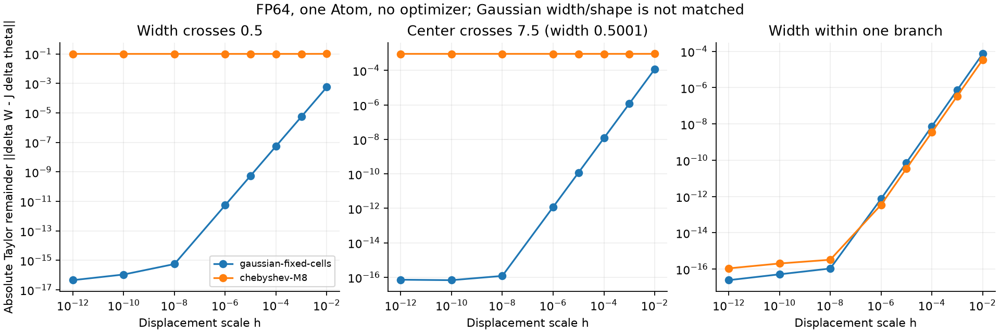
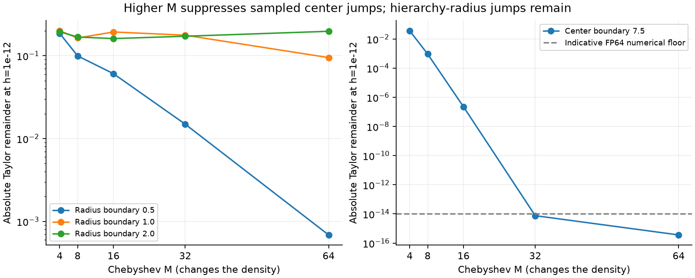
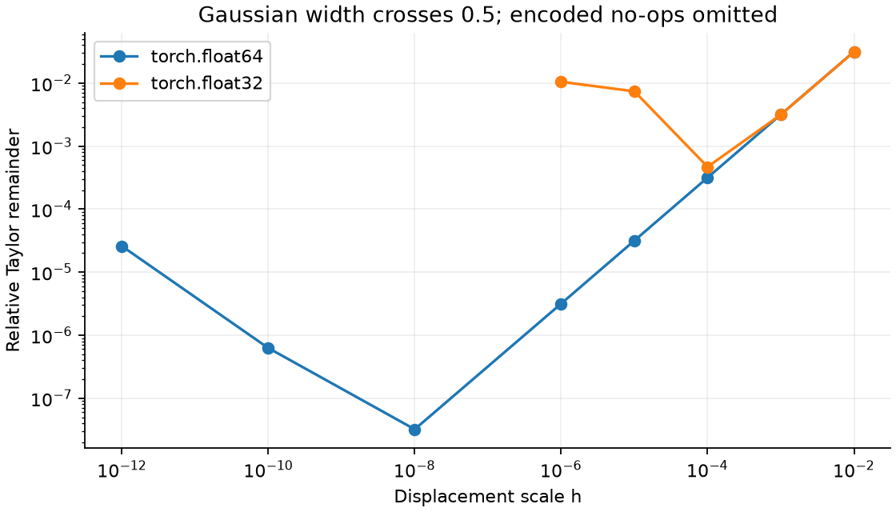

# Gaussianは有限変化を予測できる：Mの増加だけでは修復できない

[English (canonical)](kernel-taylor-continuity-20261109-results.md) | 日本語

**CPUの数学診断152条件・1216変位を完了。optimizer・学習・GPU・本番kernel変更・
速度比較はありません。** 全固定cellの周期Gaussianでは、調べた座標・幅の全境界で
一次予測へ近づきました。現行Fourier profileも同じ枝の中では微分予測に近づきますが、
区間サイズ・階層の切替では大きな残差が残ります。Mを増やすと、調べた座標区間の跳びは
大幅に減り、階層による半径の跳びとは異なる傾向でした。

[実行前protocol](kernel-taylor-continuity-20261109.ja.md) |
[選択した機械可読結果](kernel-taylor-continuity-20261109-results.json)

## 比較したもの

周期128x256・間隔1のgridで振幅1の1 Atomを使います。独立Gaussianは、正規CDF差と
固定image和-4..4で全固定cellを積分し、動的打切りを使いません。Gaussian sigmaと
Chebyshev物理半径の数値を揃えるのは同じ幾何境界を調べるためだけです。
**形・初期RMS・有効幅は揃えていません。** タスク品質の証拠でもGaussian runtime
backendでもなく、既存ライブラリの点評価・L2 Gaussian契約とも異なります。

固定したpublicのChebyshev物理半径referenceをM4/8/16/32/64で評価しました。
宣言上Mは密度関数自体の一部であり、固定Gaussianの近似次数ではありません。
Mを増やしても曲率が下がる・学習が良くなるとは限りません。次数Mの有限Fourier和は
同じ枝の中では既に滑らかです。今回の不連続は枝・区間の切替に関係します。
CPUのM32/64結果は、既存CUDA Planでの対応を示しません。

19条件には物理半径0.5/1/2の両方向、4種類の幅と周期境界における入力・出力中心の
切替、同じ枝内controlを含めます。変位は1e-2から1e-12の8尺度です。
FP64はGaussianと5種類のM、FP32はGaussianと現行M8です。J delta thetaには
符号化後の実際の端点差を使い、丸めで変化しない場合は無変化と記録し、連続性の
証拠とは解釈しません。

## Gaussianの結果

FP64の全19条件で次を確認しました。

- 独立したPDFの解析微分とautograd JVPの最大相対誤差は5.30e-16。
  数値積分・非負性・総mass・周期同一性の検査も成功。
- 変位尺度h1e-6で、Taylor残差の最大相対値は3.47e-6。
  予測と実変化のcosine最小値は0.99999999999399。
- h1e-3から1e-4の絶対残差の収束次数は1.99961–2.00039。
  丸めが支配するまでは、変位を10分の1にすると残差は概ね100分の1になる。
- 極小変位では丸めにより相対比が再び増える。これは現行kernelの有限の絶対残差が
  下がらなくなる現象とは異なる。

Fourierの同じ枝内controlも丸めまで予測へ近づきます。有限Fourier表現それ自体が
今回の不連続を必然的に生むわけではありません。



## Mを増やすと改善するか

h1e-12での絶対Taylor残差（Frobeniusノルム、振幅1）です。

| profile | 半径0.5の境界 | 半径1の境界 | 半径2の境界 | 中心7.5、半径0.5001 |
|---|---:|---:|---:|---:|
| Gaussian |4.51e-17|4.62e-17|2.72e-17|7.21e-17|
| M4 |0.18609|0.19989|0.19455|0.036128|
| M8 |0.099478|0.16368|0.16814|0.00092102|
| M16 |0.060693|0.19347|0.16104|2.23e-7|
| M32 |0.014917|0.17684|0.17184|7.56e-15|
| M64 |0.00068635|0.094881|0.19716|3.62e-16|

調べた座標の跳びはM32/64で数値上無視できる大きさになりましたが、全位置・無限精度で
跳びが厳密にゼロという証明ではありません。半径0.5の個数切替も大きく改善します。
**半径1/2のtile階層切替では大きな残差が残り、Mによる改善は単調ではありません。**
従って高調波を増やすだけでは現行切替規則の修復にはなりません。極小変位の残差を
跳びの指標として用いていますが、形式的な全体の上限ではありません。

現在のmoment基底はbankごとに実数2M+1成分です。M8→64で17→129成分になるため、
追加費用を無視できるとは仮定できません。時間・メモリ・学習精度は測っておらず、
このCPU結果から本番Mを選択していません。



FP32は変位が表現精度に近づくと相対誤差が大きくなり、更に小さい符号化変位では
無変化になります。学習の保存dtypeを変更する根拠ではありません。FP64は今回、
幾何と丸めを分けるために用いています。



## この範囲で言えること

Gaussian対照では、専用optimizerなしで、調べた座標・幅の変化が通常の微分と一致する
ことを示しました。Gaussianの学習性能や高速性を示したわけではありません。
現行M8も同じ枝内では微分と一致し、枝を跨ぐと残差が残るため、Fourier和全般を疑う前に
区間・階層の接続を調べる根拠になります。実用近似の許容差は、絶対的な跳びに加えて、
実際に使う更新幅で意図した更新に対する残差も見るべきです。タスク劣化の許容基準を
今回新たに選んだわけではありません。

将来の接続設計は、位置とサイズ・階層の境界を両方扱い、共有momentの利点を残す必要が
あります。この研究では混合・修正版kernel・新public API・既定値・学習実験を実装していません。

## 出自と検証

実行consumerは73d8ec20dc576d1174f630f0e971a9c0b5eb981b、固定operatorは
0d277ae6dc0ae14fe515c7559f39535ed0238950でcleanでした。
CPU runtimeはTorch2.13.0、Python3.11.15で、以前のGPU runtimeとは異なります。
runner SHA256はe40b373ed6c618cd53473b090c864097bcaa477c02ac351e264c7f122af03734、
raw summary SHA256はf9975160b3fc820523d4c0e21e8e7a8a052c1ea272b6a78513127476d9ac5a6e、
固定source archive SHA256はe21a226b468f6a30cd043295ee0d333a8969241067a153d35d6533fb3326fbffです。
archiveのsource2003件とrunner同一性を再読して検証しました。
証拠はCST_RESEARCH_EVIDENCE_ROOT/kernel-taylor-continuity-cpu-20261109-01です。

独立Gaussian5テスト成功、ローカル全体277件中216成功・61任意skip、registry43研究の
検証、Ruff、図の確認を実施しました。固定run前、総massの厳しい検査で周期offsetの
桁落ちを検出しました（誤差4.55e-15、基準3e-15）。整数site+image*periodを先に計算し、
その後に中心を引くことで直し、元の許容値は全て維持しました。事前検査の失敗・修正の
記録を保全しています。既存実験は再実行していません。

```bash
# 固定operator sourceをPYTHONPATHに指定し、新しい出力先を使います。
python scripts/compare_kernel_taylor.py --output "$NEW_OUTPUT"
python scripts/report_kernel_taylor.py --run "$NEW_OUTPUT" --repository .
```

独立積分で使うGaussian CDFの定義は
[SciPy ndtr](https://docs.scipy.org/doc/scipy/reference/generated/scipy.special.ndtr.html)を参照してください。
