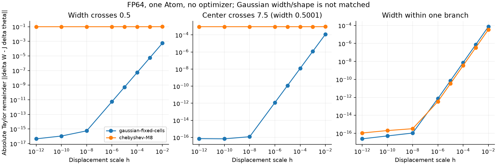
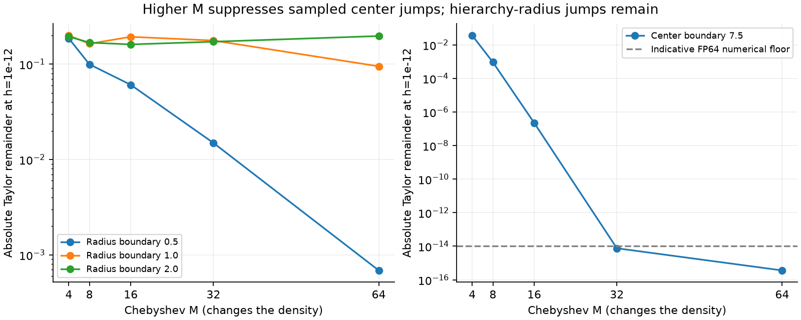
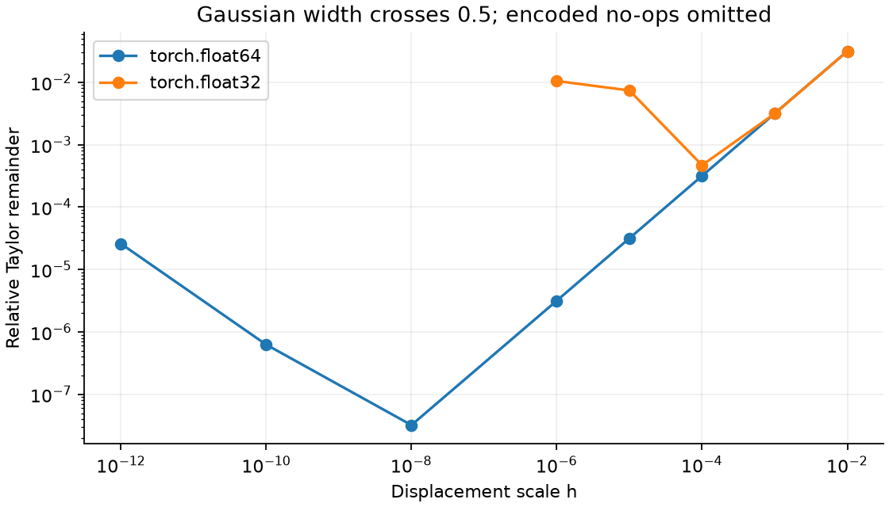

# Gaussian predicts its finite changes; increasing M is not a complete repair

English (canonical) | [日本語](kernel-taylor-continuity-20261109-results.ja.md)

**Completed CPU mathematical diagnostic:152 fixture/profile/dtype records and
1216 finite displacements. No optimizer, training, GPU, production kernel change
or speed comparison.** The fixed-cell wrapped Gaussian follows its first-order
prediction across all tested coordinate/width boundaries. The current Fourier
profile also follows its derivative within a fixed branch, but retains large
residuals when its window size/hierarchy changes. Higher M suppresses sampled
coordinate-window jumps much more than the hierarchy-radius jumps.

[Pre-execution protocol](kernel-taylor-continuity-20261109.md) |
[Selected machine-readable results](kernel-taylor-continuity-20261109-results.json)

## What was compared

One amplitude1 Atom on periodic128x256 unit grids. The independent Gaussian
integrates every fixed cell using normal-CDF differences and fixed wrapped images
-4..4, without a moving cutoff. Gaussian sigma and Chebyshev physical radius use
the same numbers solely to probe the same geometric boundaries. **Shape, initial
RMS and effective width are not matched.** This is not task-quality evidence or
a Gaussian runtime backend. It is not the library's existing point-sampled/L2
Gaussian contract.

The frozen public Chebyshev physical-radius reference is evaluated at M4/8/16/32/64.
Its declaration explicitly makes M part of the mathematical density, rather than
an approximation order for a fixed Gaussian. Increasing M need not reduce
curvature or improve learning. A degree-M finite Fourier branch is already
smooth; the diagnosed jumps involve switching between branches/windows.
CPU M32/64 evidence does not establish support in an existing CUDA Plan.

All19 fixtures include physical-radius0.5/1/2 boundaries in both directions,
input/output-center window boundaries at four widths plus the periodic seam,
and same-branch controls. Eight displacement scales run from1e-2 to1e-12.
FP64 covers Gaussian and all five M values; FP32 covers Gaussian and current M8.
Actual encoded endpoint differences define J delta theta, so a rounded no-op is
recorded as a no-op, never evidence of continuity.

## Gaussian result

Across all19 FP64 fixtures:

- Independent analytic PDF derivatives versus autograd JVP: maximum relative
  error5.30e-16. Quadrature, positivity, mass and periodic checks also pass.
- At displacement scale h1e-6, maximum relative Taylor remainder is3.47e-6;
  minimum cosine(predicted,actual) is0.99999999999399.
- Over h1e-3 to1e-4, absolute-remainder convergence order is1.99961–2.00039:
  reducing h by10 reduces the remainder by about100 until roundoff dominates.
- At extremely small displacements the relative ratio can rise from roundoff.
  This is distinct from the current kernel's finite absolute residual plateau.

The same-branch Fourier controls also approach their predictions until roundoff;
finite Fourier representation alone does not force the observed discontinuities.



## Does larger M help?

Absolute Taylor remainder at h1e-12 (Frobenius norm, amplitude1):

| Profile | radius0.5 boundary | radius1 boundary | radius2 boundary | center7.5, radius0.5001 |
|---|---:|---:|---:|---:|
| Gaussian |4.51e-17|4.62e-17|2.72e-17|7.21e-17|
| M4 |0.18609|0.19989|0.19455|0.036128|
| M8 |0.099478|0.16368|0.16814|0.00092102|
| M16 |0.060693|0.19347|0.16104|2.23e-7|
| M32 |0.014917|0.17684|0.17184|7.56e-15|
| M64 |0.00068635|0.094881|0.19716|3.62e-16|

The sampled center jump becomes numerically negligible at M32/64; this does not
prove an exact zero jump at all positions or infinite precision. Radius0.5's
count change also improves substantially. **At radius1/2, where the selected tile
hierarchy changes, large residuals remain and the M trend is not monotone.**
Adding harmonics is therefore not a complete repair of the current switching
rule. Small-step residuals are jump indicators here, not formal global bounds.

The current moment basis has2M+1 real components per bank. M8→64 changes17→129
components, so the extra cost cannot be assumed negligible. No time, memory or
trained accuracy was measured; these CPU figures select no production M value.



FP32 exhibits larger relative error as displacements approach its resolution;
smaller encoded displacements become no-ops. This does not justify changing the
training storage dtype. FP64 is used here to separate geometry from roundoff.



## Consequences within scope

The Gaussian control demonstrates that the tested coordinate/width changes can
agree with ordinary differentiation without a bespoke optimizer. It does not
show that Gaussian will train better or run efficiently. Current M8's
same-branch controls agreeing with derivatives, while cross-branch plateaus
persist, supports examining window/hierarchy connection before blaming Fourier
sums in general. Practical approximation tolerances should compare the residual
with the intended update at relevant step sizes, in addition to measuring the
absolute jump. No tolerance for acceptable task degradation has been selected.

A future connection design must address both position and size/hierarchy
boundaries and retain the shared-moment benefit. No blending, repaired kernel,
new public API, default or learning experiment was implemented in this study.

## Provenance and checks

Executed consumer:73d8ec20dc576d1174f630f0e971a9c0b5eb981b.
Frozen operator:0d277ae6dc0ae14fe515c7559f39535ed0238950, clean checkout.
CPU runtime:Torch2.13.0,Python3.11.15; this is not the earlier GPU runtime.
Runner SHA256:e40b373ed6c618cd53473b090c864097bcaa477c02ac351e264c7f122af03734.
Raw summary SHA256:f9975160b3fc820523d4c0e21e8e7a8a052c1ea272b6a78513127476d9ac5a6e.
Frozen source archive SHA256:e21a226b468f6a30cd043295ee0d333a8969241067a153d35d6533fb3326fbff.
The archive's2003 source files and runner identity were re-read and verified.
Evidence:CST_RESEARCH_EVIDENCE_ROOT/kernel-taylor-continuity-cpu-20261109-01.

Five independent Gaussian tests passed; full local suite277 tests,216 passed,
61 optional skips. Registry validation covers43 studies. Ruff and figure review
pass. Before the frozen run, a strict mass-sum test exposed periodic-offset
cancellation (4.55e-15 error versus3e-15 gate). Computing integer site+image*period
before subtracting center fixed it; all original tolerances remain unchanged.
The preflight failure/correction note is preserved. No prior experiment was rerun.

```bash
# Use the frozen operator source on PYTHONPATH and a fresh output directory.
python scripts/compare_kernel_taylor.py --output "$NEW_OUTPUT"
python scripts/report_kernel_taylor.py --run "$NEW_OUTPUT" --repository .
```

The Gaussian CDF definition used for the independent integral is documented in
[SciPy ndtr](https://docs.scipy.org/doc/scipy/reference/generated/scipy.special.ndtr.html).
