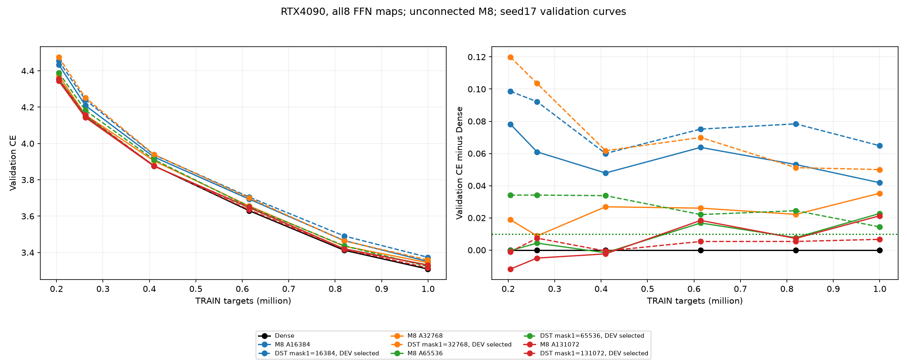
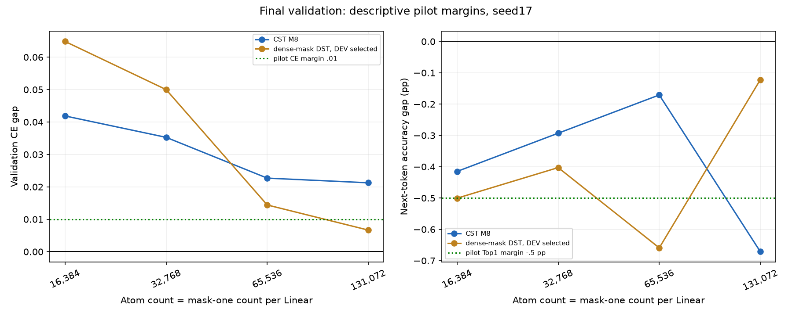
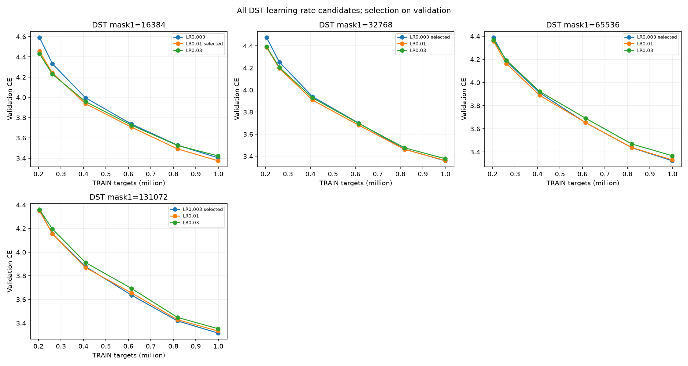
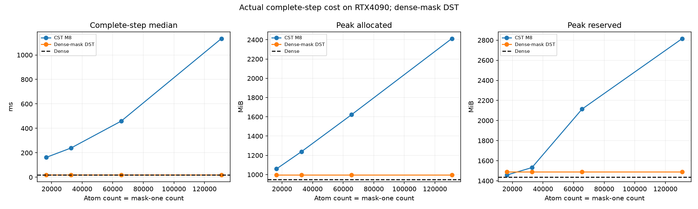
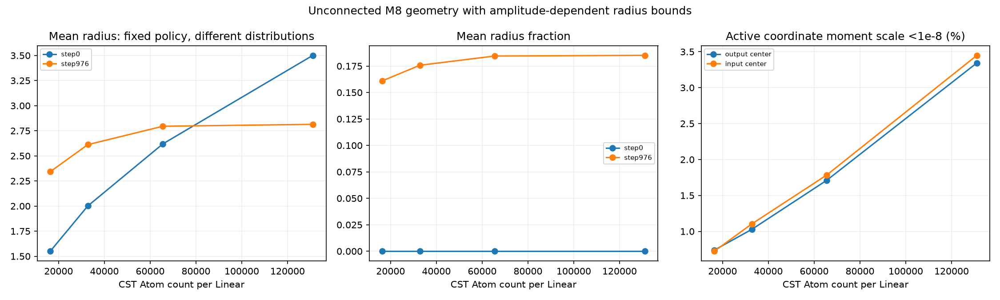

# Denseに近づくM8 Atom予算pilot: validation結果

[English](lm-atom-budget-20261110-results.md) | 日本語

RTX4090で新17条件が全完了した。**ここでDEVはvalidation（検証用split）の意味**。
TRAINとはstory単位で分離した8192 targetを、model.eval()・torch.no_grad()で評価する。
以下は検証用のクロスエントロピーであり、記録したminibatch学習損失とは別。
パラメータ更新はTRAINのみ。DEVはAtom数/DST LR選択に使い、別のconfirmation32768 targetは
整合性チェックのみでモデルの性能評価は未実施。学習/検証曲線は別に保存した。

M8のAtom16384→131072でvalidation CEは3.350850→3.330237へ下がった。
新Denseは3.308981。事前のCE差≤.01かつTop1差≥−.5ポイントというpilot基準を満たすCST条件はない。
宣言したc128上限まで実行し、途中合格がないため中間点は実行せず、規則上の選択coefficientはnull。
範囲を定めたpilotの実行完了であり、Dense同等の条件を選択できたという結果ではない。

## 固定タスクと選択

[手順](lm-atom-budget-20261110.ja.md)。4block・幅512・head8・context128・FFN512→2048→512で、
全8FFN mapを置換。attention/embedding/共有語彙出力はDense。
A=c√(d_in d_out)=1024c、coarse c16/32/64/128を実行した。
非接続M8・envelope tau.003・fraction0・半径[.5,50]・振幅上限32・通常LR.0003・CST全4field32倍、
AdamW(.9,.95)・eps1e-8・decay0・clip1・FP32/TF32無効を固定。
seed17・shuffle905・976更新/999424学習target・20M schedule。
全モデルは正解tokenの次token CEで学習する。数値参照は各CST自身の演算を再構成する正しさ検査で、
Dense行列やDense出力を学習の教師にはしない。

Denseも4090で新規測定し、旧3090のCEとの差は約1.82e-6だった。旧3090のコストは履歴対照でpaired速度比較ではない。
以前の同数[M8/M16 pilot](lm-geometry-epsilon-capacity-20261110-results.ja.md)は、
A8192で3.392873/3.390253、A16384で3.353298/3.354932（M16 eps1e-8）と近かった。
このprofileは実効幅を一致させていない。所有者指定で未mergeのM16実装PR159〜162をcloseしたが、
branch/結果は保全し、M16がタスク差の原因だと認定するものではない。

## validationの精度

| Arm | Active FFN scalars incl.bias | Validation CE | PPL | Next-token Top1 % | CE minus Dense |
| --- | ---: | ---: | ---: | ---: | ---: |
| Dense | 8,398,848 | 3.308981 | 27.3572 | 37.451 | +0.000000 |
| M8 A16384 | 534,528 | 3.350850 | 28.5270 | 37.036 | +0.041869 |
| DST mask1=16384 | 141,312 | 3.373828 | 29.1901 | 36.951 | +0.064847 |
| M8 A32768 | 1,058,816 | 3.344251 | 28.3393 | 37.158 | +0.035270 |
| DST mask1=32768 | 272,384 | 3.358979 | 28.7598 | 37.048 | +0.049998 |
| M8 A65536 | 2,107,392 | 3.331671 | 27.9851 | 37.280 | +0.022690 |
| DST mask1=65536 | 534,528 | 3.323396 | 27.7544 | 36.792 | +0.014415 |
| M8 A131072 | 4,204,544 | 3.330237 | 27.9450 | 36.780 | +0.021255 |
| DST mask1=131072 | 1,058,816 | 3.315642 | 27.5401 | 37.329 | +0.006661 |

65536 AtomではDenseよりCEが.022690高く（PPL約2.30%増）、Top1は.171ポイント低い。
131072ではCEがさらに.001435改善する一方、観測Top1は65536より.500ポイント低かった。
このレシピでは65536が次に確認する折衷候補だが、事前基準の合格条件や証明済み最適値ではない。
1seed/validation8192 targetなので、正答率悪化や同等性の統計的主張はしない。
観測終了時も曲線は下降中で、収束は未検証。今回の系列ではAtom増加でCEが改善したが、上限まで差が残った。

[別図の生TRAIN損失](assets/lm-atom-budget-20261110/training.png)。緑のvalidation CE線は事前の+.01基準。

## Dense-mask DSTの対照

各LinearのCST Atom数とDSTのboolマスク1の数を揃える。raw scalar予算は異なり、
CSTは1Atomに4値、DSTはマスク1に有効重み1値。全条件にFFN bias10240 scalarが加わる。
DSTは密重み+boolマスクを維持し、COO/CSRは使わない。再成長直後に値0でもマスク1なら有効数に含む。
行予算を保つRigL型更新250/500/750、active-fan分散補正は既存のまま。
同じ有効数のLR間で初期mask/値は一致。実時計はCST976、DST973。

全訪問数でLR.003/.01/.03を保全し、終端validation CE最小、同値なら小LRを選んだ。
c16は.01、c32/64/128はgrid下端の.003が最良で、.003未満の最適値は未探索。
選択DSTはA16384/32768でCSTよりCEが高く、A65536/131072でCSTより低い。
131072のDSTは両方の記述的基準内に入った。DEV選択・1seedの結果であり、普遍的優位は主張しない。

| Mask-one count/map | LR | Final validation CE | Selected |
| --- | ---: | ---: | --- |
| 16384 | 0.003 | 3.403289 |  |
| 16384 | 0.01 | 3.373828 | yes |
| 16384 | 0.03 | 3.422353 |  |
| 32768 | 0.003 | 3.358979 | yes |
| 32768 | 0.01 | 3.361983 |  |
| 32768 | 0.03 | 3.378284 |  |
| 65536 | 0.003 | 3.323396 | yes |
| 65536 | 0.01 | 3.331100 |  |
| 65536 | 0.03 | 3.367331 |  |
| 131072 | 0.003 | 3.315642 | yes |
| 131072 | 0.01 | 3.332801 |  |
| 131072 | 0.03 | 3.352513 |  |

## 実装の実測コストと幾何

| Arm | Complete-step median ms | Peak allocated MiB | Peak reserved MiB |
| --- | ---: | ---: | ---: |
| Dense | 18.194 | 948.74 | 1436.00 |
| M8 A16384 | 161.978 | 1059.31 | 1458.00 |
| DST mask1=16384 | 18.310 | 995.82 | 1490.00 |
| M8 A32768 | 239.538 | 1238.94 | 1532.00 |
| DST mask1=32768 | 18.356 | 995.82 | 1490.00 |
| M8 A65536 | 459.236 | 1622.90 | 2114.00 |
| DST mask1=65536 | 18.349 | 995.82 | 1490.00 |
| M8 A131072 | 1134.130 | 2412.58 | 2816.00 |
| DST mask1=131072 | 18.351 | 995.82 | 1490.00 |

全コストを同じ4090 jobで測定。同期した完全stepは4forward/backward microbatch、clip、optimizer/topologyを含む。
先頭10更新、入力準備、validation、probe、checkpoint、oracleを除外した。
allocated/reservedは別で、reservedにはobserverのallocator履歴が残る。
DSTは密重み/mask/勾配/optimizer状態を含み、有効数を変えても保存shapeは変わらない。
dense-mask実装の実測であって疎保存実装の測定ではない。
この小型LMではCSTの速度・総allocatedメモリの優位はない。
A65536の有効FFN raw scalarはDenseの約1/4だが、完全step allocatedは1622.90MiB対948.74MiB。

初期化方針は固定だが、振幅に依存する半径境界によりAに応じて初期半径分布は変わる。
実効幅や関数空間での更新量まで固定した純粋な容量介入ではなく、この観測だけでは表現容量と初期化/最適化を分離できない。
幾何と固定TRAIN4箇所の層出力/cotangent/特徴集約/raw勾配を後の分析用に残した。
activeは振幅絶対値≥.01。moment割合はactive Atom数、初期/終端半径はAtom数で重みづけた。

| A/map | Initial mean radius | Final mean radius | Final mean fraction | Active coord moment scale <1e-8 out/in % |
| --- | ---: | ---: | ---: | --- |
| 16384 | 1.550377 | 2.342595 | 0.160981 | 0.74/0.72 |
| 32768 | 2.000937 | 2.611765 | 0.175732 | 1.03/1.10 |
| 65536 | 2.618953 | 2.794925 | 0.184490 | 1.71/1.79 |
| 131072 | 3.501164 | 2.814021 | 0.185106 | 3.34/3.45 |

## 検証と保全

実機NVIDIA GeForce RTX4090・CUDA可視25262096384 byte・CC8.9・Torch2.9.1+cu128・CUDA12.8。
CPU library2288合格/2677任意skip、research241合格/61skip。
最初のresearch全件実行はPYTHONPATHにscriptsがなく14 import errorだったが、コードを変えず経路を直して合格した。
大予算のretained/複数forward/非連続入力を含むnative123件に合格。全17条件で保存/observer後の次更新が完全一致。
初期/終端・全A・up/downのFP64参照は96 tensor/raw-field対を検証し、maxabs最大1.9908421e-5、
relativeL2最大5.9737507e-7、旧component違反0。
各fieldでmaxabs≤3e-4かつrelativeL2≤1e-4を満たし、許容差は不変。
34 checkpoint監査と32明示的有効数監査で有限FP32 moment、実時計、mask行予算、無効位置0、終端validation再現に合格。
native準備317.446秒、事前検証はDense/c16/c32/c64/c128で194.047/121.264/30.853/53.411/101.498秒、全てstep時間外。
純compile時間は分離していない。観測・保存・準備を含むjob全体は4135.892秒。

固定library0bed48655b1d988e0c59b4442005aaec8c463a31、
consumer9b9e2eb1e4579fe035ca2442b36bad99f1df029d。
runtime278file、通常C++ guard/packed AST、共有module/train/audit bodyの一致に合格した。
変更は条件付きhost予算guardとprivate宣言のみで数値kernelは不変。
実タスク検証済みはc16/32/64/128で、未実行の中間c24/48/96はmetadataテストのみ。
job `lm-atom-budget-4090-20261110-01`、source archive
 e77a8b6ed48d24a8dc44600f3f6459d44774391194b44b858665c27d5abd5a07、
final compact60f83fa3f78f9135c5c8d9612cca02d6479e1021860d02f80c2327936e952ffa、
external driver360e60b8ac299e4e4a0fd48bb896f8276962dc840cb180d719217b8935c20b44。
195 payload/2237 source hashを取得検証。途中Hub API403で監視できなくなったが、所有者のtoken更新で復旧し、
独立実行jobは完走済みだった。所有33commandは全成功、GPUは0%/40MiBでidle、Hubは維持。
raw checkpoint/tensorはremoteに保全。merge/既定採用はしない。

[派生データ・全選択・asset hash](lm-atom-budget-20261110-results.json)。
再描画はscripts/report_lm_atom_budget.pyへ最終取得先--run、選択した4DSTを各--dst-run、新--outputで渡す。
sealed payload、適応trace、有効数、config、選択、数値gateを検証して描画し、validation/TRAINを別表記する。
