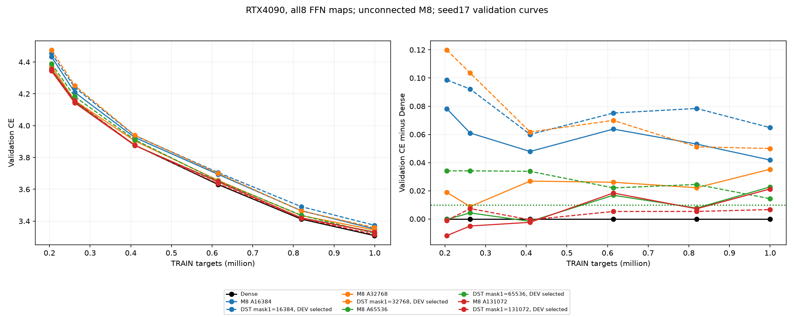
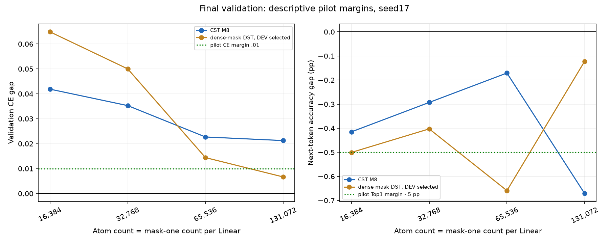
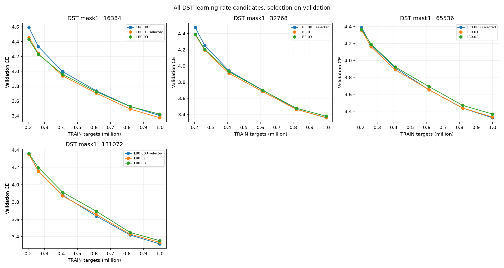
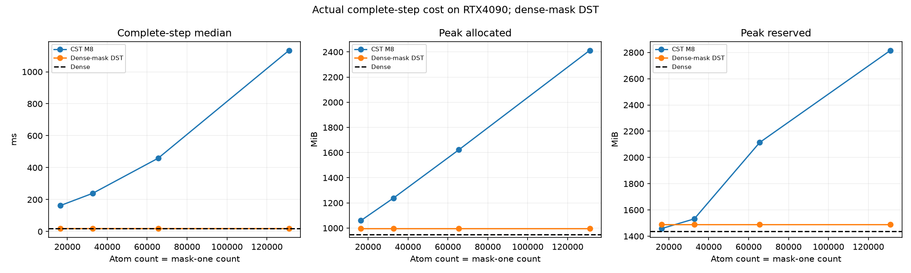
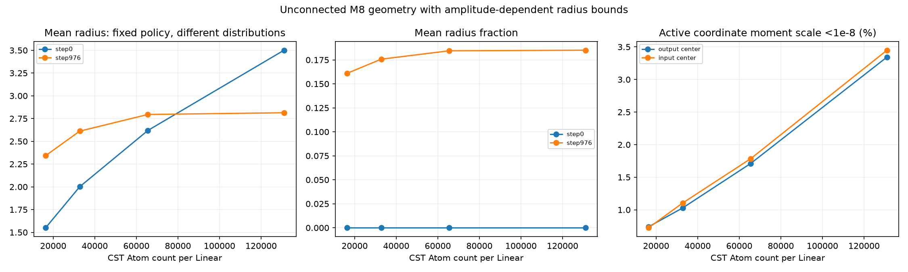

# M8 Atom-budget pilot toward Dense: validation results

English (canonical) | [日本語](lm-atom-budget-20261110-results.ja.md)

All17 fresh arms completed on RTX4090. **DEV means the validation split here**:
model.eval() under torch.no_grad(),8192 targets from stories separated from TRAIN.
The losses below are validation cross-entropy,not the logged minibatch training
loss. Parameter updates use TRAIN only. DEV is used for Atom-count and DST LR
selection; the separate32768-target confirmation split has received integrity
checks but no model-performance evaluation. Training and validation curves are
saved separately.

Increasing M8 Atoms16384→131072 lowers validation CE3.350850→3.330237.
Fresh Dense is3.308981. No tested CST count passes the prespecified CE-gap≤.01
AND Top1-gap≥−.5 percentage-point pilot rule. Expansion reached the declaredc128
cap; no midpoint was triggered and the rule-selected coefficient remains null.
This is a completed bounded pilot,not a successful Dense-equivalence selection.

## Fixed task and selection

[Protocol](lm-atom-budget-20261110.md). Four blocks,width512,heads8,context128,
FFN512→2048→512;all eight FFN maps replaced. Attention,embeddings and tied
vocabulary remain Dense. A=c√(d_in d_out)=1024c;coarsec16/32/64/128 only.
Unconnected M8,envelope tau.003,fraction0,radius[.5,50],amplitude cap32,
ordinary LR.0003,all four CST field LRs32×,AdamW(.9,.95),eps1e-8,decay0,clip1,
FP32/TF32off stay fixed. Seed17,shuffle905,976 updates/999424 training targets,
20M schedule horizon. All models train on next-token ground-truth CE.
Numerical reference checks reconstruct each CST's own operator;Dense matrices
or outputs are not training targets.

Fresh Dense is the paired4090 control. Its CE differs from the prior3090 result
by about1.82e-6;old3090 costs remain historical rather than paired timing.
The earlier equal-count [M8/M16 pilot](lm-geometry-epsilon-capacity-20261110-results.md)
had similar losses:atA8192,3.392873/3.390253;atA16384,3.353298/3.354932
(M16 eps1e-8). Those profiles were not effective-width matched. Closing the
unmerged M16 implementation PRs159–162 at the owner's request preserves their
branches/results and does not establish M16 as the task-gap cause.

## Validation quality

| Arm | Active FFN scalars incl.bias | Validation CE | PPL | Next-token Top1 % | CE minus Dense |
| --- | ---: | ---: | ---: | ---: | ---: |
| Dense | 8,398,848 | 3.308981 | 27.3572 | 37.451 | +0.000000 |
| M8 A16384 | 534,528 | 3.350850 | 28.5270 | 37.036 | +0.041869 |
| DST mask1=16384 | 141,312 | 3.373828 | 29.1901 | 36.951 | +0.064847 |
| M8 A32768 | 1,058,816 | 3.344251 | 28.3393 | 37.158 | +0.035270 |
| DST mask1=32768 | 272,384 | 3.358979 | 28.7598 | 37.048 | +0.049998 |
| M8 A65536 | 2,107,392 | 3.331671 | 27.9851 | 37.280 | +0.022690 |
| DST mask1=65536 | 534,528 | 3.323396 | 27.7544 | 36.792 | +0.014415 |
| M8 A131072 | 4,204,544 | 3.330237 | 27.9450 | 36.780 | +0.021255 |
| DST mask1=131072 | 1,058,816 | 3.315642 | 27.5401 | 37.329 | +0.006661 |

At65536 Atoms,CE is.022690 above Dense (about2.30% higher PPL),and Top1 is
.171 percentage points lower. At131072,CE improves only.001435 further and
observed Top1 is.500 percentage points lower than at65536. This makes65536 an
exploratory follow-up compromise under this recipe,not a predeclared passing
selection or proven optimum. One seed and8192 validation targets do not support
a statistical accuracy-drop or equivalence claim. The curves are still descending
at the observation limit; convergence is untested. More Atoms improve CE in this
series,but a remaining task gap survives the tested cap.

[Separate raw TRAIN losses](assets/lm-atom-budget-20261110/training.png).
The green validation-CE guide is the prespecified+.01 margin.

## Dense-mask DST controls

CST Atom count equals DST Boolean mask-one count per Linear. Raw scalar budgets
are different:CST has four raw values per Atom,DST one active weight;all arms
add10240 FFN bias scalars. DST keeps dense weights plus Boolean masks,no COO/CSR.
Regrown zero-valued weights count if their mask is one. Row-balanced RigL-style
updates250/500/750 and active-fan variance correction are unchanged;initial
masks/values match across LR trials within each count. Actual clocks:CST976,DST973.

Every visited count retains all LR.003/.01/.03 candidates. Select minimum final
validation CE,tie smaller LR. Atc16,.01 wins;atc32/64/128,.003 wins at the lower
grid boundary,so an optimum below.003 remains unexamined. The selected DST has
higher CE than CST atA16384/32768,and lower CE atA65536/131072. At131072 DST
falls inside both descriptive margins. These are DEV-selected,one-seed results;
there is no universal superiority claim for either parameterization.

| Mask-one count/map | LR | Final validation CE | Selected |
| --- | ---: | ---: | --- |
| 16384 | 0.003 | 3.403289 |  |
| 16384 | 0.01 | 3.373828 | yes |
| 16384 | 0.03 | 3.422353 |  |
| 32768 | 0.003 | 3.358979 | yes |
| 32768 | 0.01 | 3.361983 |  |
| 32768 | 0.03 | 3.378284 |  |
| 65536 | 0.003 | 3.323396 | yes |
| 65536 | 0.01 | 3.331100 |  |
| 65536 | 0.03 | 3.367331 |  |
| 131072 | 0.003 | 3.315642 | yes |
| 131072 | 0.01 | 3.332801 |  |
| 131072 | 0.03 | 3.352513 |  |

## Actual implementation cost and geometry

| Arm | Complete-step median ms | Peak allocated MiB | Peak reserved MiB |
| --- | ---: | ---: | ---: |
| Dense | 18.194 | 948.74 | 1436.00 |
| M8 A16384 | 161.978 | 1059.31 | 1458.00 |
| DST mask1=16384 | 18.310 | 995.82 | 1490.00 |
| M8 A32768 | 239.538 | 1238.94 | 1532.00 |
| DST mask1=32768 | 18.356 | 995.82 | 1490.00 |
| M8 A65536 | 459.236 | 1622.90 | 2114.00 |
| DST mask1=65536 | 18.349 | 995.82 | 1490.00 |
| M8 A131072 | 1134.130 | 2412.58 | 2816.00 |
| DST mask1=131072 | 18.351 | 995.82 | 1490.00 |

All costs use this same4090 job. Synchronized complete steps include four
forward/backward microbatches,clip and optimizer/topology. Exclude first10,
input preparation,validation,probes,checkpoints and oracles. Allocated and
reserved are distinct;reserved retains observer allocator history. DST memory
includes dense weights,masks,gradients and optimizer state,so active-count
changes do not change its storage shapes. These are actual dense-mask costs,
not sparse-storage implementation measurements. This small LM has no CST speed
or total allocated-memory advantage. AtA65536 raw active FFN scalars are about
one quarter of Dense,while the complete step allocates1622.90MiB versus948.74MiB.

The initialization policy stays fixed,but amplitude-dependent radius bounds
change initial radius distributions as A grows. Thus this is not a pure capacity
intervention holding effective width and function-space update size constant.
The observations alone cannot separate representation capacity from initialization
and optimization effects. Geometry and four fixed TRAIN contexts retain per-layer
outputs,cotangents,feature summaries and raw gradients for later analysis.
Active means amplitude absolute value≥.01;moment percentages are weighted by
active Atom counts. Initial/final radii below are weighted by Atom counts.

| A/map | Initial mean radius | Final mean radius | Final mean fraction | Active coord moment scale <1e-8 out/in % |
| --- | ---: | ---: | ---: | --- |
| 16384 | 1.550377 | 2.342595 | 0.160981 | 0.74/0.72 |
| 32768 | 2.000937 | 2.611765 | 0.175732 | 1.03/1.10 |
| 65536 | 2.618953 | 2.794925 | 0.184490 | 1.71/1.79 |
| 131072 | 3.501164 | 2.814021 | 0.185106 | 3.34/3.45 |

## Validation and preservation

Actual NVIDIA GeForce RTX4090,25262096384 CUDA-visible bytes,CC8.9,
Torch2.9.1+cu128,CUDA12.8. CPUlibrary2288 passed/2677 optional skips;
research241 passed/61 skips. The first research invocation missed scripts in
PYTHONPATH (14 import errors);the corrected command passed without a code change.
Native123 tests passed,including large-budget retained/multiple-forward and
noncontiguous cases. All17 serialized-next-update/observer checks passed.
Initial/final full-A up/down FP64 checks cover96 tensor/raw-field pairs:maxabs
1.9908421e-5,relativeL2 max5.9737507e-7,zero older componentwise violations.
Every field satisfies maxabs≤3e-4 AND relativeL2≤1e-4;no tolerance change.
All34 checkpoint and32 explicit active-count audits passed,including finite
FP32 moments,actual clocks,mask row counts,inactive zeros and final validation
reload. Native preparation317.446s;qualifications194.047/121.264/30.853/53.411/101.498s
(Dense,c16,c32,c64,c128),outside step timing. Pure compilation time is unisolated.
Whole durable job4135.892s including preparation,observation and storage.

Frozen library0bed48655b1d988e0c59b4442005aaec8c463a31;
consumer9b9e2eb1e4579fe035ca2442b36bad99f1df029d. Runtime278-file identity,
ordinary C++ guard/packed AST and shared module/train/audit-body proofs passed.
Only the conditional budget host guard and private declarations change admission;
numerical kernels are unchanged. Actual task-qualified budgets arec16/32/64/128;
unused midpointc24/48/96 received metadata tests without task runs.
Job `lm-atom-budget-4090-20261110-01`;source archive
 e77a8b6ed48d24a8dc44600f3f6459d44774391194b44b858665c27d5abd5a07;
final compact60f83fa3f78f9135c5c8d9612cca02d6479e1021860d02f80c2327936e952ffa;
external driver360e60b8ac299e4e4a0fd48bb896f8276962dc840cb180d719217b8935c20b44.
Retrieved/verified195 payloads and2237 source hashes. A temporary Hub API403
blocked monitoring;user token renewal restored access and the durable job had
completed. All33 owned commands ended successfully,GPU idle0%/40MiB,Hub left
running. Raw checkpoints/tensors remain remote. No merge/default adoption.

[Derived data,all selections and asset hashes](lm-atom-budget-20261110-results.json).
Regenerate with scripts/report_lm_atom_budget.py:final retrieved --run,each of the
four selected DST directories via --dst-run,and a new --output directory.
The report validates sealed payloads,trace,counts,config,selection and numerical
gates before plotting;validation/TRAIN curves have separate labels.
