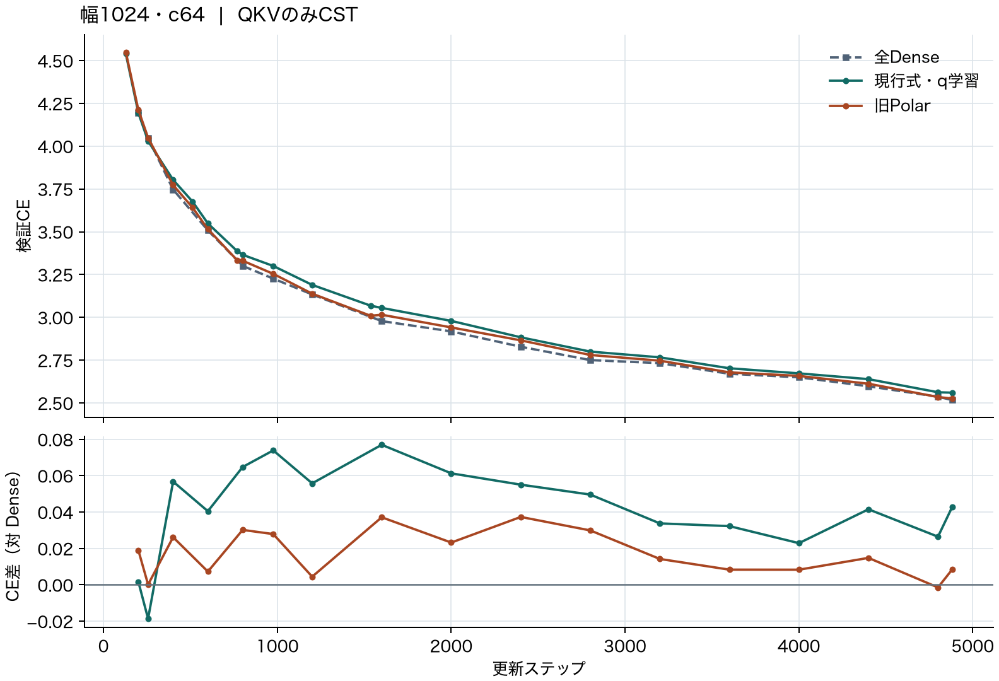

# 幅1024のQKV置換と射影別の疎化に関する根拠

[English](lm-c64-qkv-20261114.md) | 日本語

## QKV実験

TinyStoriesの全4ブロックでQ・K・Vを有理式Polar CSTに置換すると、4,882更新後の検証CEは
**2.525793** でした。全Denseは **2.517333**、指数型包絡で損失勾配から半径比率 $q$ を
学習した条件は **2.560202**、同じ指数型で $q=0$ 固定は **3.260552** です。
seed 17、幅1024、8ヘッド、文脈128、学習率の20Mターゲットのホライズン、実学習
4,999,168ターゲット、共通の検証8,192ターゲットで比較しました。O、FFN、埋め込みと
Attentionの演算はDense構成です。CSTは正方射影12個にそれぞれ65,536個のM8 cell-mass Atomを
使い、バイアス込みのQKV保存スカラー数は3,158,016、Denseは12,595,200でした。

| 更新 | 全Dense | 有理式Polar | 指数型・$q$ 学習 |
| ---: | ---: | ---: | ---: |
| 976 | 3.226502 | 3.254399 | 3.300402 |
| 2400 | 2.828544 | 2.865854 | 2.883605 |
| 4882 | 2.517333 | 2.525793 | 2.560202 |

通常重みの初期化とCSTのモーメント目標を揃えています。有理式Polarは
[幅256のパイロット](attention-combined-20261107-results.ja.md)に合わせ、振幅上限1、
半径の最小・初期上限・最大を0.5/4/50、Atom学習率倍率16、Polarのactivity更新としました。
現行式は振幅上限32、半径範囲[0.5, 512]、Atom学習率倍率32で、最初の1,536更新で
$\tau:0.03\to0.003$ を対数上で半コサイン減衰させました。Polarと現行式の比較には
これらの設定差が含まれます。指数型の2条件は $q$ 学習の効果を測っています。
下限の指数型・有理式と $q$ 固定・学習を交差させる追試では、現行の座標と上限512を使います。

$r=L(a)^{1-q}U(a)^q$ で、旧Polarの最終半径が $L(a)$ を上回った幅は、786,432 Atomに対し
中央値0.062%、最大0.194%でした。最終半径の中央値はPolar 2.77、現行式の $q$ 学習あり214.68
です。下限の形と半径を経由する損失勾配を切り分ける動機になります。この比較は1 seedの検証結果です。

## QKVを優先し、Oを個別に測る理由

- **CSTの実測。** 幅1024・c64、4882更新の指数型・半径上限512で、全FFN CSTは2.586731、
  全upをDenseに戻すと2.495145、全downをDenseに戻すと2.539491でした。
  [Atom数と活性重み数を揃えた以前のFFN比較](https://github.com/takumiecd/cst-research/pull/41)
  はDense 2.517333、CST 2.601438、マスク型DSTが約2.620でした。
  [幅512のQKVOパイロット](https://github.com/takumiecd/cst-research/blob/f879a18/docs/attention-output-6000ada-20261108-results.ja.md)
  では976更新で3.4226、Dense 3.3090でした。Q・K・V・Oの同時置換で、幅1024とは方式も違います。
  幅1024でのO単独の効果は未測定です。ここでのOは各ヘッドの出力を残差加算の前に混ぜる
  Attention出力射影 $W_O$ です。
- **射影別の枝刈り。** GroupMask §3.4・図4は、事前学習済みLLaMA-2-7Bにグループ単位の
  重みマスクと自己蒸留を適用しました。全体約50%の疎度で、Attention重みの36.6%、
  MLP重みの56.6%を保持しました。Attention内ではOの保持率が最も高く、Vの保持数もQまたはKの
  約2.2倍でした。OとVを個別に測る根拠になります。この値は同手法による事後の配分です。
  [GroupMask](https://arxiv.org/html/2609.33977v1#S3.SS4)
- **Oを省いた設計。** Scaling Transformers §3.2は共有の乗法型変換と個別畳み込みでQ・K・Vを
  置換し、その構成ではOを省きました。T5-large相当の比較では総パラメータ数を揃えるために
  FFN幅を4096から6144に増やしています。設計をまとめて変更して成立した例で、
  $W_O$ 単独の感度は未確定です。 [Sparse is Enough in Scaling Transformers](https://arxiv.org/abs/2111.12763)
- **FFNの疎な学習。** MadhyasthaらのLlama 1Bの全ステップ疎学習アブレーション（§5.2.1・表3）
  では学習損失がDense 2.758、$W_1$ のみ疎で2.784、$W_2$ のみ疎で2.785、両方で2.844でした。
  疎な更新とDense更新の併用では品質を回復しています（§5.1・表2）。CSTでもFFN同時置換を
  独立に扱う動機になります。論文の2:4重みと動的な活性疎化はCSTや枝刈り・再成長型DSTと
  異なる仕組みです。 [To 2:4 Sparsity and Beyond](https://arxiv.org/html/2602.06183v1#S5.SS2.SSS1)
- **DSTの根拠。** Mixed Sparsity Trainingの付録B.2・図14ではGPT-2比較でRigLにDenseとの差が
  残りました。提案手法は後半に容量を戻し、FLOP計算ではQKV・O・FFNに重みの疎度を適用します
  （付録A.5）。この比較から射影別の感度は決まりません。
  [Mixed Sparsity Training](https://arxiv.org/html/2408.11746#A2.SS2)

現時点の結果に基づき、次のCST比較はQKVを優先します。Oの直接比較は同じ幅・Atom予算・データ順で
Dense、QKV CST、OのみCST、QKVO CSTです。OのみとDenseの差はO単独の影響を、
QKVOとQKVの差はQKVがCSTの場合にOを追加する影響を測ります。Oの置換が難しいか、
FFNの疎化に固有の限界があるかは検証課題です。

## 証拠と再現

[集計値とSHA-256](lm-c64-qkv-20261114-results.json)に保存済みrun、ソース・データmanifest、
driver、曲線、checkpointとリソース測定を記録しています。生の資料は記載のrun IDで研究用の外部保存先に
残しています。再現には各runの `train.py`、対応するソースsnapshotと差分manifest、凍結データを
使います。Polar driverは記録どおり幅比較・半径上限比較・包絡対照がある場所で
`--output <run-directory>` を渡します。包絡driverは `--source`、`--parent`、
`--baseline`（$q$ 学習条件）、`--output` を使います。
RTX 4090、Torch 2.9.1+cu128のeager FP32で実行しました。正方形状のCUDA許可は隔離snapshotの
変更です。正方射影のFP64参照による出力と全Atom勾配の検査を通過し、完了した各CST checkpointで
検証CEを再現しました。
