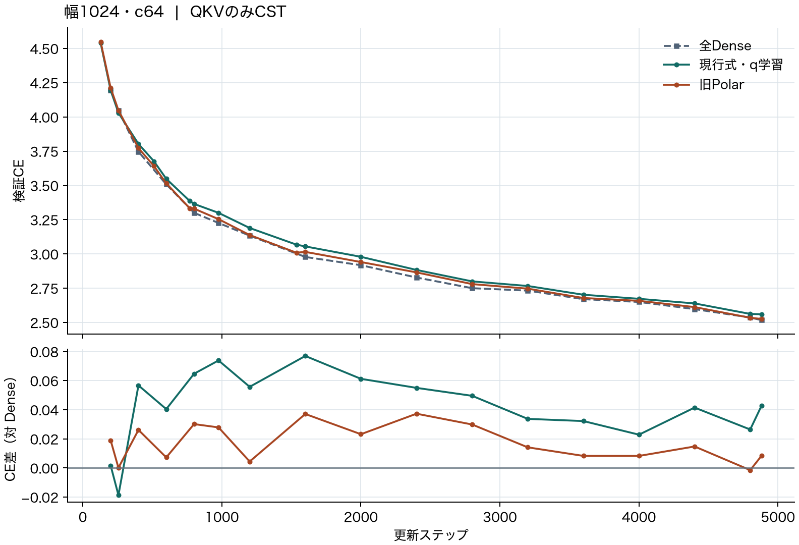

# Width-1024 QKV replacement and projection sparsity evidence

English | [日本語](lm-c64-qkv-20261114.ja.md)

## QKV experiment

On TinyStories, replacing Q, K and V with rational Polar CST in all four
blocks gave validation CE **2.525793** after 4,882 updates. Full Dense gave
**2.517333**, and the current exponential envelope with task-trained radius
fraction $q$ gave **2.560202**. The fixed-$q=0$ version of that envelope
gave **3.260552**. Each run used seed 17, width 1024, eight heads, context
128, a 20M-target learning-rate horizon, 4,999,168 actual training targets and
the same 8,192 validation targets. O, FFN, embeddings and the attention
computation follow the Dense architecture. Each of the 12 square CST maps has
65,536 M8 cell-mass Atoms, with 3,158,016 stored scalars including projection
biases versus 12,595,200 for Dense QKV.

| Update | Full Dense | Rational Polar | Exponential envelope, trained $q$ |
| ---: | ---: | ---: | ---: |
| 976 | 3.226502 | 3.254399 | 3.300402 |
| 2400 | 2.828544 | 2.865854 | 2.883605 |
| 4882 | 2.517333 | 2.525793 | 2.560202 |

The ordinary weights share their initialization and the CST arms use the
same moment target. The rational Polar recipe follows the [width-256 pilot](attention-combined-20261107-results.md):
amplitude cap 1, radius minimum/birth/maximum 0.5/4/50, Atom LR multiplier 16,
and the Polar activity update. The current envelope uses amplitude cap 32,
radius range [0.5, 512], Atom LR multiplier 32 and log half-cosine
$\tau:0.03\to0.003$ over the first 1,536 steps. These are comparisons of
complete recipes. The difference between the two exponential arms isolates
training $q$ within that recipe. The follow-up crosses the exponential and
rational lower bounds with fixed and learned $q$, using the current
coordinates and upper bound 512. That comparison has its own results.

With $r=L(a)^{1-q}U(a)^q$, the terminal Polar radius was above $L(a)$
by a median 0.062% and a maximum 0.194% across 786,432 Atoms. The final radius
median was 2.77 for Polar and 214.68 for the trained exponential envelope.
These observations motivate isolating the lower-bound shape and the task
gradient through the radius. This development comparison covers one seed.

## Why prioritize QKV and measure O separately

- **CST evidence.** At width 1024/c64 and step 4,882, the exponential
  cap-512 all-FFN CST arm gave 2.586731, with 2.495145 after returning
  every FFN up projection to Dense and 2.539491 after returning every
  down projection to Dense. The earlier [Atom-count-matched FFN study](https://github.com/takumiecd/cst-research/pull/41)
  observed 2.517333 Dense, 2.601438 CST and about 2.620 for masked DST.
  The [width-512 QKVO pilot](https://github.com/takumiecd/cst-research/blob/f879a18/docs/attention-output-6000ada-20261108-results.md)
  gave 3.4226 versus Dense 3.3090 at 976 updates. It replaced Q, K, V and O
  together with a different recipe. O's isolated effect at width 1024 remains
  open. Here O denotes the attention output projection $W_O$, which mixes
  head outputs before the residual addition.
- **Projection-level pruning.** GroupMask §3.4/Fig. 4 used group weight masks
  and self-distillation on pretrained LLaMA-2-7B. At approximately 50% global
  sparsity, it retained 36.6% of attention weights and 56.6% of MLP weights.
  O received the highest retention among attention projections and V retained
  about 2.2 times as many parameters as Q or K. This supports testing O and V
  separately. The statistic is the allocation found by that post-training
  method. [GroupMask](https://arxiv.org/html/2609.33977v1#S3.SS4)
- **An architecture that removes O.** Scaling Transformers §3.2 replaces
  Q/K/V with shared multiplicative mixing followed by separate convolutions
  and removes O in that variant. It increases FFN width from 4096 to 6144
  for the T5-large-size comparison to preserve the model parameter budget.
  The result demonstrates a workable joint redesign. The paper's design
  changes leave the standalone sensitivity of $W_O$ open.
  [Sparse is Enough in Scaling Transformers](https://arxiv.org/abs/2111.12763)
- **FFN training with sparsity.** In the all-sparse Llama 1B ablation of
  Madhyastha et al. §5.2.1/Table 3, train loss was 2.758 Dense, 2.784 with
  sparse $W_1$, 2.785 with sparse $W_2$, and 2.844 with both sparse.
  Their mixed sparse/dense training recipe recovers quality (§5.1/Table 2).
  Together with the CST result, this motivates treating simultaneous FFN
  replacement as a separate question. The paper's 2:4 weights and dynamic
  activation sparsity differ from CST and prune-and-regrow DST.
  [To 2:4 Sparsity and Beyond](https://arxiv.org/html/2602.06183v1#S5.SS2.SSS1)
- **DST evidence.** Mixed Sparsity Training Appendix B.2/Fig. 14 reports
  a gap for RigL in its GPT-2 comparison. Its schedule restores capacity
  later, and its FLOP model applies the weight sparsity rate to QKV, O,
  and FFN (Appendix A.5). This comparison cannot rank those projections.
  [Mixed Sparsity Training](https://arxiv.org/html/2408.11746#A2.SS2)

The existing evidence supports focusing the next CST comparisons on QKV.
At the same width, Atom budget and data order, the direct test for O is
Dense, QKV CST, O-only CST and QKVO CST. The O-only comparison measures
its standalone cost; QKVO minus QKV measures its added cost when QKV is
already CST. An O-specific failure and an inherent limit on FFN sparsity
remain hypotheses.

## Evidence and reproduction

[Curated results and SHA-256 identifiers](lm-c64-qkv-20261114-results.json)
identify the archived runs, source and data manifests, driver, curves,
checkpoints and resource measurements. Raw artifacts are in the external
research evidence store under the recorded run IDs. Use the archived
`train.py`, the matching source snapshot and its source-change manifest,
and the fixed token data. The Polar driver takes `--output <run-directory>`
with the sibling width, cap and envelope control runs described in the
receipt. The envelope drivers take `--source`, `--parent`, `--baseline`
(learned-$q$ run) and `--output`. The task ran in eager FP32 on RTX 4090
with Torch 2.9.1+cu128. The square CUDA shape admission was a private snapshot
change. Independent square FP64 forward and all-Atom gradient checks passed,
and each completed CST checkpoint reproduced its validation CE. These
measurements establish task quality for the recorded configuration.
