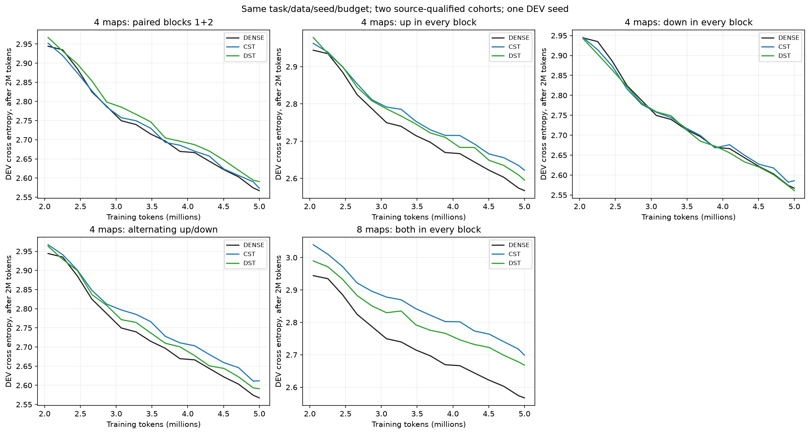
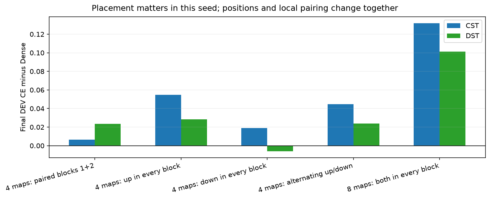
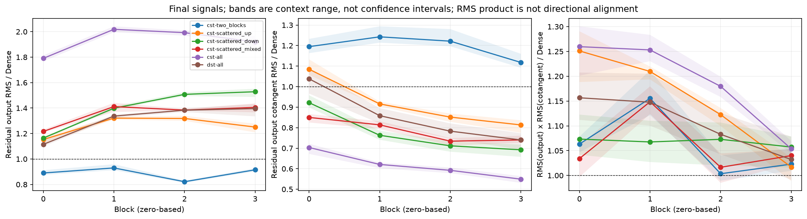
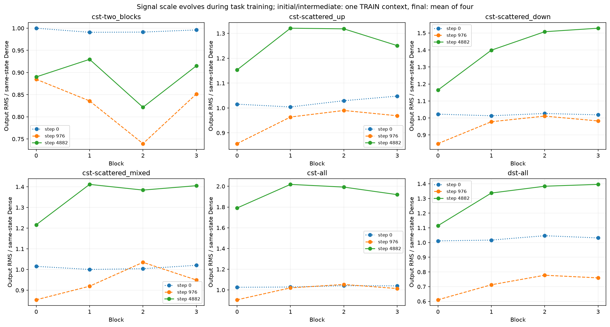
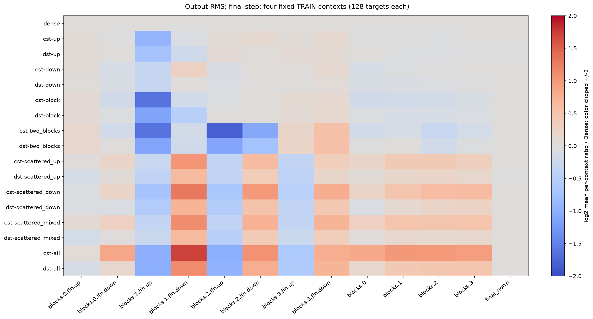
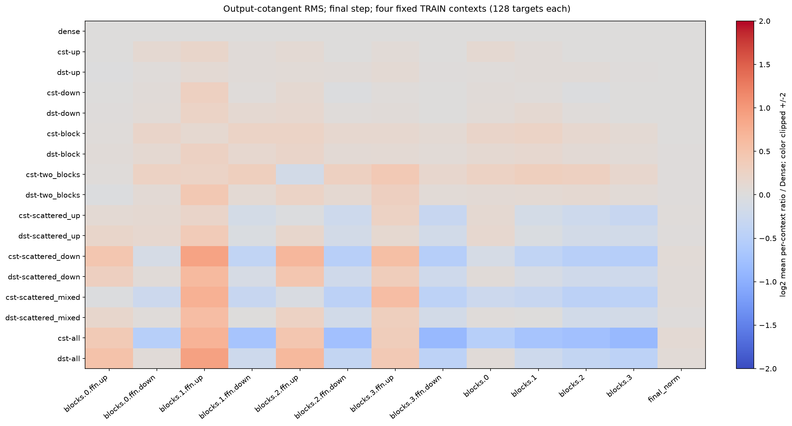
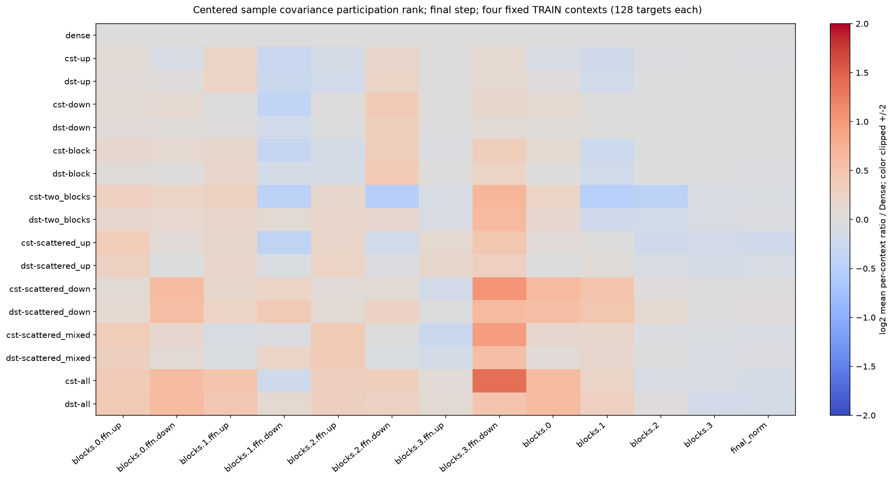
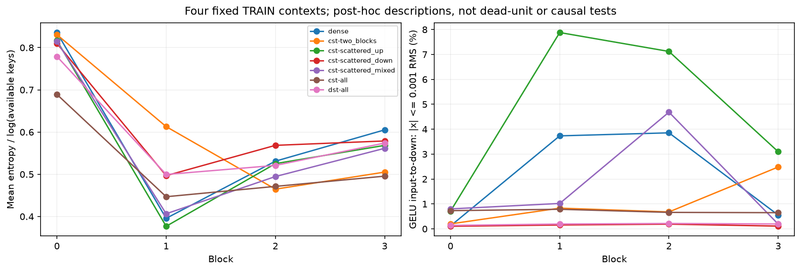

# FFN配置とタスクLMの信号診断結果

[English](lm-composition-20261109-results.md) | 日本語

分散配置6条件は、中断した最後のDSTを同じプロトコルで復旧した分も含めて完了。
[先行11対照条件](ffn-site-count-20261109-results.ja.md)と合わせて17モデルの証拠を
ローカルで照合し、学習済み51checkpointを監査しました。その後の読み取り専用診断も
51モデル状態・102回のTRAIN probeを完了。本来のタスクラベルを学習し、Denseは比較対照です。

## タスク結果

[配置プロトコル](ffn-block-placement-20261109.ja.md)はTinyStories、4ブロック、
幅512、8head、context128、seed17、4,999,168学習token（4882更新）、LR/topologyの
20M-token horizonを固定。選択したCST写像は各8192atoms、tau.003、初期radius fraction0、
振幅上限32、公開moment初期化、全4fieldのLR32倍、RMS校正なし。同予算DSTは各32768個の
有効重みとsparse LR.003、通常パラメータのLRは3e-4。Attention・embedding・tied head・
未置換写像は学習可能Denseです。固定した1seedのDEV pilotで、追加HPO・confirmation評価はありません。

| 置換位置（ブロック番号は0始まり） | CST DEV CE | DST DEV CE | CST token top1 | DST token top1 |
|---|---:|---:|---:|---:|
| blocks1+2の上下：4写像 | 2.573492 | 2.590663 | 46.777% | 46.411% |
| 各ブロックup：4写像 | 2.621995 | 2.595345 | 45.667% | 46.399% |
| 各ブロックdown：4写像 | 2.585912 | 2.561047 | 46.240% | 46.899% |
| up/down交互：4写像 | 2.611801 | 2.591034 | 46.289% | 46.033% |
| 全ブロック上下：8写像 | 2.698948 | 2.668223 | 44.641% | 44.897% |

新規DenseはCE=2.567102、次token top1=46.826%（3836/8192）。4写像置換はすべて
有効FFN scalar数4,335,616、全8写像では272,384です。top1は共通のDEV8192対象に対する
teacher forcingでの次token正答率で、自由生成の品質ではありません。

交互4写像と中央2ブロック上下4写像は、2up/2downの形状数と有効scalar数を揃えていますが、
このseedではCSTのCEに0.038309の差がありました。各ブロックに1個ずつ散らせば必ず改善する
わけではありません。今回のdown分散はup分散より良く、down/output写像が本質的に悪いとも
言えません。位置とFFN内の連続性を同時に変えているため、隣接性の因果実験ではありません。
先行の1写像・1ブロック上下はDenseに近く、1つのFFN内にCSTを2個置くだけでは全8写像の差を
説明できません。4個と8個では全体の圧縮率も変わります。順位・同等性には追加seedと別途固定する
confirmation基準が必要です。





## 出力と勾配

[読み取り専用プロトコル](lm-signal-diagnostics-20261109.ja.md)で初期・step976・4882を評価。
各状態で従来のTRAIN先頭128対象を使い、最終状態ではoffset4096/8192/12288もそれぞれ
独立した128行の呼び出しで測定しました。native呼び出しは検証済み1..256行の範囲内です。
以下は最終4contextの**context別比率の平均**であり、tokenをpoolした統計ではありません。
図の帯はcontext間の範囲で、信頼区間ではありません。診断によるoptimizer更新は0回です。

| 最終の全8写像CST / 同状態Dense | block0 | block1 | block2 | block3 |
|---|---:|---:|---:|---:|
| 残差出力RMS | 1.791 | 2.019 | 1.992 | 1.919 |
| 残差出力cotangent RMS | 0.703 | 0.621 | 0.592 | 0.549 |
| RMS(出力) x RMS(cotangent) | 1.260 | 1.253 | 1.180 | 1.054 |

全8CSTの初期block RMSは従来probeでDenseの1.026–1.041倍。大きなスケール差は学習中に
生じています。以前のHIGGSで見た極端な初期減衰とは異なります。最終正規化後の出力と
cotangentのRMS比は平均1.017・1.070で、このTRAIN probe群ではネットワーク全体がゼロへ
崩壊する挙動は観測されませんでした。

単純なスカラー再パラメータ化h'=c hではcotangentはg'=g/cとなり、RMS(h)RMS(g)は不変です。
この積は生の勾配スケールと、出力スケールを考慮した感度を分ける補助になります。ただし
方向を含む内積でも、Jacobianや学習効率の推定でもありません。学習済み正規化ネットワークは
厳密なスカラー再パラメータ化ではありませんが、出力が約2倍のときにcotangentが約0.55倍という
だけで勾配消失とは判断できません。共有入力Tensorのhookが観測するのは残差側なども含む
**全cotangent**であり、その分岐だけの局所Jacobianではありません。





中心化した標本共分散のparticipation rankにも一様な崩壊は見えません。最終の全8CSTでは
up出力の比がブロック間で1.047–1.403、down出力が0.871–2.601、最終正規化後は0.924です。
各context最大128token行の統計であり、重みrank・情報量・表現能力の限界ではありません。
participation rankが高いことも、良いタスク特徴を得た証明にはなりません。

QKV/OがDenseのままでも正規化attention entropyは変化し、全8CSTで平均[.689,.447,.471,.496]、
Denseで[.836,.396,.531,.605]でした。up分散条件では中央ブロックのGELU出力のうちRMSの0.001倍
以下の割合が増えますが、ReLUのdead unit判定でも、原因を特定する結果でもありません。
出力分布・勾配・attentionから複数の仮説を立てられますが、単一の原因は未確定です。
CST fieldの生の勾配はDense重みと単位が異なり、更新の比較には従来の実効action-update probeも
参照する必要があります。









過去のQKV成功とQKVO悪化は、幅・旧Polarの設定・source/runtime cohortが異なり、現在の設定で
Oだけを切り分けていません。今回は現envelopeの同条件attention役割比較を実行しておらず、
その前に正方形写像のbackend検証が必要です。

## 資源・検証・復旧

| 新規条件 | step中央値 ms | allocated / reserved MiB | 全wall秒 |
|---|---:|---:|---:|
| cst-scattered_up | 83.39 | 927.09 / 1176 | 523.16 |
| dst-scattered_up | 18.06 | 970.85 / 1192 | 115.17 |
| cst-scattered_down | 83.90 | 988.47 / 1302 | 434.31 |
| dst-scattered_down | 18.10 | 970.80 / 1192 | 114.81 |
| cst-scattered_mixed | 83.32 | 940.94 / 1248 | 432.50 |
| dst-scattered_mixed、復旧分 | 18.04 | 970.82 / 1192 | 115.21 |

RTX4090、Torch2.9.1+cu128、CUDA12.8、Parameter/momentはFP32、TF32無効。
固定したCST levels kernelの中間値はFP64です。同期した転送+4microbatch+backward+clip+更新を
測定し、zero_grad・LR設定・DEV・checkpoint・診断・最初の10stepは除外。setupとwallは別です。
peakは計測追加処理のないstepにおける値でallocator履歴を含みます。最後のDSTはサーバー復旧後、
先行対照は別jobなので、これらは記述的な資源値であり、対にした配置速度比較・デバイス比較では
ありません。DSTはDense保存・matmulの精度対照で、最適化sparse kernelではありません。
語彙・activationのコストも引き続き大きく残ります。

最初の配置jobは5条件完了後にサーバー停止。ユーザーは手動停止なし・予約継続中と回答。
永続NFSに5条件を保持し、完了summary/checkpointがなかったdst-scattered_mixedだけを
復旧後に学習しました。fresh qualificationで初期Parameter identityの完全一致を確認。
完了条件を破棄・選別して再実行していません。6条件の18 milestone監査、全17条件の51checkpoint
監査が成功。native微分の許容差はatol1e-4/rtol4e-3のままです。

診断は68件のoperator testを再実行し、51状態すべてでParameterとCPU/CUDA RNGを保持。
従来probeのlossを1e-6以内、FFN勾配RMSをatol1e-10/rtol1e-5以内で再現し、102probeすべて成功。
最終compactを両方ダウンロードして独立hash照合し、配置47files/1940source identities、
診断9files/1955source identitiesを確認。回収中にHTTP503が再発しましたが、診断自体は正常終了し、
接続復帰後に回収しました。Hub不安定の根本原因は不明で、GPU故障・OOMの証明ではありません。
失敗したローカル回収の試行も別保存し、失敗を隠すための追加学習はしていません。

ローカル後処理ではCPU suite261件（200pass・61optional skip）、40studyのregistry検証、
Ruff、report link、全10図のhash、描画時の証拠・source整合チェックを通過しました。
これらのCPU検証はGPU観測とは別で、統計的な主張の範囲を広げるものではありません。

## 出典と再現

Operator:`0d277ae6dc0ae14fe515c7559f39535ed0238950`。
配置consumer:`dc0dca16e6589de50368d2ea32626f92579fff4d`、
source:`1d78e7f960c4084418e16efac0ae39bb9bd2ce5f3f63d29a8551dd3648af6bc4`、
最終compact:`f98ef8a15acf91101dceebf51ef2004c3a12479dc205c4ac81ff65c8fec18425`。
診断consumer:`5e3cee7ea64d2e138a75ed8f06d7ec7a70861ee0`、
source:`ea81b5ba5ab73aaebefcb0b56e2723194ff78d7add1ac2e1b6c90bb6aef0fabe`、
evaluator:`2ca8b22825644cceb38db7a2e55d9d051d64edba6fe851a524ca2502f7246707`、
最終compact:`da623de635843ceb3ca13546191aac10f584aae2e18a53e38531c63286a1283c`。
[JSON](lm-composition-20261109-results.json)に全17条件の結果、source/data/checkpoint/figureの
hash、資源の範囲、context別比率を記録しています。

3つのjob root、source archive、最終compact展開先、backup-state.jsonを
CST_RESEARCH_EVIDENCE_ROOT配下に復元してください。描画にはPython3.12・Matplotlib・NumPyを
使い、GPUや追加学習は不要です。

```bash
python scripts/plot_lm_composition.py \
  --base-run "$CST_RESEARCH_EVIDENCE_ROOT/ffn-site-count-4090-20261109-01" \
  --placement-run "$CST_RESEARCH_EVIDENCE_ROOT/ffn-block-placement-4090-20261109-recovery01" \
  --signals-run "$CST_RESEARCH_EVIDENCE_ROOT/lm-signal-diagnostics-4090-20261109-01" \
  --output output/lm-composition-figures
```

描画時に、未完了・未照合の証拠、core/operator bytes・training/probe関数ASTの不一致、
runtime/config/data/order/budgetの変更、checkpoint監査の欠落、診断checkpoint identityの
不一致を拒否します。公開operatorの既定値・LR方針・半径設計・因果的な解決策の採用ではありません。
