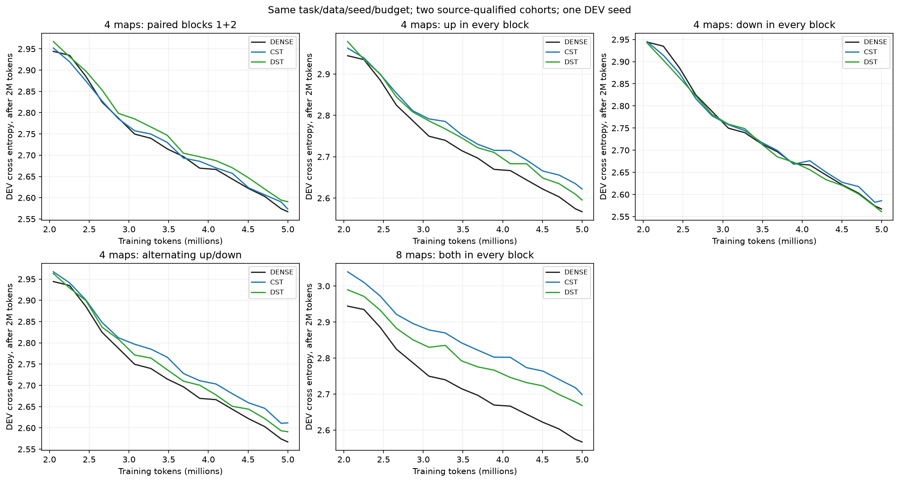
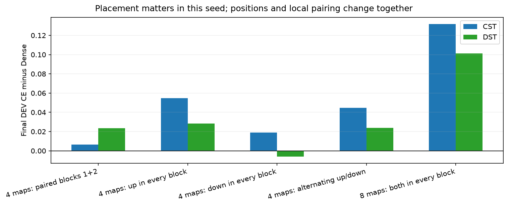
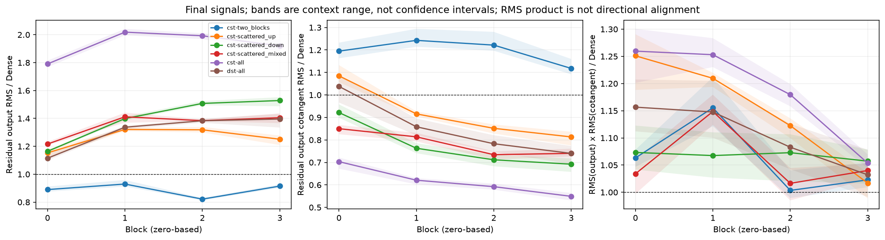
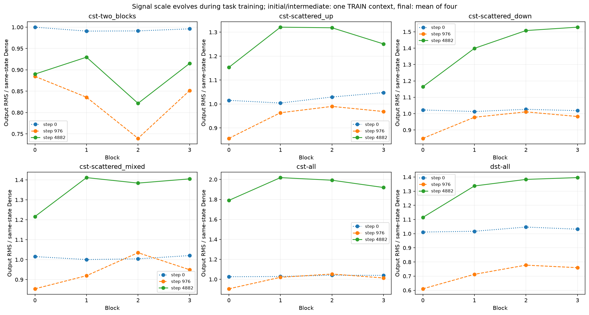
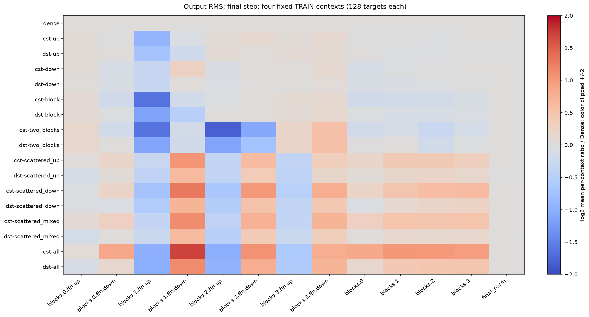
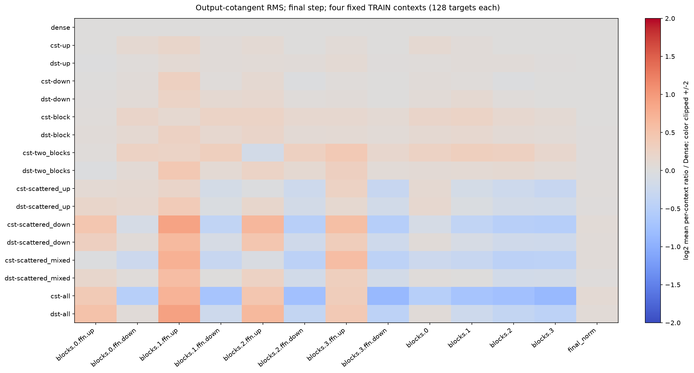
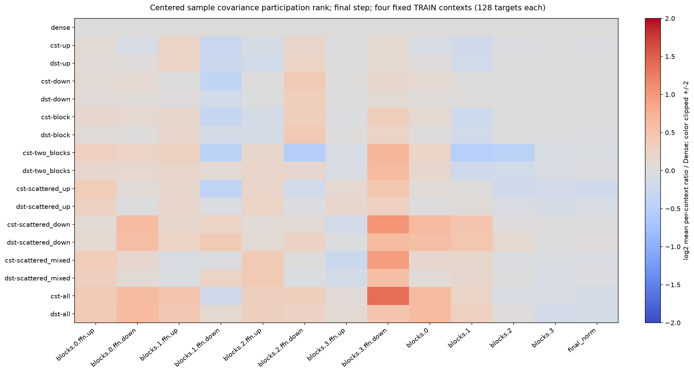
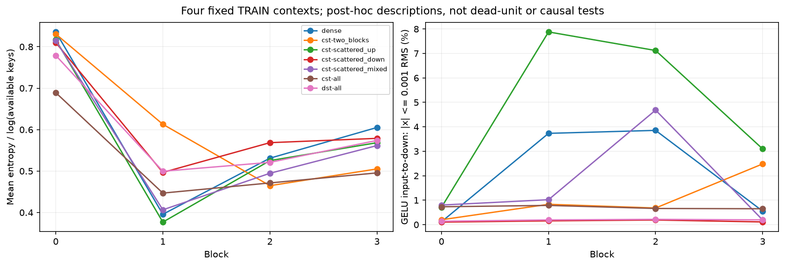

# FFN placement and task-LM signal results

English (canonical) | [日本語](lm-composition-20261109-results.ja.md)

All six distributed-map conditions completed, including the interrupted final
DST condition recovered under the unchanged protocol. Together with the eleven
[site-count controls](ffn-site-count-20261109-results.md), all seventeen models
have locally verified evidence and 51 trained-checkpoint audits. The subsequent
read-only diagnostic completed 51 model states and 102 TRAIN probes. Task labels
remain the training objective; Dense is a comparison control.

## Task results

The [placement protocol](ffn-block-placement-20261109.md) keeps the four-block,
width512, eight-head, context128 TinyStories LM, seed17, 4,999,168 training tokens
(4882 updates), and 20M-token LR/topology horizons. Every selected CST map has
8192 atoms, tau.003, initial radius fraction0, amplitude cap32, public moment
initialization, all four field rates32x, and no RMS calibration. Matched DST has
32768 active weights per selected map and sparse LR.003; ordinary LR is3e-4.
Attention, embeddings, tied head and unselected maps remain trainable Dense.
These are fixed one-seed DEV pilots, with no new HPO or confirmation evaluation.

| Replacement (zero-based blocks) | CST DEV CE | DST DEV CE | CST token top1 | DST token top1 |
|---|---:|---:|---:|---:|
| Both maps in blocks1+2: 4 maps | 2.573492 | 2.590663 | 46.777% | 46.411% |
| Up in every block: 4 maps | 2.621995 | 2.595345 | 45.667% | 46.399% |
| Down in every block: 4 maps | 2.585912 | 2.561047 | 46.240% | 46.899% |
| Alternating up/down: 4 maps | 2.611801 | 2.591034 | 46.289% | 46.033% |
| Both maps in every block: 8 maps | 2.698948 | 2.668223 | 44.641% | 44.897% |

Fresh Dense CE=2.567102, next-token top1=46.826% (3836/8192).
All four-map models have 4,335,616 active FFN scalars; all-eight models have
272,384. Top1 uses the same8192 DEV targets and teacher-forced next tokens;
it does not measure free-generation quality.

The four-map mixed and paired-middle CST cases match2up/2down shapes and active
scalar counts, yet differ by0.038309 CE in this seed. Scattering one CST map into
each block therefore does not automatically improve the task result. The
distributed down-only case is better than up-only here; this does not support
an unconditional claim that down/output maps are intrinsically worse. Positions
and within-FFN pairing change together, so this is not a causal adjacency test.
The earlier single-map and one-paired-block models remain close to Dense; simply
placing two CST maps in one FFN is not sufficient to explain the all-eight gap.
Global compression also changes between four and eight maps. Rankings and
equivalence need additional seeds and separately fixed confirmation criteria.





## Outputs and gradients

The [read-only protocol](lm-signal-diagnostics-20261109.md) evaluated initial,
step976 and step4882 states. Each state uses the original128-target TRAIN prefix;
the final state additionally uses offsets4096/8192/12288 as three separate
128-row calls. Native calls stay inside the qualified1..256-row contract. The
following table averages **per-context ratios** across the four final contexts,
not pooled-token statistics. Context ranges in the plots are not confidence
intervals. No diagnostic optimizer updates occurred.

| Final all-eight CST / same-state Dense | block0 | block1 | block2 | block3 |
|---|---:|---:|---:|---:|
| Residual output RMS | 1.791 | 2.019 | 1.992 | 1.919 |
| Residual output-cotangent RMS | 0.703 | 0.621 | 0.592 | 0.549 |
| RMS(output) x RMS(cotangent) | 1.260 | 1.253 | 1.180 | 1.054 |

All-eight CST initially has block RMS1.026–1.041x Dense on the original probe;
the larger scale develops during training. This does not reproduce the severe
initial attenuation previously observed in HIGGS. At the final state, the
final-normalized output and cotangent RMS ratios average1.017 and1.070.
There is no observed network-wide collapse toward zero on these TRAIN probes.

For a pure scalar reparameterization h'=c h, its cotangent transforms as
g'=g/c; RMS(h)RMS(g) is invariant. The table's product therefore helps distinguish
raw gradient scale from scale-adjusted sensitivity. It is neither a directional
inner product nor a Jacobian/learning-efficiency estimate. Learned normalized
networks are not exact scalar reparameterizations, but a cotangent ratio near0.55
alone cannot establish vanishing gradients when the corresponding activation
scale is nearly2x. Tensor input hooks observe the **total** cotangent at shared
inputs, including residual consumers, not a branch-isolated local Jacobian.





The sampled centered covariance participation ranks do not show a uniform
rank collapse: final all-eight CST up-output ratios are1.047–1.403 across blocks,
down-output ratios0.871–2.601, and final-normalized output ratio0.924. These
statistics use at most128 token rows **per context**. They are not weight rank,
information content or a representational-capacity bound. Higher participation
rank does not prove better task features.

Normalized attention entropy changes although QKV/O remain Dense: all-eight
CST averages[.689,.447,.471,.496], versus Dense[.836,.396,.531,.605]. The
distributed up-only model has more near-zero GELU values in middle blocks
(relative threshold0.001x RMS), but the statistic is not a ReLU dead-unit test
or an identified cause. Output distributions, gradients and attention therefore
provide several hypotheses without establishing a single failure mechanism.
Raw CST field-gradient magnitudes are not in Dense-weight units; the original
realized action-update probes remain the more comparable update descriptions.









Historical QKV success and QKVO degradation used different widths, old Polar
recipes and source/runtime cohorts. O was not isolated under the current recipe.
No matched current-envelope attention-role experiment was run here; square-map
backend qualification is still required before that study.

## Resources, verification and recovery

| New condition | Median step ms | Allocated / reserved MiB | Total wall seconds |
|---|---:|---:|---:|
| cst-scattered_up | 83.39 | 927.09 / 1176 | 523.16 |
| dst-scattered_up | 18.06 | 970.85 / 1192 | 115.17 |
| cst-scattered_down | 83.90 | 988.47 / 1302 | 434.31 |
| dst-scattered_down | 18.10 | 970.80 / 1192 | 114.81 |
| cst-scattered_mixed | 83.32 | 940.94 / 1248 | 432.50 |
| dst-scattered_mixed, recovered | 18.04 | 970.82 / 1192 | 115.21 |

RTX4090, Torch2.9.1+cu128, CUDA12.8, FP32 Parameters/moments, TF32off.
The frozen CST levels kernel retains FP64 intermediates. Timing is synchronized
transfer+four microbatches+backward+clip+update; it excludes zero_grad/LR setup,
DEV/checkpoints/diagnostics and the first10 steps. Setup and wall are separate.
Peaks describe uninstrumented steps with allocator history. The final DST arm
ran after a server restart, and parent controls belong to a separate job: these
are descriptive resources, not a paired placement-speed or device comparison.
DST uses dense storage/matmul and is an accuracy reference, not an optimized
sparse-kernel implementation. Vocabulary/activation costs remain substantial.

The original placement run stopped after five complete conditions; the owner
reported no manual stop and an active reservation. Persistent NFS retained those
five outcomes. Only dst-scattered_mixed, which had no completed summary/checkpoint,
was trained after recovery. Fresh qualification reproduced its exact initial
parameter identity. No completed condition was discarded or selected for rerun.
All six conditions passed their18 milestone audits; all seventeen models have
51 audited checkpoints. Native derivative tolerances remain atol1e-4/rtol4e-3.

The diagnostic reran68 operator tests, then preserved Parameters and CPU/CUDA
RNG at all51 states, reproducing original-probe loss within1e-6 and FFN gradient
RMS within atol1e-10/rtol1e-5. All102 probes passed. Both final compact archives
were downloaded and independently hash-verified: placement47files/1940source
identities; signals9files/1955source identities. HTTP503 recurred during retrieval,
but the diagnostic finished successfully and evidence was recovered when the
service returned. The Hub instability's root cause remains unknown; this does
not establish GPU failure or an out-of-memory cause. Failed local retrieval
attempts are preserved separately. No new training was started to mask failures.

Local postprocessing validation passed261 CPU-suite tests (200passed,61optional
skips),40-study registry validation,Ruff,report links,all10 figure hashes and
the plotter's full evidence/source compatibility checks. These CPU checks are
separate from the GPU observations and do not strengthen the statistical scope.

## Provenance and reproduction

Operator:`0d277ae6dc0ae14fe515c7559f39535ed0238950`.
Placement consumer:`dc0dca16e6589de50368d2ea32626f92579fff4d`;
source:`1d78e7f960c4084418e16efac0ae39bb9bd2ce5f3f63d29a8551dd3648af6bc4`;
final compact:`f98ef8a15acf91101dceebf51ef2004c3a12479dc205c4ac81ff65c8fec18425`.
Diagnostic consumer:`5e3cee7ea64d2e138a75ed8f06d7ec7a70861ee0`;
source:`ea81b5ba5ab73aaebefcb0b56e2723194ff78d7add1ac2e1b6c90bb6aef0fabe`;
evaluator:`2ca8b22825644cceb38db7a2e55d9d051d64edba6fe851a524ca2502f7246707`;
final compact:`da623de635843ceb3ca13546191aac10f584aae2e18a53e38531c63286a1283c`.
The [JSON](lm-composition-20261109-results.json) includes all17 outcomes,
source/data/checkpoint/figure hashes, resource scopes and per-context ratios.

Restore the three job roots, source archives, final extracted compacts and their
backup-state.json files under CST_RESEARCH_EVIDENCE_ROOT. Python3.12 and
Matplotlib/NumPy are sufficient for the plotter; no GPU or new training is needed:

```bash
python scripts/plot_lm_composition.py \
  --base-run "$CST_RESEARCH_EVIDENCE_ROOT/ffn-site-count-4090-20261109-01" \
  --placement-run "$CST_RESEARCH_EVIDENCE_ROOT/ffn-block-placement-4090-20261109-recovery01" \
  --signals-run "$CST_RESEARCH_EVIDENCE_ROOT/lm-signal-diagnostics-4090-20261109-01" \
  --output output/lm-composition-figures
```

The plotter rejects incomplete/unverified evidence, mismatched core/operator
bytes or training/probe function ASTs, runtime/configuration/data/order/budget
changes, missing checkpoint audits, or diagnostic checkpoint-identity mismatches.
No public operator default, LR policy, radius design or causal remedy is adopted.
