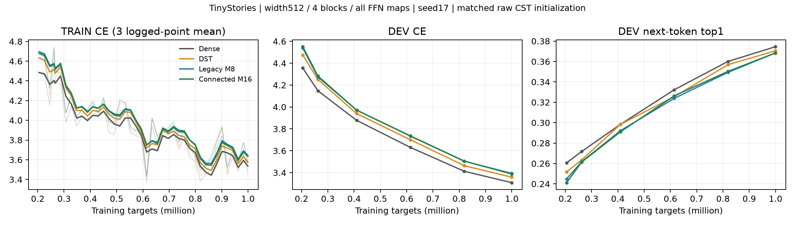
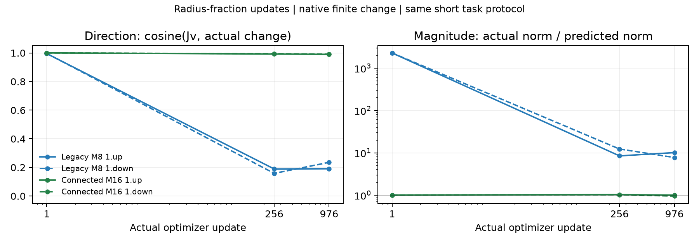
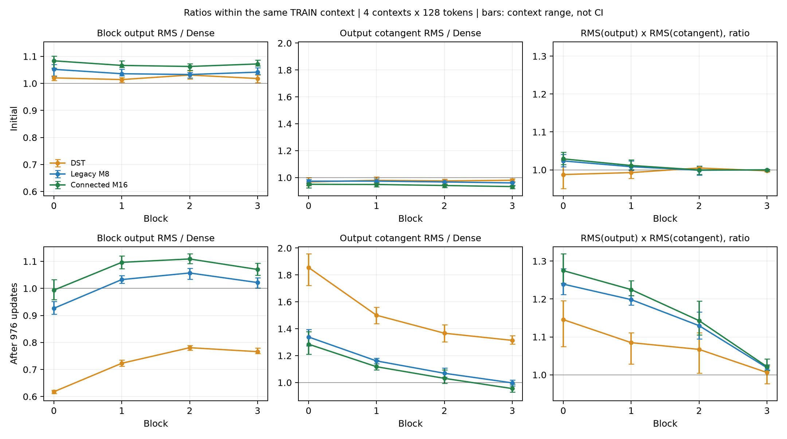

# 短期LM：境界の予測一致は改善、精度差は残る

[English](lm-connected-short-20261109-results.md) | **日本語**

TinyStoriesの4条件を初期から976更新・999424 targets学習し、有限更新の全解析も完了。
Connected M16で半径更新の予測一致度は大幅改善したが、DEV CEの差は小さく、次token正答数は旧M8と同じ。
1seedの短期pilotであり、収束・統計的同等性・残るDense差の原因は確定していない。

## 同条件のタスク曲線

[事前計画](lm-connected-short-20261109.ja.md)：幅512、因果pre-norm4ブロック、全FFN8写像を置換し、各A=8√(512×2048)=8192。
attention・embedding・共有語彙射影はDense。seed17、context128、有効1024 targets/update、20MのLR/topology horizon、
tau.003、初期割合0、cap32、CST全field LR32倍。両CSTのraw初期Parameterはbyte一致し、全条件の共有通常Parameterも一致。
RMS再調整・LR探索・Dense教師・confirmation評価はない。次数とconnectionを同時に変えるため、精度差を片方だけの効果とはしない。
実際のM16 Planは`cuda_connected_m16_ordered_envelope`。共通configの旧backend欄は初期化・対照の一致のため維持している。

| 条件 | DEV CE | 次token top1 | LM完全step中央値 ms | allocated / reserved MiB |
|---|---:|---:|---:|---:|
| Dense | 3.308981 | 37.451% | 18.196 | 950.666 / 1142 |
| DST | 3.358979 | 37.048% | 18.245 | 993.869 / 1090 |
| Legacy M8 | 3.394198 | 36.841% | 134.714 | 972.921 / 1256 |
| Connected M16, ordered | 3.388291 | 36.841% | 69.467 | 950.319 / 1272 |

DEVは学習storyと重複しない8192 targets。M16のCE改善はM8から0.005908、Denseとの差は0.079309、DSTとの差は0.029312。
両CSTの正答は3018/8192で同じ。曲線はまだ下降しており、最終精度ではない。Dense・DST・旧M8は過去の同token数のCEを完全再現した。



[初期も含む全曲線](assets/lm-connected-short-20261109/learning-full.png)。TRAINの太線は3記録点平均、細線は生値。
時間はzero_grad・LR設定・4回forward/backward・clip・optimizerを含み、batch準備は計測前。
最初10stepと観測step、DEV、checkpoint、数値解析は除外。peakは常駐model・勾配・optimizer・scratchとallocator履歴を含み、
プロセス全体の使用量ではない。新M16は旧M8より1.94倍速いがDenseより3.82倍遅い。
この小型LM全体のallocatedはDenseとほぼ同じで、大規模Linear単体の節約率とは別条件。DSTはdense保存・matmulの精度対照。

## 更新予測で改善したこと

実raw変位vに対し、元TRAIN入力Xとbiasを固定する。

\[
\Delta z=f(\theta+v,X)-f(\theta,X),\quad c=\cos(Jv,\Delta z),\quad
 e=\frac{\|\Delta z-Jv\|}{\|Jv\|}.
\]

主たる実変化はnative実装で計算。Jvは符号化済みFP32包絡写像の後に公開FP64物理factorを適用し、振幅→半径・割合→半径の微分を維持。
更新1/256/976のblock1 up/downで、最初のTRAIN microbatch先頭32行と実際のprojection後変位を使う。
解析でmodel/optimizerを更新しない。12観測×5field、尺度1/.1/.01を記録し、尺度1のnative照合は60回。

下表は学習後256/976の4観測範囲。1は方向一致であり、有用な学習の割合ではない。

| raw field | 旧M8 cosine | 新M16 cosine |
|---|---:|---:|
| amplitude | 0.988383–0.998917 | 0.977142–0.995540 |
| radius_fraction | 0.158402–0.235613 | 0.990143–0.994137 |
| output_center | 0.999974–0.999979 | 0.999953–0.999970 |
| input_center | 0.999957–0.999982 | 0.999948–0.999975 |
| all_fields | 0.543057–0.790676 | 0.984067–0.997601 |

割合だけの更新の実変化/予測norm比は7.730～12.283から0.951～1.028へ、相対defectは7.558～12.165から0.112～0.140へ改善。
有限stepの曲率による誤差は残る。初回の旧M8はcosineだけでは誤解しやすく、半径norm比が約2277～2280、M16は1.003～1.004だった。
小さい更新にはnative出力の差し引き誤差が見え、小さいepsilonではFP32丸めが支配し得る。



[座標・半径の全図](assets/lm-connected-short-20261109/update-fidelity.png)。この観測更新では座標は旧M8でも高一致であり、
今回座標が大幅改善したとは言えない。過去の座標境界の決定的再現例は別の数学的結果。
振幅には非線形な包絡半径の連動が残り、一様には改善していない。全field合計の予測一致は大きく改善した。
予測への忠実さと、タスク余接ベクトルへの方向一致は別の量。

割合を止めた結果でもない。256/976で割合が変化したAtomはM16で82.5～85.7%、M8で76.9～79.0%。
割合変位RMSは約.00144～.00166対.00175～.00188。raw endpointと復号した半径変化もJSONに保存。

## 初期・学習後のブロックスケールを追加確認

ユーザーの質問を受けた事後の読み取り専用拡張として、TRAINの位置0/4096/8192/12288から独立した128token contextを4組使い、
初期と976を観測。数値は同じcontextのDenseに対する比を4組で平均したもので、pooled RMSではない。
図の棒はcontext間の範囲であり、信頼区間ではない。

| M16 / Dense | block0 | block1 | block2 | block3 |
|---|---:|---:|---:|---:|
| 初期出力RMS | 1.084 | 1.067 | 1.063 | 1.072 |
| 976の出力RMS | 0.994 | 1.096 | 1.109 | 1.070 |
| 976の出力cotangent RMS | 1.285 | 1.118 | 1.031 | 0.955 |
| 976のRMS(出力)×RMS(cotangent) | 1.275 | 1.225 | 1.143 | 1.021 |



以前の旧M8・5M-tokenで見た約1.8～2.0倍という出力比は、今回1Mでは出ていない。
旧M8の1Mは0.926～1.057、DSTは0.618～0.781でもCSTよりCE差が小さい。現在の精度差を出力の大きさだけでは説明できない。
このprobeで一様なゼロ崩壊は見えないが、出力cotangentは生のParameter勾配や学習効率そのものではない。
新M16の5Mは未実行で、短いhorizonの結果から後期のスケール増大を防ぐとは言えない。

## 配置の解釈は未確定

[過去のM8配置研究](lm-composition-20261109-results.ja.md)は今回1Mとは異なる5Mで、block1上下がCE2.567259、
中央blocks1+2上下が2.573492、Denseが2.567102だった。FFN丸ごとの2/4写像置換であり、Dense/CSTの交互配置ではない。
attentionはすべてDense。全8CSTは2.698948。4写像hybridの有効FFN scalarは4,335,616、全8では272,384であり、
枚数・残るDenseの自由度・位置が混ざる。同数配置でも1seedの値に違いがあった。
Denseがスケールや特徴変換を補う可能性はあるが、因果的な補償実験は未実施。
枚数・up/down役割・配置を揃える比較は次の仮説であり、結論でも自動で開始した追加学習でもない。

## 検証・失敗・証拠

実GPU83件に成功し、独立長方形積分と順序固定反復を含む。実A8192・両FFN方向の初期/最終oracleが
atol1e-4/rtol4e-3を通過。全4モデルで直列化後のmodel/optimizer次更新一致とhook非干渉が成功。
物理primitiveの3e-4ゲートは別に維持。checkpoint hash、Parameter digest、clock、momentは終了後の独立監査も成功。
生証拠はjob名のローカルignored領域とNFSに保全し、データ・checkpointはGitに入れない。

初回import失敗と、非順序固定direct集約による次更新の最大7.451e-9のbit不一致も保全した。
別の順序固定site実装で元の厳密ゲートを通し、許容差・optimizer・recipeは緩和していない。
順序固定版の8192 Linear単体は12.923ms、直前12.811ms、Dense4.908msで、scratchは32MiB増。
公開deterministic/Graph modeは未対応のまま。

- 学習/解析: operator `00aae6afaf3615da6bccd986c75c14cd7b2ca64b`, consumer `4110c0df1452200ba2591861b3d90276f663107c`, job `lm-connected-short-4090-20261109-03`.
- 最終compact SHA256: `e2e396767e3d1864edefee65c68560a0ae80977c6dad99ca9e52022a1a2502ab`。26 payloadファイルと固定source2108件をローカル照合。外部driver SHA256 `30d322f9bbbcc33d8b93d5a1e5b4eb51adceb2472285b34cdd99d141672b7f60`はリモートコピーと一致。
- 読み取り専用信号job `lm-connected-signals-4090-20261109-01`: archive `2dea863d7439bd5f22b30e2aeacd4dff95c0b5259aa5042309eef2c6e09e61b7`。32probeでParameter・buffer・CPU/CUDA RNGの不変を確認。
- checkpoint監査と順序固定Linearコスト: `connected-m16-ordered-4090-20261109-01`; archive `6ec0c5e958cb6c1b9163cf8b49ae064ea1a9010320d807bb2d1f08bd827d97c1`. 全8中間ファイルhashを照合し、4最終Parameter digestが実モデルを再現。Adam時計は976（DST973）、momentsはすべて有限FP32。


[集計JSON](lm-connected-short-20261109-results.json)に全観測とhashを保存。
研究用ローカル289件は228成功・任意61skip、現在の診断算術/起動4件も成功。
実行runtimeのoperator CPUは2255成功・2654skip、その後のbenchmark metadata roundtripも別途成功。
GPU skipはGPU証拠に数えない。両PRはdraftで、merge・公開既定変更はない。

```bash
# 記録したoperator/consumerを明示し、古いffn extraとは区別する。
export PYTHONPATH="$TORCHCST_CHECKOUT/src:$TORCHCST_CHECKOUT:$RESEARCH_CHECKOUT/src:$RESEARCH_CHECKOUT:$RESEARCH_CHECKOUT/scripts"
python -m cst_research.experiments.lm_connected_run qualify --data "$TOKENS" --data-manifest-sha256 5b995103ca95d3c9b62a4e860039683dc734b0a0bb20e232db1b2e45aa690d01 --output "$QUALIFICATION"
python -m cst_research.experiments.lm_connected_run train --arm connected-m16 --data "$TOKENS" --data-manifest-sha256 5b995103ca95d3c9b62a4e860039683dc734b0a0bb20e232db1b2e45aa690d01 --qualification "$QUALIFICATION/qualification.json" --output "$NEW_ARM"
python scripts/analyze_lm_connected.py --run "$RUN" --output "$NEW_ANALYSIS"
python scripts/report_lm_connected.py --run "$VERIFIED_EXPORT" --dst-run "$VERIFIED_EXPORT/dst-all" --checkpoint-audit "$AUDIT" --output "$NEW_REPORT"
```
