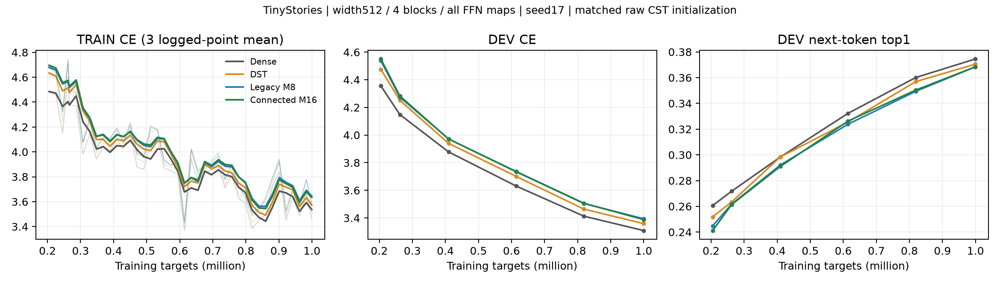
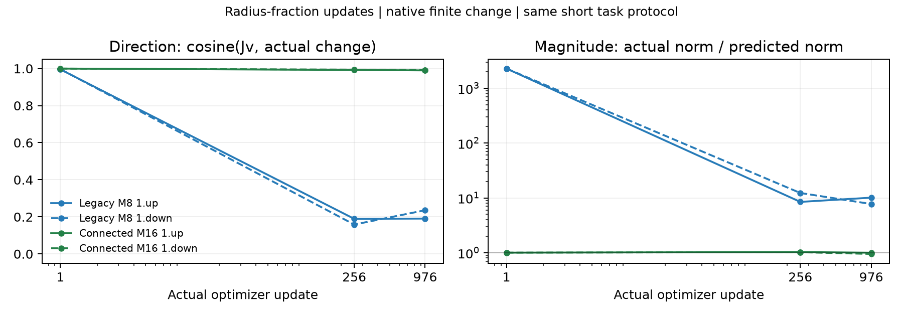
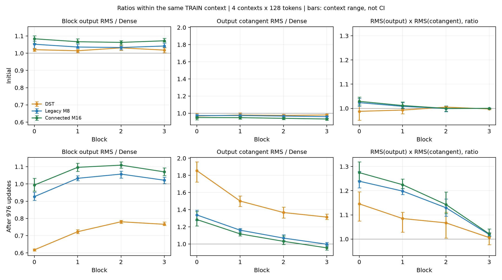

# Short LM learning: boundary fidelity improved, quality gap remains

**English** | [日本語](lm-connected-short-20261109-results.ja.md)

Completed four fresh 976-update / 999424-target TinyStories arms and the full finite-response analysis. Connected M16 greatly improves radius-update prediction fidelity, while DEV CE changes only slightly and token top1 is unchanged from legacy M8. This one-seed pilot does not establish convergence, statistical equivalence or the cause of the remaining Dense gap.

## Matched task curves

[Prespecified protocol](lm-connected-short-20261109.md): width512, four causal pre-norm blocks, eight FFN maps replaced, each A=8√(512×2048)=8192. Attention, embedding and tied vocabulary projection stay Dense. Seed17, context128, effective1024 targets/update, 20M LR/topology horizon, tau.003, fraction0, cap32, all CST field LRs32x. The CST raw initial Parameter bytes are identical; shared ordinary Parameters match all arms. No RMS recalibration, LR search, Dense teacher or confirmation evaluation. The comparison changes both profile degree and connection; it does not isolate their individual quality effects. The actual M16 Plan is `cuda_connected_m16_ordered_envelope`; the common legacy config fields are retained for initialization/control matching.

| Arm | DEV CE | Next-token top1 | Median whole step ms | Peak allocated / reserved MiB |
|---|---:|---:|---:|---:|
| Dense | 3.308981 | 37.451% | 18.196 | 950.666 / 1142 |
| DST | 3.358979 | 37.048% | 18.245 | 993.869 / 1090 |
| Legacy M8 | 3.394198 | 36.841% | 134.714 | 972.921 / 1256 |
| Connected M16, ordered | 3.388291 | 36.841% | 69.467 | 950.319 / 1272 |

DEV uses8192 story-disjoint targets. New M16 lowers CE by0.005908 versus M8; its gap to Dense is0.079309 and to DST0.029312. Both CST arms correctly predict3018/8192 tokens. Curves continue falling; this is a short observation, not final accuracy. Dense, DST and old M8 reproduce the historical same-budget CE endpoints exactly.



[Full curves including initialization](assets/lm-connected-short-20261109/learning-full.png). TRAIN bold lines average three logged points; thin lines retain raw values. Task time includes zero_grad/LR setting, four forwards/backwards, clip and optimizer; batches are prepared before timing. First10 and observed steps are excluded. DEV, checkpointing and numerical analysis are outside timing. Peaks include resident model/gradients/optimizer/scratch and allocator history, not total process memory. New M16 is1.94x faster than M8 here but3.82x slower than Dense. Total small-LM allocated memory is essentially the same as Dense; large isolated-Linear memory results are a different workload. DST uses dense storage and matmul as an accuracy control.

## What improved in the update prediction

For actual raw displacement v, fixed original TRAIN input X and fixed bias,

\[
\Delta z=f(\theta+v,X)-f(\theta,X),\quad c=\cos(Jv,\Delta z),\quad
 e=\frac{\|\Delta z-Jv\|}{\|Jv\|}.
\]

The primary finite change is measured by the native executor. Jv uses independent public FP64 physical factors after the encoded FP32 envelope map, with both amplitude-to-radius and fraction-to-radius derivatives live. Observations use the first32 task rows of the first microbatch at updates1/256/976, block1 up/down, with actual post-projection displacements. No model/optimizer is updated by this analysis. There are12 observations, five field isolates each and scales1/.1/.01;60 native finite-change checks at scale1.

Ranges below cover the four learned-state observations at256/976;1 means matching directions, not a fraction of useful learning:

| Raw field | Legacy M8 cosine | Connected M16 cosine |
|---|---:|---:|
| amplitude | 0.988383–0.998917 | 0.977142–0.995540 |
| radius_fraction | 0.158402–0.235613 | 0.990143–0.994137 |
| output_center | 0.999974–0.999979 | 0.999953–0.999970 |
| input_center | 0.999957–0.999982 | 0.999948–0.999975 |
| all_fields | 0.543057–0.790676 | 0.984067–0.997601 |

Radius-fraction actual/predicted norm ratios change from7.730–12.283 to0.951–1.028, and relative defects from7.558–12.165 to0.112–0.140. Finite-step curvature remains. At the first old-M8 update cosine alone is misleading: its radius norm ratio is about2277–2280, versus1.003–1.004 for M16. Native subtraction noise is visible for tiny updates; encoded FP32 rounding can dominate the smaller epsilon scales.



[All coordinate/radius plots](assets/lm-connected-short-20261109/update-fidelity.png). Coordinates already matched their derivative predictions closely in these old-M8 observed updates; this pilot does not show a large coordinate improvement. The older deterministic coordinate-boundary witness remains a separate mathematical result. Amplitude retains the nonlinear envelope-radius coupling and did not uniformly improve. All-field prediction fidelity improves substantially. Prediction fidelity and alignment with the task cotangent are different quantities.

The improvement is not explained by freezing fraction: at256/976 its changed share is82.5–85.7% for M16 versus76.9–79.0% for M8. Fraction delta RMS is about.00144–.00166 versus.00175–.00188. Raw endpoints and decoded radius updates are retained in JSON.

## Fresh initial/final block-scale check

A user-requested post-hoc read-only extension observes four separate128-token TRAIN contexts at0/4096/8192/12288, before training and at976. Each number is the mean of four within-context ratios to the matching Dense model, not pooled RMS. Bars show context ranges, not confidence intervals.

| M16 / Dense | Block0 | Block1 | Block2 | Block3 |
|---|---:|---:|---:|---:|
| Initial output RMS | 1.084 | 1.067 | 1.063 | 1.072 |
| At976 output RMS | 0.994 | 1.096 | 1.109 | 1.070 |
| At976 output cotangent RMS | 1.285 | 1.118 | 1.031 | 0.955 |
| At976 RMS(output)×RMS(cotangent) | 1.275 | 1.225 | 1.143 | 1.021 |



The earlier legacy-M8 5M-token output ratios of about1.8–2.0 are not present at this1M endpoint. M8 at1M is0.926–1.057, while DST is0.618–0.781 despite its smaller CE gap. Scalar output size alone does not explain the current quality difference. No uniform zero-collapse is observed in these probes; output cotangents are not raw Parameter gradients or a direct learning-efficiency metric. M16 at5M has not been run, so the shorter-horizon result is not evidence that M16 prevents later scale growth.

## Placement interpretation remains open

The [historical M8 placement study](lm-composition-20261109-results.md), at5M rather than this1M, found block1 up/down CE2.567259 and central blocks1+2 up/down CE2.573492 versus Dense2.567102. These are two or four CST maps inside whole FFNs, not Dense/CST alternation. All attention stayed Dense. All eight CST maps gave2.698948. The four-map hybrid retains4,335,616 active FFN scalars versus272,384 for all eight; count, remaining Dense capacity and position are confounded. Even same-count placements differed in the one-seed pilot. Remaining Dense may compensate scale or feature transformations, but no causal compensation experiment has been completed. A matched count/role/placement comparison is the next hypothesis, not a conclusion or an automatic new training sweep.

## Validation, failures and evidence

83 actual-GPU tests pass, including independent rectangular quadrature and ordered repeats. Full-A8192 numerical oracles at both FFN directions pass initially and finally (atol1e-4/rtol4e-3); all four models pass serialized model/optimizer next-step equality and observation-hook invariance. Physical primitive gates remain3e-4. Checkpoint hashes, Parameter digests, clocks and moments pass separate post-run audit. Raw evidence is preserved locally and on NFS under the job IDs; no datasets or checkpoints enter Git.

Initial failed attempts are preserved: runner import failure before retained training; then a7.451e-9 bitwise gate difference from the unordered direct-level path. A separate ordered-site executor passed the original exact gates; tolerances, optimizer and recipe were not relaxed. The ordered schedule's isolated8192 Linear check is12.923ms versus coalesced12.811 and Dense4.908, with32MiB extra scratch; public deterministic/Graph modes remain unsupported.

- Learning/analysis: operator `00aae6afaf3615da6bccd986c75c14cd7b2ca64b`, consumer `4110c0df1452200ba2591861b3d90276f663107c`, job `lm-connected-short-4090-20261109-03`.
- Final compact SHA256: `e2e396767e3d1864edefee65c68560a0ae80977c6dad99ca9e52022a1a2502ab`; 26 payload files and all 2108 frozen source identities verified locally. External driver SHA256 `30d322f9bbbcc33d8b93d5a1e5b4eb51adceb2472285b34cdd99d141672b7f60` matches the remote copy.
- Read-only signal job `lm-connected-signals-4090-20261109-01`: archive `2dea863d7439bd5f22b30e2aeacd4dff95c0b5259aa5042309eef2c6e09e61b7`; 32 probes, Parameters/buffers/CPU+CUDA RNG unchanged.
- Checkpoint audit and ordered Linear cost: `connected-m16-ordered-4090-20261109-01`; archive `6ec0c5e958cb6c1b9163cf8b49ae064ea1a9010320d807bb2d1f08bd827d97c1`. All eight milestone file hashes verified; four final Parameter digests reproduce live models; Adam clocks976 except DST973, all moments finite FP32.


[Curated JSON](lm-connected-short-20261109-results.json) contains all observations and hashes. Research local suite289 tests:228 pass,61 optional skips; current diagnostic arithmetic/startup tests4 pass. Operator CPU2255 pass/2654 skip at the executed runtime; later benchmark-metadata roundtrip passes separately. GPU skips are not GPU evidence. Both PRs remain drafts; no merge or public default change.

```bash
# Use the recorded operator/consumer snapshots explicitly, not the old ffn extra.
export PYTHONPATH="$TORCHCST_CHECKOUT/src:$TORCHCST_CHECKOUT:$RESEARCH_CHECKOUT/src:$RESEARCH_CHECKOUT:$RESEARCH_CHECKOUT/scripts"
python -m cst_research.experiments.lm_connected_run qualify --data "$TOKENS" --data-manifest-sha256 5b995103ca95d3c9b62a4e860039683dc734b0a0bb20e232db1b2e45aa690d01 --output "$QUALIFICATION"
python -m cst_research.experiments.lm_connected_run train --arm connected-m16 --data "$TOKENS" --data-manifest-sha256 5b995103ca95d3c9b62a4e860039683dc734b0a0bb20e232db1b2e45aa690d01 --qualification "$QUALIFICATION/qualification.json" --output "$NEW_ARM"
python scripts/analyze_lm_connected.py --run "$RUN" --output "$NEW_ANALYSIS"
python scripts/report_lm_connected.py --run "$VERIFIED_EXPORT" --dst-run "$VERIFIED_EXPORT/dst-all" --checkpoint-audit "$AUDIT" --output "$NEW_REPORT"
```
