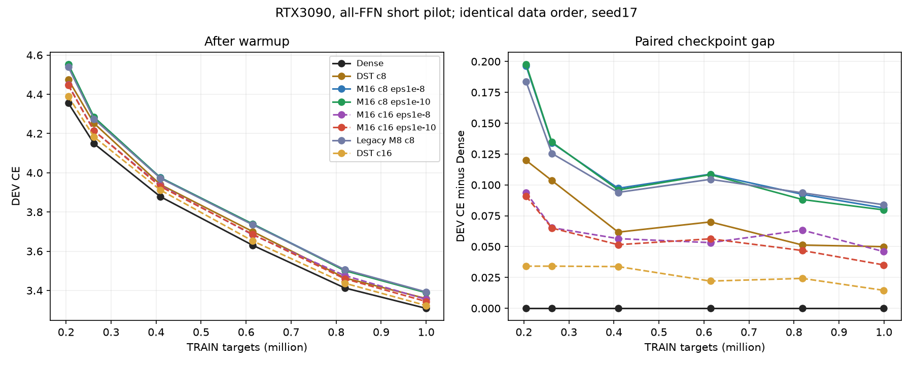
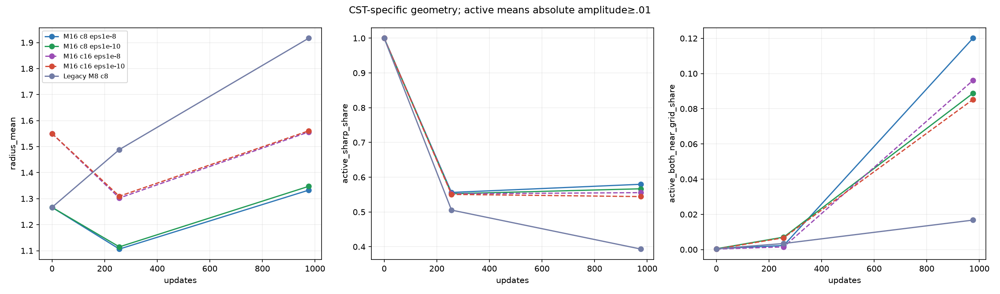

# 全FFN CST：Atom数とAdam epsilonの短期比較結果

[English](lm-geometry-epsilon-capacity-20261110-results.md) | 日本語

再起動したRTX3090で8条件すべてが完了した。短期DEV損失への効果はepsilon低下より
Atom増加の方が大きかった。M8はM16より座標momentがepsilon未満の割合が小さいが、損失はほぼ同じ。
局所の幾何学習の鈍化は実在するものの、それだけで全FFNの差や重ねたときの悪化を
説明できない。主因の一意な特定や解決策の実証には至っていない。

## 固定条件

[Protocol](lm-geometry-epsilon-capacity-20261110.ja.md)。4block・幅512、FFN512→2048→512の
全8mapを置換し、attention/embedding/共有語彙出力はDense。
A=c√(d_in d_out)、c8/16は各map8192/16384 Atom。seed17・同一データ順、976更新・999424 target、
20M schedule固定、DEV8192 target、confirmation未使用。通常LR.0003とCST4fieldの32倍LRを固定。
Atom epsilon1e-8/1e-10は振幅も含むpacked Atom群のみ変更し、通常群は1e-8のまま。
同じcのepsilon間とc8のM8/M16間でraw初期値はbyte一致するが、有効な広がりは揃えていない。
DSTは各map4A active weight、行単位の予算を保つRigL形式で250/500/750更新にtopology更新。
sparse LR.003は以前の探索から移した値で、c16で新たに調整していない。
Dense保存の精度参照であり、疎な高速実装ではない。

## タスク結果

| 条件 | bias込みactive FFN scalar | 終端DEV CE | Top1 % |
| --- | ---: | ---: | ---: |
| dense | 8,398,848 | 3.308980 | 37.451 |
| dst-c8 | 272,384 | 3.358918 | 37.012 |
| m16-c8-e8 | 272,384 | 3.390253 | 36.938 |
| m16-c8-e10 | 272,384 | 3.388710 | 36.914 |
| m16-c16-e8 | 534,528 | 3.354932 | 37.158 |
| m16-c16-e10 | 534,528 | 3.344134 | 37.134 |
| legacy-m8 | 272,384 | 3.392873 | 36.951 |
| dst-c16 | 534,528 | 3.323542 | 36.816 |

c8でepsilonを下げるとCE3.390253→3.388710で、今回の短期では小さな変化だった。
eps1e-8のままAtomを2倍にすると3.390253→3.354932、両方変更で3.344134、Denseは3.308980。
DSTも容量増加で3.358918→3.323542と改善するため、Atom増加の効果をCST特有とは言えない。
eps1e-8でのCST−DST差はc8/c16で約.03134/.03139。小さなDEV集合ではCE改善とTop1改善は
一貫していない。1seed・短期・DEVのみなので収束、同等性、epsilon効果の統計的確定、
Atom下限の主張はしない。

[全DEV CE/PPL/Top1](assets/lm-geometry-epsilon-capacity-20261110/development.png)、
[非平滑のTRAIN曲線](assets/lm-geometry-epsilon-capacity-20261110/training.png)。

## 幾何と多層化への示唆

activeは振幅絶対値≥.01。8mapのactive Atom数で重み付けした割合。
momentの尺度は実際のbias補正済み第2momentから計算する。
eps1e-10条件も含め、比較閾値を全行1e-8に揃えた。

| 条件 | active r<.6 % | 両座標が格子点近傍 % | moment尺度<1e-8 amp/fraction/out/in % |
| --- | ---: | ---: | --- |
| m16-c8-e8 | 57.97 | 12.01 | 0.01/32.05/41.65/41.92 |
| m16-c8-e10 | 56.67 | 8.88 | 0.01/21.49/33.95/34.29 |
| m16-c16-e8 | 55.56 | 9.61 | 0.00/33.20/41.22/41.32 |
| m16-c16-e10 | 54.43 | 8.53 | 0.00/23.60/34.59/34.98 |
| legacy-m8 | 39.33 | 1.67 | 0.00/0.01/0.69/0.65 |

旧M8でactive座標moment尺度が1e-8未満の割合は約.7%、既定M16では約42%だが、
CEは3.392873/3.390253とほぼ同じだった。M16のepsilon低下は小半径・格子点近傍の割合を
減らし、動ける余地を増やすが、c8のタスク差は埋まらなかった。
小さな幾何momentやepsilonだけによる一因説を弱める結果であり、幾何が無関係という証明ではない。
M8/M16はprofile形状・有効な広がりが異なり、幅を揃えた因果比較にはなっていない。
履歴momentは実際の次の更新方向を測ったものではない。

以前の[配置・ablation結果](lm-m16-placement-20261109-results.ja.md)では役割・位置への依存と、
残したDenseへの条件付きのタスク依存増加を確認した。出力/勾配が全体で一斉にゼロになる現象や
大域的なrank崩壊は確立せず、終盤の出力増大だけでは初期からある差を説明できない。
CSTの変換・適応の制約が合成で積み重なり、残ったDenseが追加のタスク上の自由度を提供する、
という見方は未解決の仮説として残る。Denseが具体的にどの変換を補うかは特定していない。
局所的に止まったAtomを誤配置・損失の原因と断定しない。容量・配置を固定し、有効な広がりを
戻した実学習で差が埋まるかという因果介入は未実行である。

## 速度・メモリ・検証

| 条件 | 完全step中央値 ms | allocated peak MiB | reserved peak MiB |
| --- | ---: | ---: | ---: |
| dense | 29.765 | 948.74 | 1436.00 |
| dst-c8 | 29.831 | 995.82 | 1490.00 |
| m16-c8-e8 | 116.183 | 951.13 | 1448.00 |
| m16-c8-e10 | 115.747 | 951.13 | 1448.00 |
| m16-c16-e8 | 140.358 | 1183.41 | 1734.00 |
| m16-c16-e10 | 140.490 | 1183.41 | 1734.00 |
| legacy-m8 | 212.479 | 969.36 | 1104.00 |
| dst-c16 | 29.958 | 995.82 | 1490.00 |

実機NVIDIA GeForce RTX3090、25307578368bytes・CC8.6、Torch2.9.1+cu128/CUDA12.8、FP32・TF32無効。
完全stepを同期し、4microbatchのforward/backward・clip・optimizerを含む。
先頭10更新と入力準備・DEV・probe・保存・oracleを除外。reservedには観測時のallocator履歴が残る。
M8/M16は次数に加えて実装も異なる速度比較である。この小型LMではDenseに対する速度や
総メモリの優位性は示していない。

最初の失敗を保全し、ユーザー再起動後に同期・非同期の元手順再現が通過した。
新attemptでnative84件、8条件の保存後次更新・observer不変性の完全一致、全AのY/dX/raw各field
120検証、16checkpointの有限FP32 moment・実epsilon/時計・終端DEV再現に合格。
Adam時計はCST976/DST973。数値最大絶対誤差1.02544e-4、最大relativeL2 1.56186e-5。
旧componentwise基準への2違反も記録し、今回の事前基準は変更していない。
復旧だけでGPU故障の原因を特定したとは扱わない。

固定consumer76e80b6816269f63b02ff85ad262746f14754726、torchcst95f647f97749f61f5f5c15ac29932f908fb334ce。
job `lm-geometry-epsilon-capacity-3090-20261110-02`、source archive
`e0342a39b6367a899a528b85a0d69d8995a772a99c6f4b54571060bb20f920d6`。
最終compact SHA256 `5e4cc94f8aea2cbfd38ccb4a4dcc8d7dc7487f55ff0039bc81e1e730678c0858`。86payload・2178source fileのhashを取得後検証済み。
所有jobは完了し、raw checkpoint/tensorはremote保全。runtime/既定値採用やPR mergeは行っていない。
[派生データと図のhash](lm-geometry-epsilon-capacity-20261110-results.json)。

固定版`lm_geometry_trial_run`のqualify/train/auditを正確なprotocol/data SHAで実行する。
描画は`scripts/report_lm_geometry_trial.py --run RUN --dst-run RUN/dst-c8 --dst-run RUN/dst-c16
--output NEW_OUTPUT`。対照・予算・データ・監査・manifestの互換性を検証する。
