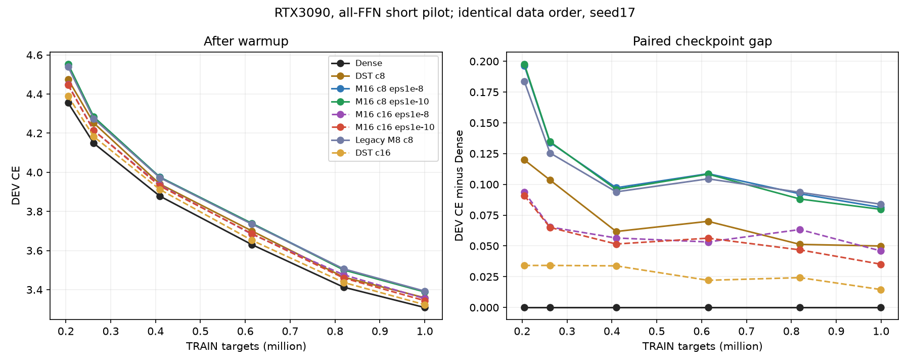
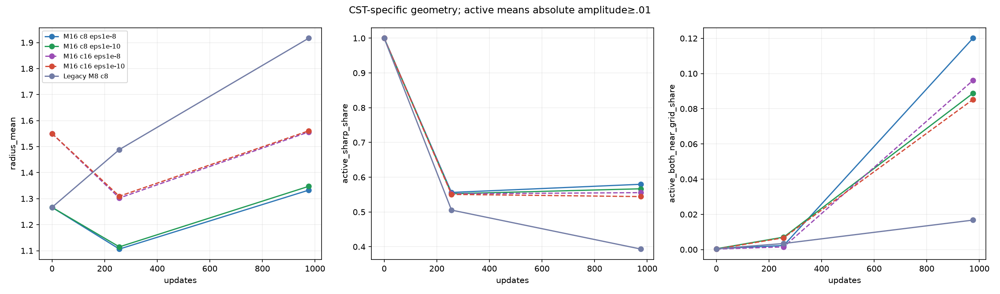

# All-FFN CST: capacity and Adam epsilon pilot results

English (canonical) | [日本語](lm-geometry-epsilon-capacity-20261110-results.ja.md)

All8 arms completed on the restarted RTX3090. Increasing Atom capacity improved
short DEV loss more than reducing Atom epsilon. M8 has far fewer coordinate moment scales below epsilon
than M16 but has similar loss. Thus local geometry attenuation is
real, but does not by itself explain the all-FFN task gap or the depth effect.
A unique cause and a demonstrated remedy remain unestablished.

## Fixed comparison

[Protocol](lm-geometry-epsilon-capacity-20261110.md). Four blocks, width512,
FFN512→2048→512, all8 FFN maps replaced, Dense attention/embeddings/tied vocabulary.
A=c√(d_in d_out), c8/16 means8192/16384 atoms per map. Seed17, identical data order,
976 updates/999424 targets, fixed20M schedule,8192-target DEV; confirmation unused.
Ordinary LR.0003 and all4 CST field LRs32× stay fixed. Atom eps1e-8/1e-10 changes
only the packed Atom group, including amplitude; ordinary epsilon stays1e-8.
Same raw initial bytes within each coefficient and between c8 M8/M16; profiles
are not matched for effective width. DST has4A active weights/map, row-balanced
RigL-style topology250/500/750 and transferred sparse LR.003 (no new c16 tuning).
It uses dense storage, not a sparse performance implementation.

## Task results

| Arm | Active FFN scalars incl.bias | Final DEV CE | Top1 % |
| --- | ---: | ---: | ---: |
| dense | 8,398,848 | 3.308980 | 37.451 |
| dst-c8 | 272,384 | 3.358918 | 37.012 |
| m16-c8-e8 | 272,384 | 3.390253 | 36.938 |
| m16-c8-e10 | 272,384 | 3.388710 | 36.914 |
| m16-c16-e8 | 534,528 | 3.354932 | 37.158 |
| m16-c16-e10 | 534,528 | 3.344134 | 37.134 |
| legacy-m8 | 272,384 | 3.392873 | 36.951 |
| dst-c16 | 534,528 | 3.323542 | 36.816 |

At c8, lowering epsilon changes CE3.390253→3.388710: a small effect in this short
run. Doubling atoms at eps1e-8 changes3.390253→3.354932; with both changes CE is
3.344134 versus Dense3.308980. DST capacity also improves3.358918→3.323542,
so the capacity gain is not CST-specific. The c8/c16 CST-minus-DST gaps at eps1e-8
are about.03134/.03139. CE improvements do not consistently improve Top1 in this
small DEV sample. One seed, short duration and DEV-only results do not establish
convergence, equivalence, a statistical epsilon effect or an Atom lower bound.

[Full DEV CE/PPL/Top1](assets/lm-geometry-epsilon-capacity-20261110/development.png),
[raw TRAIN curves](assets/lm-geometry-epsilon-capacity-20261110/training.png).

## Geometry and implications for stacking

Active means absolute amplitude≥.01. Percentages below are weighted by active
Atom counts over8 maps. Moment scales use actual bias-corrected second moments;
the comparison threshold is the same1e-8 in every row, including eps1e-10 arms.

| Arm | Active r<.6 % | Both centers near grid % | Moment scale<1e-8 amp/fraction/out/in % |
| --- | ---: | ---: | --- |
| m16-c8-e8 | 57.97 | 12.01 | 0.01/32.05/41.65/41.92 |
| m16-c8-e10 | 56.67 | 8.88 | 0.01/21.49/33.95/34.29 |
| m16-c16-e8 | 55.56 | 9.61 | 0.00/33.20/41.22/41.32 |
| m16-c16-e10 | 54.43 | 8.53 | 0.00/23.60/34.59/34.98 |
| legacy-m8 | 39.33 | 1.67 | 0.00/0.01/0.69/0.65 |

Legacy M8 has about.7% of active coordinate moment scales below1e-8, versus about
42% for default M16, yet CE3.392873 and3.390253 are similar. Lowering M16 epsilon
reduces sharp/grid-near shares and increases movement potential without closing
the c8 task gap. This weakens a one-factor explanation based solely on tiny
geometry moments or epsilon; it does not prove geometry is irrelevant. M8 and
M16 differ in profile shape/effective width, so this is not a width-matched
causal comparison. Historical moments are not measured next-update directions.

Prior [placement/ablation evidence](lm-m16-placement-20261109-results.md) shows
role/position dependence and more conditional task dependence on remaining
Dense maps. There was no uniform output/gradient zero-collapse or established
global rank collapse, and late output growth cannot explain the earlier gap
alone. A plausible unresolved picture is that limited CST transformations and
adaptation accumulate through composition while remaining Dense maps provide
additional task flexibility. The exact transformation Dense supplies is not
identified. Do not call locally stationary Atom positions wrong or a proven
cause of task loss. Restoring effective width in actual task learning, with
capacity/placement controlled, remains an unperformed causal intervention.

## Cost and validation

| Arm | Complete-step median ms | Peak allocated MiB | Peak reserved MiB |
| --- | ---: | ---: | ---: |
| dense | 29.765 | 948.74 | 1436.00 |
| dst-c8 | 29.831 | 995.82 | 1490.00 |
| m16-c8-e8 | 116.183 | 951.13 | 1448.00 |
| m16-c8-e10 | 115.747 | 951.13 | 1448.00 |
| m16-c16-e8 | 140.358 | 1183.41 | 1734.00 |
| m16-c16-e10 | 140.490 | 1183.41 | 1734.00 |
| legacy-m8 | 212.479 | 969.36 | 1104.00 |
| dst-c16 | 29.958 | 995.82 | 1490.00 |

Actual GPU NVIDIA GeForce RTX3090,25307578368bytes,CC8.6; Torch2.9.1+cu128,
CUDA12.8, FP32/TF32off. Synchronized complete steps include four forward/backward
microbatches, clipping and optimizer; exclude first10, input preparation, DEV,
probes, checkpoints and oracles. Reserved peaks retain observer allocation
history. M8/M16 timing also changes the implementation, not just degree. This
small LM does not demonstrate a speed or total-memory advantage over Dense.

After the preserved first failure and user restart, both synchronized and
asynchronous original-prefix reproductions passed. The new attempt passed84
native tests,8 exact serialized-next-update/observer qualifications,120 full-A
Y/dX/raw-field checks under the predeclared rule, and16 checkpoint audits with
finite FP32 moments, actual epsilon/clocks and final DEV reproduction. CST clocks
are976, DST973. Max numerical absolute error1.02544e-4 and relativeL2 1.56186e-5;
2 violations of the older componentwise criterion remain recorded. No gate was
changed during this attempt. Failure recovery does not establish a GPU-fault cause.

Frozen consumer76e80b6816269f63b02ff85ad262746f14754726; torchcst95f647f97749f61f5f5c15ac29932f908fb334ce.
Job `lm-geometry-epsilon-capacity-3090-20261110-02`; source archive
`e0342a39b6367a899a528b85a0d69d8995a772a99c6f4b54571060bb20f920d6`.
Final compact SHA256 `5e4cc94f8aea2cbfd38ccb4a4dcc8d7dc7487f55ff0039bc81e1e730678c0858`. Retrieved/verified86 payloads and2178
source files. All owned commands finished; raw checkpoints/tensors remain on
remote storage. No runtime/default adoption or PR merge. [Derived data and
asset hashes](lm-geometry-epsilon-capacity-20261110-results.json).

Reproduce with the frozen `lm_geometry_trial_run` qualify/train/audit entrypoints
and exact protocol/data SHA. Plot with `scripts/report_lm_geometry_trial.py
--run RUN --dst-run RUN/dst-c8 --dst-run RUN/dst-c16 --output NEW_OUTPUT`;
controls, budgets, data, audit and manifest compatibility are checked.
