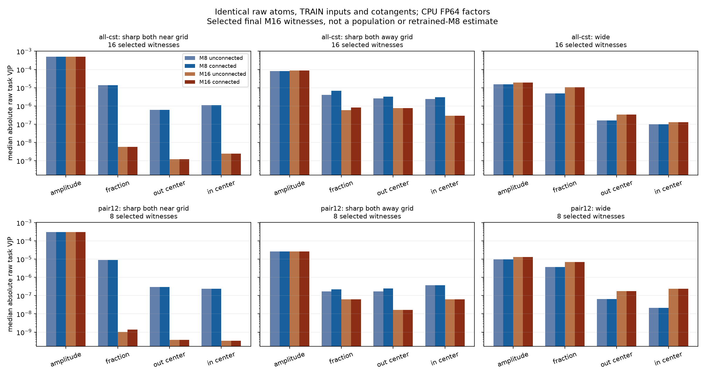

# Atom数とepsilonの短期検証

[English](lm-geometry-epsilon-capacity-20261110.md) | 日本語

状態は8条件の短期比較完了。[結果](lm-geometry-epsilon-capacity-20261110-results.ja.md)。consumerは
`76e80b6816269f63b02ff85ad262746f14754726`に固定。
[draft PR38](https://github.com/takumiecd/cst-research/pull/38)。CPUは234件合格・61件optional skip。
実機GPUの正しさ・qualificationを通過してから学習する。全FFN置換時の劣化について、容量と小さな
幾何パラメータのmomentに対するepsilonの影響を切り分ける。改善や単一原因は
前提にしない。旧M8でも差があったが、M16の追加の影響を否定するものではない。

## 固定する条件

実機RTX3090 24GB・CC8.6を1台使う。4090の速度とは別記する。公開torchcstは
`95f647f97749f61f5f5c15ac29932f908fb334ce`のままで、実装や既定値は変更しない。
研究ソースを実行前に固定し、全ファイルとアーカイブのSHAを保存する。

TinyStoriesのGPT2トークンを使用。manifest SHAは
`5b995103ca95d3c9b62a4e860039683dc734b0a0bb20e232db1b2e45aa690d01`。
物語単位で分離済みのTRAINと8192 targetのDEVを用い、confirmationには触れない。
4ブロック・幅512・8head・context128、FFNは512→2048→512。全8FFNを置換し、
attention・embedding・共有語彙出力・正規化はDenseのまま。seed17・名前別の初期化・
shuffle905を共有する。

| 条件 | profile | c | AtomのAdam epsilon |
| --- | --- | --- | --- |
| dense | Dense | — | — |
| dst-c8 | 行ごとに予算を保つRigL参照 | 8 | 通常1e-8 |
| m16-c8-e8 | 接続M16 | 8 | 1e-8 |
| m16-c8-e10 | 接続M16 | 8 | 1e-10 |
| m16-c16-e8 | 接続M16 | 16 | 1e-8 |
| m16-c16-e10 | 接続M16 | 16 | 1e-10 |
| legacy-m8 | 非接続M8 | 8 | 1e-8 |
| dst-c16 | 行ごとに予算を保つRigL参照 | 16 | 通常1e-8 |

A=c√(d_in d_out)で1mapあたり8192/16384 Atom、1Atomは4 raw scalar。
DSTは各mapで4A active weightとactive fanによる分散補正を用いる。実装を特定した
行単位prune/growを250更新ごとに実施し、以前のDEV探索からsparse LR.003を移す。
新たな調整済みという主張、特にc16での最適化済みという主張はしない。
Dense保存の精度対照であり、疎な高速実装ではない。

各条件976更新・999424 target、LR/topologyのhorizonは20M token固定。
2contextのmicrobatchを4回で1024 target/更新。通常LR.0003、CSTの4fieldは全て32倍。
AdamW(.9,.95)、decay0、clip1、FP32、TF32無効。変更するepsilonはpacked Atom群のみで、
通常群は1e-8固定。振幅もepsilon変更の対象なので、その更新が同一とは言わない。
tau.003、fraction0、半径[.5,50]、振幅上限32。同じcではepsilon違いと旧M8のraw初期値を
byte一致させる。cが異なる場合は同じ目標分散とseedの初期化族を用い、後からRMSを合わせない。

## 実行前に固定する検証と証拠

実機3090で関連するnative4suiteを再実行し、block1のup/downについて全A・B3の
FP64 factor参照と比較する。Y/dX/raw各fieldそれぞれmaxabs≤3e-4かつrelativeL2≤1e-4を
要求する。旧componentwise基準の違反数も保存し、旧基準に合格したと言い換えない。
以前変更した基準を今回は事前に固定し、再緩和はしない。失敗した実行も保全する。

全8条件で保存・復元後の次の更新が完全一致することを確認し、片側だけ観測hookを
有効にしてmoment・epsilon・時計まで比較する。DEV CE/PPL/top1は0/200/256/400/600/800/976。
固定TRAIN offset0/4096/8192/12288で0/256/976更新時の出力・非scale非clipのcotangentを
記録し、offset0のtensorを保持する。半径・fraction・幾何momentの尺度、終端native正しさ、
有限FP32 moment、Adam時計976（DST973）、復元後DEV一致を監査する。
速度は完全stepを同期測定し最初の10回を除外、評価・probe・保存・oracle準備も除く。
allocated/reserved peakを分け、観測による高速化とは主張しない。

別途CPU FP64で、前回のall-cst/pair12終端から同じraw Atom・元のTRAIN入力/cotangentを
固定してM8/M16×接続なし/ありを比較する。全12site、既存の各幾何カテゴリの先頭最大2例を
使い、旧接続M16のVJPを再現する。局所微分の差であり、M8再学習による因果特定ではない。

学習曲線にはDenseと明示的な互換DST入力2本を予算付きで含める。1seed・短期なので
収束・同等性・普遍的Atom下限・既定値採用は主張しない。epsilon低下はFP32ノイズを
増幅し得るし、存在しない真の微分を生まない。native/FP64の証拠を分ける。
checkpointとraw tensorはremote保存し、小さなreportをhash検証して取得する。
ソース・設定の同定と失敗記録を保全する。

入口は`cst_research.experiments.lm_geometry_trial_run`のqualify/train/auditと
`scripts/compare_lm_profile_sensitivity.py`。正確なdata manifest SHA、明示したarm、
qualification receipt、未使用output directoryを渡す。

## 最初の3090実行は学習前に停止

job `lm-geometry-epsilon-capacity-3090-20261110-01`はnative84件と接続M16 c8の
全A up/down oracleに合格した。Dense/DST-c8の保存後次更新も完全一致した。
M16 c8では最初の256行更新が完了した後、128行probeの逆伝播で
`CUDA error: unspecified launch failure`が出た。その後Hubはreadyのまま
nvidia-smiがGPUなしを返した。原因は未特定で、カーネル起因ともhost/driver起因とも
断定しない。ユーザーが3090サーバーを再起動した。
`scripts/reproduce_lm_geometry_probe.py`に同期実行による同じ確認手順を準備した。

学習条件は未開始。全モデルの検証合格や精度の結果とは扱わない。
元の失敗証拠は変更せず保全し、compactの7payloadのhashを検証した。
失敗アーカイブSHA256:
`5166cfe813cd7284c4d8b0a775613e00832d78d0a4b3560be65114287d767501`。

## 復旧と次数ごとの局所微分

ユーザーが3090を再起動した後、同期実行と通常の非同期実行の両方で同じ元の手順に合格した。
全A up/down oracle、256行更新、復元、128行probeの逆伝播、2回目のモデル・optimizer更新の
完全一致まで確認した。以前のGPU故障の原因を特定したわけではなく、runtimeも変更していない。
分離したattempt `lm-geometry-epsilon-capacity-3090-20261110-02`で、元の固定consumer76e80b6から
native suiteと全条件qualificationをやり直す。失敗した軌跡や検証を合格へ書き換えない。

CPUの2×2比較は36個のsite/category記録（12site・選択した72Atom）について、同じraw値と
元のTRAIN入力/cotangentを固定し、FP32 envelope decode後のFP64 factorで行った。
接続M16は以前保存したタスクVJPを再現した。all-cstの小半径・格子点近傍の選択16例では、
raw VJPの絶対値の中央値は以下だった。

| Field | 非接続M8 | 接続M16 | 中央値のM8/M16比 |
| --- | --- | --- | --- |
| amplitude | 5.05225e-4 | 5.06444e-4 | 1.00 |
| radius fraction | 1.38109e-5 | 5.73006e-9 | 2410 |
| output center | 6.10341e-7 | 1.20855e-9 | 505 |
| input center | 1.10083e-6 | 2.48207e-9 | 444 |

この16例では次数ごとの接続有無でVJPが一致しており、局所の差は次数に依存する。
他のカテゴリでは異なり、広い半径の例ではM16の勾配が大きいこともある。
よって局所幾何勾配の減衰についてM16と無関係とは言えない。ただし、母集団の無作為標本でも、
M8を再学習したタスク比較でもない。M16終端モデルから選んだraw値・cotangentを使っている。
精度差の主因の特定や解決策の実証にはならない。

[選択例の中央値](assets/lm-geometry-epsilon-capacity-20261110/summary.json)。
図と中央値の生成は`scripts/report_lm_profile_sensitivity.py`。
復旧・profile compact SHA256:
`57967c2ebe8aa83491f57a74d7346e93711cbe0f6c92316dca10577dc41552e0`。
12payloadのhashと、固定ソースが変更されていないことをlocalで検証済み。
