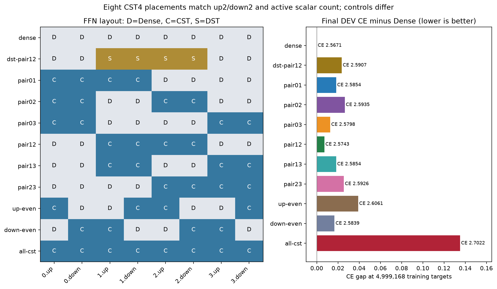
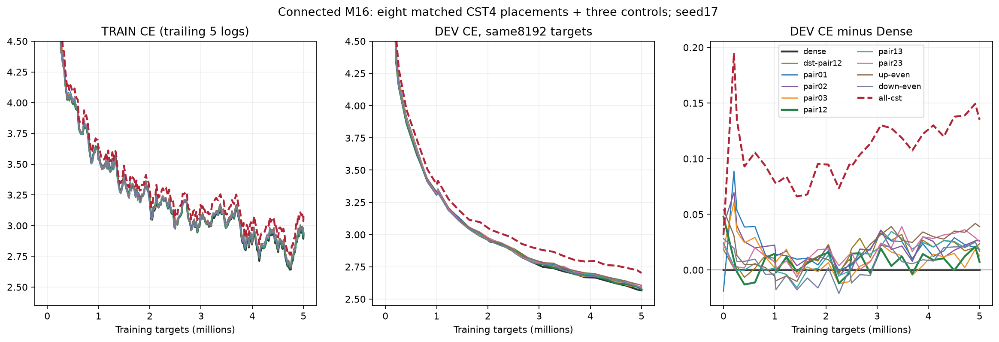
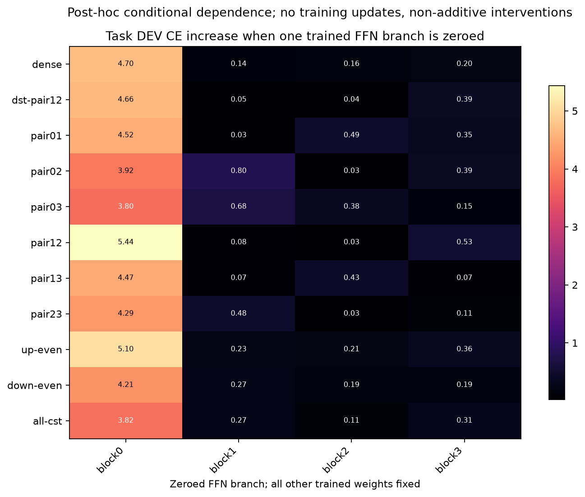
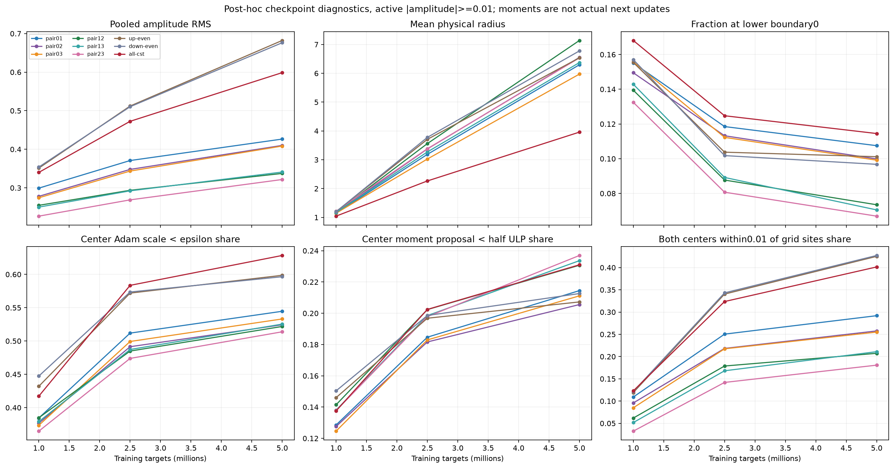
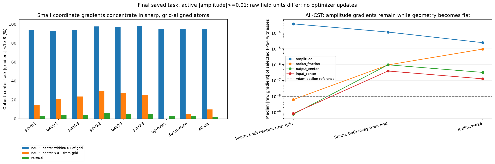

# 新M16：FFN配置比較と幾何学習の停滞分析

[English](lm-m16-placement-20261109-results.md) | **日本語**

予約済みRTX4090で完了。同じCST数でも配置が効き、残したDenseへのタスク依存が増えた。
さらに、振幅が十分あって半径が狭く格子点に寄った多数のAtomで、振幅の勾配は残る一方、
座標・半径の勾配が小さくなる機構を確認した。幾何学習の停滞と仕事の再配分を支持するが、
性能差の唯一の原因や、実証済みの解決策を特定したという意味ではない。

## 同数・同役割の比較

[事後追記も含む計画](lm-m16-placement-20261109.ja.md)。TinyStories、幅512、pre-norm4ブロック、
FFN拡張4、文脈128、置換層ごと8192Atom、seed17、4882更新/4,999,168ターゲット。
同じデータ順と共通箇所のraw初期値。CST全field LR32倍、tau.003、fraction初期0、
半径[.5,50]、振幅上限32、20MのLR/topology期間を固定した。
実Planは`cuda_connected_m16_ordered_envelope`。旧config値は初期化互換のため保持する。
attention/QKVO、埋め込み、tied語彙出力はDenseのままで、全TransformerのCST化ではない。

主比較8配置はCST4層、up/down各2、有効FFNスカラー4,335,616で一致する。
D/C/SはDense/CST/DST、各ペアはup/downを表す。
Denseは8,398,848、全8FFN層CSTは272,384スカラーで、これらは異なる予算の別枠対照。
DST-pair12は既存の行平衡RigL型・Dense保存実装を使い、各置換写像4A slotと
選定済み疎重みLR.003を適用。配置ごとの追加HPOは行っていない。

| Arm | up/down types by block0/1/2/3 | DEV CE | PPL | Top1 % (correct/8192) |
|---|---|---:|---:|---:|
| dense | DD/DD/DD/DD | 2.567102 | 13.0280 | 46.826 (3836) |
| dst-pair12 | DD/SS/SS/DD | 2.590663 | 13.3386 | 46.411 (3802) |
| pair01 | CC/CC/DD/DD | 2.585367 | 13.2682 | 46.338 (3796) |
| pair02 | CC/DD/CC/DD | 2.593531 | 13.3769 | 46.204 (3785) |
| pair03 | CC/DD/DD/CC | 2.579787 | 13.1943 | 46.228 (3787) |
| pair12 | DD/CC/CC/DD | 2.574285 | 13.1219 | 46.509 (3810) |
| pair13 | DD/CC/DD/CC | 2.585376 | 13.2683 | 45.825 (3754) |
| pair23 | DD/DD/CC/CC | 2.592648 | 13.3651 | 46.130 (3779) |
| up-even | CD/DC/CD/DC | 2.606113 | 13.5463 | 46.216 (3786) |
| down-even | DC/CD/DC/CD | 2.583851 | 13.2481 | 45.996 (3768) |
| all-cst | CC/CC/CC/CC | 2.702186 | 14.9123 | 44.763 (3667) |


最良の同数配置pair12はDenseよりCE+0.007183、正答26個減（0.317ポイント）。
同数8配置のCE範囲は0.031828。分散したup-even/down-even同士でも0.022262異なる。
down-evenには完全なDense FFNブロックがないが2.583851まで学習したため、
完全なDenseブロックが必須とは言えない。中央のCST4写像を連続させても良好であり、
CSTの連続した深さだけで劣化を説明することもできない。

4000更新以降の共通46記録時点のTRAIN CE平均はDense2.8354、全CST2.9604（差0.1250）。
DEV差は0.135084で、固定予算内の学習データへの適合にも差がある。
曲線はまだ下がっている。1seedと小さいDEV1分割なので、同等性・収束・普遍的な最良配置は主張しない。




拡大表示は初期の高損失域を縦軸外にする。[全縦軸の曲線](assets/lm-m16-placement-20261109/learning-full.png)も保存した。
TRAINは直近5記録の平均。元の記録値は派生JSONと外部証拠に残る。

## 残したDenseは何を担っているか

学習済みFFN残差枝を評価時だけ1ブロックずつゼロにしたDEV CE増分：

| Arm | Zero FFN0 ΔCE | Zero FFN1 ΔCE | Zero FFN2 ΔCE | Zero FFN3 ΔCE |
|---|---:|---:|---:|---:|
| dense | 4.699251 | 0.140408 | 0.163190 | 0.202538 |
| dst-pair12 | 4.656012 | 0.051213 | 0.042774 | 0.392073 |
| pair12 | 5.438255 | 0.079209 | 0.032187 | 0.525052 |
| all-cst | 3.824506 | 0.268769 | 0.114358 | 0.308750 |


pair12の最後のDense枝を外すと+0.5251で、Dense基準の同じ枝を外す+0.2025より大きい。
中央CST2枝は+0.0792/+0.0322で、Dense基準の対応箇所+0.1404/+0.1632より小さい。
他のペア配置でも残したDenseへの依存が増える傾向がある。
DST-pair12でも最後のDense依存は+0.3921と増えており、仕事の再配分自体はCST固有ではない。
CST枝が常に無視されるわけでもない。最初のFFNをCSTにしても、その枝を外す損失増分は大きい。

44介入が示すのは、その学習済みネットワークの条件付き依存であり、加算的な仕事の割合や
最適モデル、Denseが行う変換の完全な特定ではない。ゼロ化は強い分布外介入である。
ユーザーの「Denseが補う」という直感を支持するが、DenseがCST出力を明示的に再スケールしたり
逆変換したりしているとまでは証明できない。



## Atom単位の幾何学習の停滞

activeは|振幅|>=.01。4882更新時点：

| Arm | Active atoms | Amplitude RMS | r<0.6 % | Both centers within0.01 of grid % | Fraction exactly0 % | Adam scale<eps: amp/q/out/in % |
|---|---:|---:|---:|---:|---:|---|
| pair12 | 31916 | 0.3374 | 53.11 | 20.73 | 7.35 | 0.00/44.51/51.71/52.66 |
| all-cst | 64771 | 0.5987 | 68.94 | 40.14 | 11.45 | 0.00/53.72/62.56/63.11 |
| up-even | 32379 | 0.6822 | 63.47 | 42.52 | 10.11 | 0.00/52.05/59.78/59.95 |
| down-even | 32275 | 0.6763 | 63.51 | 42.72 | 9.68 | 0.00/51.89/59.42/59.88 |


全CSTのactive Atomは全体の98.83%なので、ほぼゼロ振幅だけの問題ではない。
976→4882更新で、activeの半径<.6比率は57.9%→68.9%、両中心の格子点距離<.01は12.3%→40.1%、
座標Adam scaleがepsilon以下の比率は約41.7%→62.8%へ増え、振幅RMSは0.340→0.599へ育つ。
pair12の最終座標epsilon支配は約52.2%で、全CSTの62.8%より低い。
field全体の勾配RMSだけでは、多数の弱い幾何勾配と少数の大きい勾配が混ざることを見落とす。

fractionが0に張り付くだけでもない。全CSTのactive fractionで正確に0なのは11.45%だが、
radius_fractionのAdam scaleがepsilon以下なのは53.69%。
平均半径は増える一方で狭いAtomも多く、sharp/wideを混ぜた平均値だけでは状態を表せない。



全40最終CST写像について元の保存TRAIN入力/cotangentで局所VJPを再計算し、
全fieldのRMSをfull-model probeと一致させた。
現在の非clipタスク勾配と、過去のclip済み学習によるAdam scaleは別の測定である。
出力中心のタスク勾配について、sharpを半径<.6、格子点近傍を距離<.01、遠方を>.1と定義すると：

| Arm | Sharp, center near grid: task abs(g_mu)<eps % | Sharp, center far: % | Nonsharp: % |
|---|---:|---:|---:|
| pair12 | 97.58 | 29.44 | 5.91 |
| all-cst | 94.36 | 9.87 | 1.68 |
| up-even | 95.01 | 0.00 | 2.98 |
| down-even | 94.70 | 5.43 | 2.57 |


FP64物理因子のwitnessでも小さい勾配を確認した。
全CSTで選んだsharp・両中心近傍32Atomのraw勾配絶対値の中央値は、振幅3.66e-4、
fraction6.23e-9、出力中心7.39e-10、入力中心8.26e-10。
sharp・両中心遠方32Atomの中心中央値は約9.64e-7/3.91e-7。
これは決定論的に選んだ例であり、母集団の中央値ではない。raw fieldは単位も異なる。
高精度の参照微分でも、幾何の勾配が小さい機構は残る。

物理Atomを
\[
W_{ij}=\sum_k a_k\phi_o(i;\mu_{o,k},r_k)\phi_i(j;\mu_{i,k},r_k)
\]
と書き、\(B=\partial W/\partial r\)とすると、
\[
\frac{\partial W}{\partial\mu_o}=a\phi_i\partial_{\mu_o}\phi_o,
\quad B=a[(\partial_r\phi_o)\phi_i+\phi_o(\partial_r\phi_i)].
\]
\(r=R(a,q)=\exp[(1-q)\log L(a)+q\log U]\)なので、
\[
\frac{\partial W}{\partial q}=R_q B,\quad
\frac{dW}{da}=\phi_o\phi_i+R_a B,\quad R_q=R\log(U/L).
\]
強い振幅では\(L\simeq0.5,U=50\)、狭い端でも\(R_q\simeq2.30\)なので、
sigmoidの飽和でこの変換微分が消える話ではない。
セル内にmassが集中すると、中心や半径の微小変化がmassをほとんど変えず、
\(B\)や\(\partial_\mu\phi\)が小さい一方で\(\phi_o\phi_i\)は残り得る。
振幅は学習し、幾何は学習しにくい状態が成立する。振幅→半径のchainも含めた説明である。

Adamは\(\Delta\theta\simeq-\eta\hat m/(\sqrt{\hat v}+\epsilon)\)なので、
真の勾配が小さく\(\sqrt{\hat v}<\epsilon\)ならepsilonで減衰する。
Adam実装の不具合を意味しない。全CSTのactive座標の保持moment提案量は約23%が方向別FP32半ULP未満。
これは保存momentの診断であり、実際の次更新の再現やepsilonを変えれば直る証明ではない。



## 説明できる範囲と残る問題

1M時点の全CSTのブロック出力RMS比はDenseの0.994/1.096/1.109/1.070で、すでにCE差0.079309があった。
5Mでは1.883/2.148/2.132/2.077に育ち、出力cotangent比は0.676/0.587/0.551/0.506。
pair12の出力比は0.903/0.977/0.862/0.952付近に収まる。
特徴行平均を除いても増大は残り、全CSTの平均成分のエネルギーは約0.14〜0.17%にすぎない。
後期のスケール増大は実際にあるが、それだけで先に出た品質差を説明できない。

一律の値・勾配のゼロ崩壊はなく、ブロック特徴rankの崩壊や大きな全体的低周波集中も確認されていない。
CKA、cosine、スペクトル、rankは記述指標であり、Dense教師への適合度ではない。
up-even/down-evenは集約した幾何減衰や振幅RMSが近くても損失が異なるため、
単一のスカラー指標で配置の品質を説明することもできない。

支持される像は、強く局在したCST Atomでは位置・幅を変えにくくなっても振幅適合は続き、
残したDense写像が制約された変換の周囲でタスクの自由度を担う、というもの。
その役割・位置で仕事の分担が変わる。
局在したAtomの中には有用な位置や局所停留点に到達したものも含まれ得て、位置が誤っていると断定する診断ではない。
AとLRは固定したため、Atom容量の不足、結線再配置の難しさ、他の最適化スケールの選択は区別し切れていない。
幾何の学習を動かせば品質差が消えると示すには制御した学習介入が必要で、
epsilon・半径・LR・Atom数を変える改善や新しい既定値の採用は行っていない。
中心移動が小さいことを、その位置が最適である証拠として扱うべきではない。

[各up/downの値・勾配](assets/lm-m16-placement-20261109/layer-signals.png)、
[ブロック/残差の値](assets/lm-m16-placement-20261109/block-residual.png)、
[時系列](assets/lm-m16-placement-20261109/signal-trajectories.png)、
[行中心化](assets/lm-m16-placement-20261109/centered-signals.png)、
[表現・勾配の類似度](assets/lm-m16-placement-20261109/representations.png)、
[特徴順序の指標](assets/lm-m16-placement-20261109/feature-order.png)。
4文脈の比は文脈内比の平均であり、tensorのpoolingや信頼区間ではない。
比のheat mapの色はlog2±1.5で飽和するが、数字は表示精度まで実際の比を示す。

## 全stepコストと検証

| Arm | Complete-step median ms | Allocated MiB | Reserved MiB |
|---|---:|---:|---:|
| dense | 18.204 | 948.745 | 1436.0 |
| dst-pair12 | 18.305 | 969.244 | 1462.0 |
| pair01 | 49.844 | 906.391 | 1328.0 |
| pair02 | 50.384 | 899.812 | 1518.0 |
| pair03 | 49.643 | 907.288 | 1324.0 |
| pair12 | 50.923 | 899.937 | 1332.0 |
| pair13 | 50.267 | 912.248 | 1532.0 |
| pair23 | 50.668 | 911.163 | 1340.0 |
| up-even | 51.132 | 904.663 | 1320.0 |
| down-even | 51.276 | 895.248 | 1330.0 |
| all-cst | 76.039 | 955.629 | 1452.0 |


同期した全更新は4回のforward/backward、clip、optimizerを含み、入力準備・DEV・保存・probeを除く。
最初10更新を除外。allocatedはstep内の測定、reservedは観測用割当の履歴を含む。Graphなし。
DSTはtopology時点も含み、Dense保存なので疎カーネル速度ではない。
この小型LMではDenseの方が速く、全CSTの総allocatedも小さくない。
大きい幅でのメモリスケールや速度優位の証明にはならない。

実GPU84テスト、全11条件の厳密な復元・次更新/observer不変性、33時点checkpointの状態・clock監査、
最終DEV再現が通った。CPU232成功/61optional skip、対象の数学・配置テストとCLI import確認も成功。
全optimizer momentは有限FP32。全Atom演算18ケースからY/dX/raw各fieldの108数値検査を実施。
保存タスクVJP40箇所は元field RMSを再現し、44ablationではbaseline/Parameter/buffer/RNGが完全復元した。

元pair12の最終要素別gateは失敗のまま証拠に残る。独立積分witnessを追加し、結果を見た後の基準変更として、
Y/dX/raw各fieldそれぞれmaxabs<=3e-4かつ相対L2<=1e-4で数値受入を行った。
全最終ケースで旧要素別gateの失敗23個を記録し、最大絶対差2.03359e-4、最大field相対L2は2.36585e-5。
元の事前gateを全て通ったとは言わない。runtime・初期化・optimizer・学習コードは変更せず、
完了済み軌跡のhashと状態を検証して復旧した。

## 証拠と再現

- Operator: `95f647f97749f61f5f5c15ac29932f908fb334ce`; training core: `8adc651324468915c413a8dba44fb1d593cb9a42`; continuation consumer: `c886bd93850169973607aa762520dd00517f3697`.
- Analysis: `d815ed2dcffd4bb0d5e2f9ed32d9a149e6b04179`; task ablation: `353cdcc039e84c8d6955fb02fc9d11d60e728405`; geometry: `a7d4aa5a68d3aba0b7e3d601f9683e6bcd8f25ff`; figures: `47210e2a1b6955aadc09de4310af399f16f9df2a`.
- Original job: `lm-m16-placement-4090-20261109-01`; preserved failed compact: `1936947217cb3315686dbc370e1b8dbc83fb62bce58a1d6788f2adf2b81987e2`.
- Continuation: `lm-m16-placement-4090-20261110-02`; source archive: `edd3879b04470cbe9c6afe822198e892086cedee01b2a9b0dcf81204e81164bc`.
- Final compact: `001de63634e4fae1eecdcf65d1ede414f4099b4191dde30c545a86fb3d1eaed8`; analysis: `9569798604332ba14e3b3cdb7414961797ebe6815d2ed52795bfb89d34092fef`; geometry: `7e641a014358e6c1c64c1923a8d4af79db34a4243224c7fa1d6883f7f5454110`.
- main payload110、source file2140、事後分析payload12、幾何payload6を検証した。checkpointと保存tensorはNFS、検証済みcompact archiveはignored証拠に保持。raw log/tensor/datasetはcommitしない。公開JSONは派生した部分集計であり、全1056箇所の記録・120moment記録・raw witnessは外部証拠に残す。


上記source/job/hashは英語版と同一の機械識別情報。
完全な実行driver/protocol/source archiveは各証拠locatorに保存している。
元driverのgate失敗を成功に書き換えず、継続jobはruntimeと既存学習moduleのbyte同一性と完了軌跡を検証して使う。
過去の`ffn` extraは旧operator固定のままなので、今回の記録したcheckoutの組を使う。
検証済みexportと対応分析checkoutから、空の新規出力先を指定して図を再生成できる：

```bash
python scripts/report_lm_placement.py \
  --run "$CST_EVIDENCE/retrieved-final" \
  --dst-run "$CST_EVIDENCE/retrieved-final/dst-pair12" \
  --analysis "$CST_EVIDENCE/retrieved-analysis/analysis/analysis.json" \
  --atom-state "$CST_EVIDENCE/retrieved-analysis/atom-analysis/atom-state.json" \
  --ablation "$CST_EVIDENCE/retrieved-analysis/ablation/ablation.json" \
  --output "$CST_EVIDENCE/new-plots"
python scripts/report_lm_placement_geometry.py \
  --evidence "$CST_EVIDENCE/retrieved-geometry" \
  --output "$CST_EVIDENCE/new-geometry-plots"
```

[派生JSON](lm-m16-placement-20261109-results.json)。
[研究PR37](https://github.com/takumiecd/cst-research/pull/37)はPR36/torchcst PR162の上に保存。
mainのmergeや公開dispatcherへの採用はしていない。所有GPUジョブは終了し、Hubは起動のままidleを確認した。
