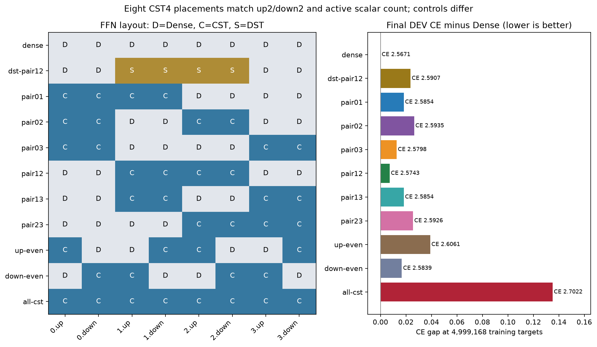
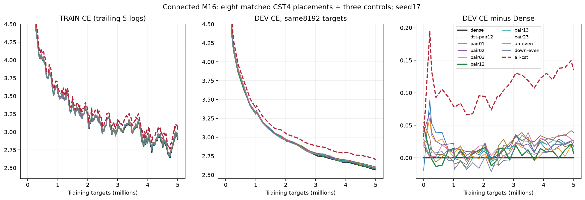
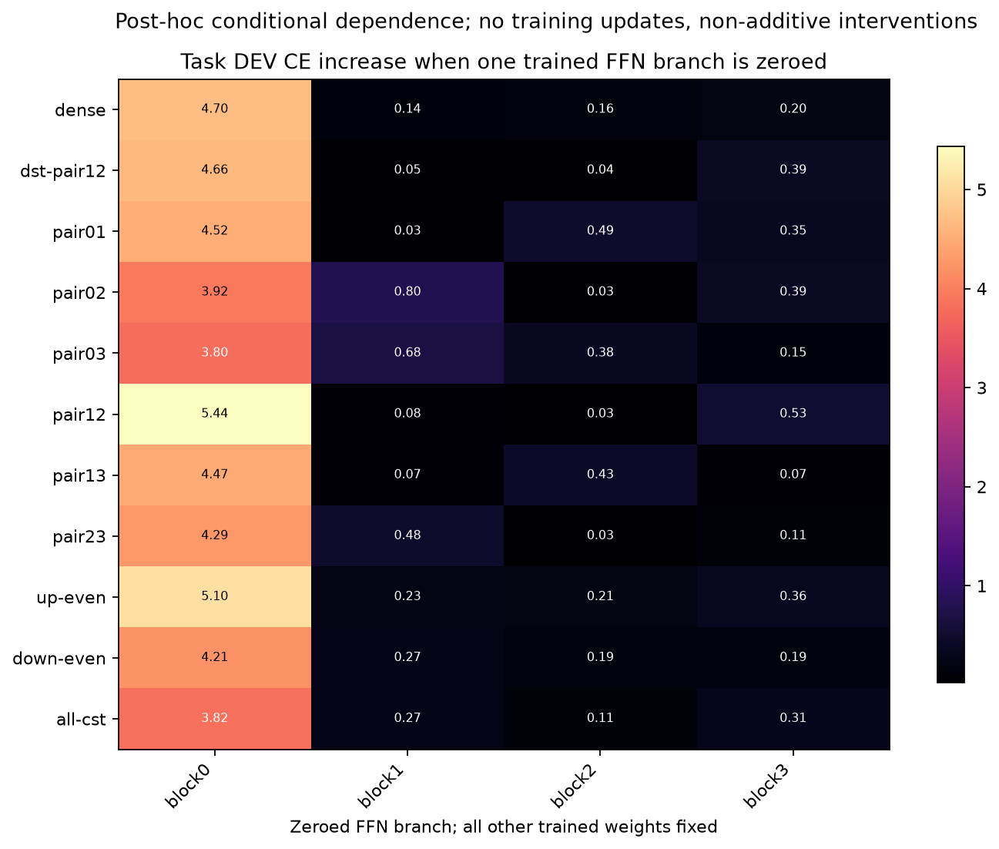
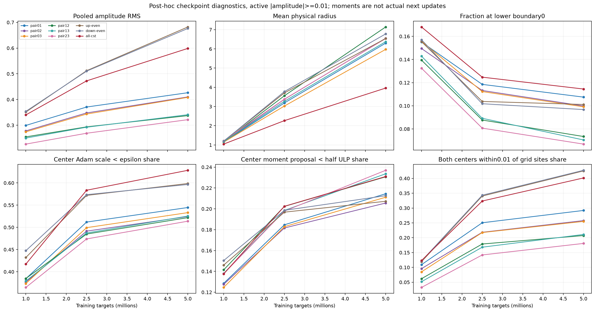
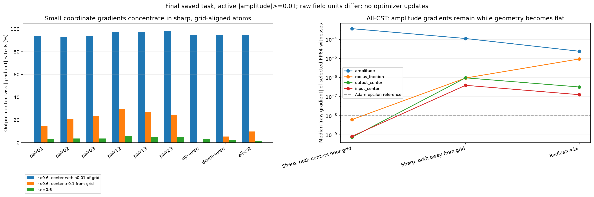

# Connected M16: FFN placement and geometry-learning diagnosis

**English** | [日本語](lm-m16-placement-20261109-results.ja.md)

Completed on the reserved RTX4090. Placement matters at fixed CST count, and remaining Dense branches take more conditional task load. A concrete CST mechanism is also visible: many strong, sharply localized atoms retain amplitude gradients while their center/radius gradients become small. These findings support a geometry-learning bottleneck plus task-work redistribution; they do not establish a unique cause or a demonstrated remedy.

## Matched comparison

[Protocol, including explicitly post-hoc amendments](lm-m16-placement-20261109.md). TinyStories, width512, four pre-norm blocks, expansion4, context128, A=8192 per selected map, seed17,4882 updates/4,999,168 targets, identical data order and initial rows at common sites. All four CST field LRs32x, tau.003, initial fraction0, radius[.5,50], cap32,20M LR/topology horizon. Actual Plan: `cuda_connected_m16_ordered_envelope`; legacy config fields remain for initializer compatibility. Attention/QKVO, embedding and tied vocabulary head stay Dense. This is FFN replacement, not an entirely CST Transformer.

The eight primary layouts have CST4/up2/down2 and4,335,616 active FFN scalars. D/C/S below mean Dense/CST/DST and each pair is up/down. Dense has8,398,848 FFN scalars; all-CST has272,384 and is a different-budget context control. DST-pair12 is the source-qualified row-balanced RigL-style dense-storage reference with4A slots per selected map and the previously selected sparse LR.003; no per-layout HPO was performed.

| Arm | up/down types by block0/1/2/3 | DEV CE | PPL | Top1 % (correct/8192) |
|---|---|---:|---:|---:|
| dense | DD/DD/DD/DD | 2.567102 | 13.0280 | 46.826 (3836) |
| dst-pair12 | DD/SS/SS/DD | 2.590663 | 13.3386 | 46.411 (3802) |
| pair01 | CC/CC/DD/DD | 2.585367 | 13.2682 | 46.338 (3796) |
| pair02 | CC/DD/CC/DD | 2.593531 | 13.3769 | 46.204 (3785) |
| pair03 | CC/DD/DD/CC | 2.579787 | 13.1943 | 46.228 (3787) |
| pair12 | DD/CC/CC/DD | 2.574285 | 13.1219 | 46.509 (3810) |
| pair13 | DD/CC/DD/CC | 2.585376 | 13.2683 | 45.825 (3754) |
| pair23 | DD/DD/CC/CC | 2.592648 | 13.3651 | 46.130 (3779) |
| up-even | CD/DC/CD/DC | 2.606113 | 13.5463 | 46.216 (3786) |
| down-even | DC/CD/DC/CD | 2.583851 | 13.2481 | 45.996 (3768) |
| all-cst | CC/CC/CC/CC | 2.702186 | 14.9123 | 44.763 (3667) |


Best matched layout pair12 is0.007183 CE above Dense, with26 fewer correct tokens (0.317 percentage points). All eight matched CST placements span0.031828 CE. Distributed up-even/down-even differ by0.022262 despite equal count and roles. Down-even has no fully Dense FFN block yet reaches2.583851: an intact Dense block is not necessary in this pilot. Four consecutive CST maps in central blocks also work well; consecutive CST depth alone does not explain degradation.

Late TRAIN CE, averaged over the same 46 logged updates from update 4000 onward, is Dense2.8354 versus all-CST2.9604 (gap0.1250); DEV gap is0.135084. The fixed-budget deficit is present in training fit as well as development. Curves keep falling. One seed and one small DEV split do not establish equivalence, convergence or a universal best placement.




The focused vertical axes omit the early high-loss range; [full-range curves](assets/lm-m16-placement-20261109/learning-full.png) include initialization. TRAIN uses trailing five logged observations; raw logged values are retained in the derived JSON/external evidence.

## What the Dense branches carry

Zeroing one trained FFN residual branch at evaluation increases task DEV CE by:

| Arm | Zero FFN0 ΔCE | Zero FFN1 ΔCE | Zero FFN2 ΔCE | Zero FFN3 ΔCE |
|---|---:|---:|---:|---:|
| dense | 4.699251 | 0.140408 | 0.163190 | 0.202538 |
| dst-pair12 | 4.656012 | 0.051213 | 0.042774 | 0.392073 |
| pair12 | 5.438255 | 0.079209 | 0.032187 | 0.525052 |
| all-cst | 3.824506 | 0.268769 | 0.114358 | 0.308750 |


In pair12, removing the final Dense branch costs0.5251 CE versus0.2025 in the Dense control. The two middle CST branches cost0.0792/0.0322 versus0.1404/0.1632 at the corresponding Dense-control branches. Other paired layouts similarly move dependence toward retained Dense branches. DST-pair12 also increases final-Dense dependence (0.3921), so this redistribution is not unique to CST. CST is not universally bypassed: replacing the first block's FFN with CST can still leave a large ablation cost.

These 44 interventions prove conditional dependence of the learned networks, not additive work fractions, optimal models, or the exact transformation Dense performs. Zeroing is a strong distribution shift. They support the user's compensation intuition without proving that Dense explicitly rescales or inverts CST outputs.



## The Atom-level learning bottleneck

Active means |amplitude|>=.01. At update 4882:

| Arm | Active atoms | Amplitude RMS | r<0.6 % | Both centers within0.01 of grid % | Fraction exactly0 % | Adam scale<eps: amp/q/out/in % |
|---|---:|---:|---:|---:|---:|---|
| pair12 | 31916 | 0.3374 | 53.11 | 20.73 | 7.35 | 0.00/44.51/51.71/52.66 |
| all-cst | 64771 | 0.5987 | 68.94 | 40.14 | 11.45 | 0.00/53.72/62.56/63.11 |
| up-even | 32379 | 0.6822 | 63.47 | 42.52 | 10.11 | 0.00/52.05/59.78/59.95 |
| down-even | 32275 | 0.6763 | 63.51 | 42.72 | 9.68 | 0.00/51.89/59.42/59.88 |


All-CST active atoms are98.83% of its atoms. Geometry attenuation is therefore not confined to nearly zero amplitudes. At976→4882, its active narrow-radius share grows57.9%→68.9%, both-centers-near-grid share12.3%→40.1%, and coordinate Adam-scale-below-epsilon share about41.7%→62.8%. Amplitude RMS grows0.340→0.599. Central pair12 has about52.2% coordinate epsilon dominance at the endpoint versus62.8% for all-CST. Aggregate field-gradient RMS hides this heterogeneous population.

Fraction is not simply stuck at its lower boundary: only11.45% of all-CST active fractions are exactly0, whereas53.69% have a radius-fraction Adam scale below epsilon. Mean radius increases because the distribution contains both sharp and broad atoms; the mean alone is misleading.



We recomputed local VJPs at all 40 final CST maps using the original saved TRAIN input and cotangent. Every field's RMS reproduced the full-model probe. Current unclipped task gradients and historical clipped-training Adam scales are distinct measurements. For output-center gradients, with sharp meaning radius<.6, near-grid distance<.01 and far distance>.1:

| Arm | Sharp, center near grid: task abs(g_mu)<eps % | Sharp, center far: % | Nonsharp: % |
|---|---:|---:|---:|
| pair12 | 97.58 | 29.44 | 5.91 |
| all-cst | 94.36 | 9.87 | 1.68 |
| up-even | 95.01 | 0.00 | 2.98 |
| down-even | 94.70 | 5.43 | 2.57 |


FP64 physical-factor witnesses confirm the small gradients. Among32 selected all-CST sharp/both-near-grid atoms, median absolute raw gradients are amplitude3.66e-4, fraction6.23e-9, output center7.39e-10 and input center8.26e-10. Among32 sharp/away-grid witnesses, center medians are about9.64e-7/3.91e-7. These are deterministic examples, not population medians; raw field units differ. The mechanism survives higher-precision reference differentiation.

For a physical Atom, write
\[
 W_{ij}=\sum_k a_k\phi_o(i;\mu_{o,k},r_k)\phi_i(j;\mu_{i,k},r_k).
\]
With \(B=\partial W/\partial r\),
\[
 \frac{\partial W}{\partial\mu_o}=a\,\phi_i\partial_{\mu_o}\phi_o,
 \quad B=a[(\partial_r\phi_o)\phi_i+\phi_o(\partial_r\phi_i)].
\]
The envelope is \(r=R(a,q)=\exp[(1-q)\log L(a)+q\log U]\), so
\[
 \frac{\partial W}{\partial q}=R_qB,\quad
 \frac{dW}{da}=\phi_o\phi_i+R_aB,\quad R_q=R\log(U/L).
\]
For strong amplitudes, \(L\simeq0.5,U=50\); at the narrow end \(R_q\simeq2.30\), which is not a vanishing sigmoid derivative. When cell mass is concentrated in a grid cell, small center/radius changes can barely alter that cell's mass: derivatives in \(B\) and \(\partial_\mu\phi\) are small while \(\phi_o\phi_i\) remains substantial. This permits amplitude learning with weak geometry learning. The raw amplitude-to-radius chain remains included.

Adam uses \(\Delta\theta\simeq-\eta\hat m/(\sqrt{\hat v}+\epsilon)\). A small true task gradient and \(\sqrt{\hat v}<\epsilon\) produce epsilon attenuation; they do not indicate an Adam implementation error. About23% of active coordinate retained-moment proposals are below half a directional FP32 ULP at the all-CST endpoint. Those are saved-moment diagnostics, not replayed next updates or proof that changing epsilon fixes training.



## What this does and does not explain

At 1M, all-CST block-output RMS ratios to Dense are0.994/1.096/1.109/1.070, already with a0.079309 CE gap. At 5M the ratios grow to1.883/2.148/2.132/2.077, with output-cotangent ratios0.676/0.587/0.551/0.506. Pair12 stays near0.903/0.977/0.862/0.952 output ratios. Removing each token's feature mean does not remove the growth; all-CST feature-mean energy is only about0.14–0.17%. Thus late scale growth is real but cannot explain the earlier onset of the quality gap by itself.

There is no uniform signal/gradient zero-collapse. No clear block-feature-rank collapse or large global low-frequency concentration is established. CKA, raw cosine, spectrum and rank are descriptive feature statistics, not a Dense teacher target. Up-even/down-even have similar aggregate geometry attenuation and amplitude RMS yet different task loss, so no single scalar geometry/scale statistic explains placement quality.

The supported picture is that sharply localized CST atoms can become difficult to reposition/rewidth while amplitude fitting continues, and retained Dense maps supply task flexibility around those constrained transformations. The role/position of those maps changes the learned workload. Some sharply localized atoms may already occupy useful or locally stationary positions; these diagnostics do not label their positions wrong. Limited Atom capacity, difficult routing adaptation and other optimization-scale choices remain alternatives because this study fixes A and LR. A controlled training intervention is still needed to show that restoring geometry learning closes the gap; no epsilon/radius/LR/Atom-count remedy or new default is adopted. Small center movement must not be treated as proof that its location is optimal.

[Per-projection values and gradients](assets/lm-m16-placement-20261109/layer-signals.png), [block/residual values](assets/lm-m16-placement-20261109/block-residual.png), [time trajectories](assets/lm-m16-placement-20261109/signal-trajectories.png), [row-centered values](assets/lm-m16-placement-20261109/centered-signals.png), [representation/cotangent similarity](assets/lm-m16-placement-20261109/representations.png), [feature-order diagnostics](assets/lm-m16-placement-20261109/feature-order.png). Four-context ratios are means of within-context ratios, not pooled tensors or confidence intervals. Heat-map ratio colors saturate at log2±1.5; printed ratios remain exact to displayed precision.

## Complete-step cost and validation

| Arm | Complete-step median ms | Allocated MiB | Reserved MiB |
|---|---:|---:|---:|
| dense | 18.204 | 948.745 | 1436.0 |
| dst-pair12 | 18.305 | 969.244 | 1462.0 |
| pair01 | 49.844 | 906.391 | 1328.0 |
| pair02 | 50.384 | 899.812 | 1518.0 |
| pair03 | 49.643 | 907.288 | 1324.0 |
| pair12 | 50.923 | 899.937 | 1332.0 |
| pair13 | 50.267 | 912.248 | 1532.0 |
| pair23 | 50.668 | 911.163 | 1340.0 |
| up-even | 51.132 | 904.663 | 1320.0 |
| down-even | 51.276 | 895.248 | 1330.0 |
| all-cst | 76.039 | 955.629 | 1452.0 |


Synchronized complete updates include four forward/backward microbatches, clipping and optimizer; input preparation, DEV, saving and probes are excluded. First10 updates are excluded. Allocated peaks are measured within steps; reserved peaks retain observer allocation history. No Graph is used. DST includes topology steps and uses dense storage. These small-LM measurements do not demonstrate a speed advantage or large-width memory scaling: Dense is faster, and all-CST total allocated memory is not smaller here.

Validation passed: 84 native GPU tests, exact serialized next-update and observer invariance for all 11 arms, audits of 33 milestone checkpoints and optimizer clocks, and reproduction of final DEV scores. CPU validation: 232 passed and 61 optional tests skipped; targeted mathematical/control tests and CLI import checks also passed. All optimizer moments are finite FP32. The 18 full-A operator cases supply 108 tensor/per-field numerical checks; 40 saved-task VJPs reproduce the original field RMS, and 44 ablations restore baseline scores, Parameters, buffers and RNG exactly.

The original pair12 terminal elementwise gate failed and remains failed in preserved evidence. The numerical admission was explicitly amended after that result to maxabs<=3e-4 AND relative L2<=1e-4 separately for Y,dX and each raw field, with an independent integral witness. Across all endpoint cases,23 old component-gate failures remain counted; maxabs is2.03359e-4 and max field-relative L2 is2.36585e-5. Do not call this passage of the original prespecified gate. Runtime, initialization, optimizer and training code were unchanged; completed trajectories were recovered by hashes and state checks.

## Evidence and reproduction

- Operator: `95f647f97749f61f5f5c15ac29932f908fb334ce`; training core: `8adc651324468915c413a8dba44fb1d593cb9a42`; continuation consumer: `c886bd93850169973607aa762520dd00517f3697`.
- Analysis: `d815ed2dcffd4bb0d5e2f9ed32d9a149e6b04179`; task ablation: `353cdcc039e84c8d6955fb02fc9d11d60e728405`; geometry: `a7d4aa5a68d3aba0b7e3d601f9683e6bcd8f25ff`; figures: `47210e2a1b6955aadc09de4310af399f16f9df2a`.
- Original job: `lm-m16-placement-4090-20261109-01`; preserved failed compact: `1936947217cb3315686dbc370e1b8dbc83fb62bce58a1d6788f2adf2b81987e2`.
- Continuation: `lm-m16-placement-4090-20261110-02`; source archive: `edd3879b04470cbe9c6afe822198e892086cedee01b2a9b0dcf81204e81164bc`.
- Final compact: `001de63634e4fae1eecdcf65d1ede414f4099b4191dde30c545a86fb3d1eaed8`; analysis: `9569798604332ba14e3b3cdb7414961797ebe6815d2ed52795bfb89d34092fef`; geometry: `7e641a014358e6c1c64c1923a8d4af79db34a4243224c7fa1d6883f7f5454110`.
- Verified 110 main payloads, 2,140 source files, 12 post-analysis payloads and 6 geometry payloads. Checkpoints and retained tensors stay on NFS; verified compact archives are retained in ignored evidence. Raw logs, tensors and datasets are not committed. The public JSON is a derived subset; the full 1,056 layer records and 120 moment records and raw witnesses remain in external evidence.


The exact execution drivers/protocols/source archives are retained under those evidence locators. The original driver intentionally ends with a recorded gate failure; do not rewrite it as a successful run. The continuation verifies byte-identical training modules and runtime and reuses verified completed trajectories. Historical `ffn` extra remains pinned to its old operator: use the recorded checkout pair for this trial. With verified exports and the matching analysis checkout, reproduce figures offline as follows (choose new output directories):

```bash
python scripts/report_lm_placement.py \
  --run "$CST_EVIDENCE/retrieved-final" \
  --dst-run "$CST_EVIDENCE/retrieved-final/dst-pair12" \
  --analysis "$CST_EVIDENCE/retrieved-analysis/analysis/analysis.json" \
  --atom-state "$CST_EVIDENCE/retrieved-analysis/atom-analysis/atom-state.json" \
  --ablation "$CST_EVIDENCE/retrieved-analysis/ablation/ablation.json" \
  --output "$CST_EVIDENCE/new-plots"
python scripts/report_lm_placement_geometry.py \
  --evidence "$CST_EVIDENCE/retrieved-geometry" \
  --output "$CST_EVIDENCE/new-geometry-plots"
```

[Derived machine-readable results](lm-m16-placement-20261109-results.json). [Research PR37](https://github.com/takumiecd/cst-research/pull/37), based on PR36 and torchcst PR162. No main merge or public dispatcher adoption. All owned GPU jobs finished; the Hub remains running and was checked idle.
