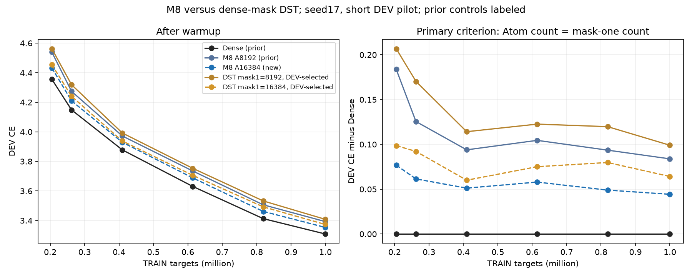
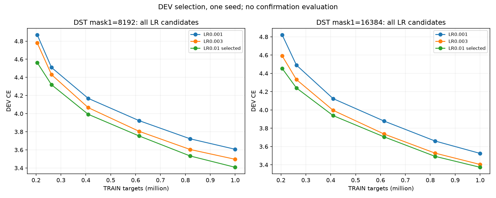
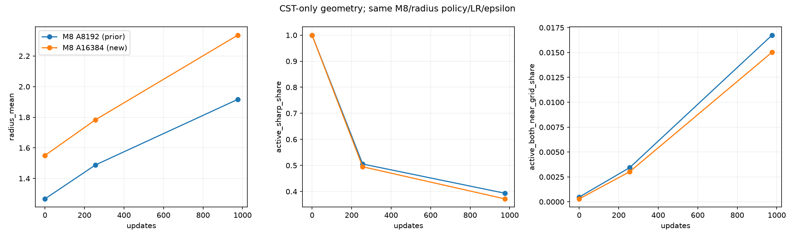
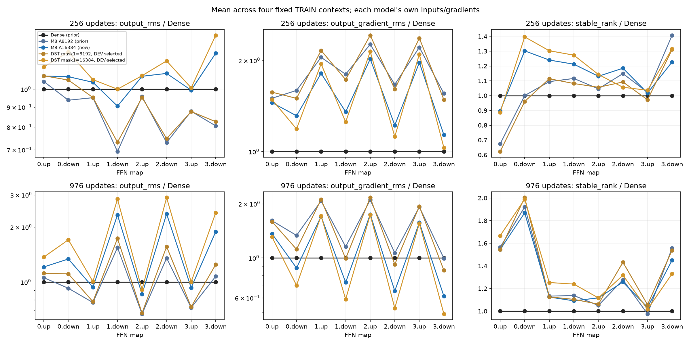

# M8容量と有効数を揃えたマスクDSTの結果

[English](lm-m8-active-count-20261110-results.md) | 日本語

RTX3090で新7条件が完了した。所有者指定の主比較は、**各LinearのCST Atom数とDSTのboolマスク1の数の一致**。
DSTは密な重み+boolマスクを維持し、COO/CSRは導入していない。
M8は8192→16384 Atomで短期DEV CEが3.392873→3.353298へ改善した。
同じ有効数のDEV選択DSTより、両条件でM8のCEが少し低い。Denseは3.308980で引き続き低い。
1seed・短期の観測であり、収束や同等性を示す結果ではない。

## 手順と予算

[手順](lm-m8-active-count-20261110.ja.md)。4block・幅512・FFN512→2048→512の全8mapをCST/DSTへ置換。
attention/embedding/共有語彙出力はDense。非接続M8、半径範囲[.5,50]、envelope tau.003、fraction0、
振幅上限32、通常LR.0003、CST全4fieldのLR32倍、epsilon1e-8、FP32/TF32無効を固定する。
A=c√(d_in d_out)、c8/16は各map8192/16384 Atom。seed17・shuffle905・976更新/999424学習target、
20M schedule、DEV8192 target。DenseとM8 A8192はSHA検証済みの旧対照を再利用し、再学習していない。

揃えるのは表現単位数である。CSTは1Atomにraw値4個、DSTはマスク1に有効重み1個を持つ。
全条件でbias10240 scalarが加わるため、raw変数数は別に報告する。
再成長直後に値0でも、マスク1ならDSTの有効数に数える。
旧4A DST比較は[元の基準の補助結果](lm-geometry-epsilon-capacity-20261110-results.ja.md)として保全した。

## 学習曲線と終端DEV

| Arm | Raw active FFN scalars incl.bias | DEV CE | PPL | Top1 % |
| --- | ---: | ---: | ---: | ---: |
| Dense (prior) | 8,398,848 | 3.308980 | 27.3572 | 37.451 |
| M8 A8192 (prior) | 272,384 | 3.392873 | 29.7513 | 36.951 |
| M8 A16384 | 534,528 | 3.353298 | 28.5969 | 37.073 |
| DST mask1=8192 | 75,776 | 3.408098 | 30.2077 | 36.438 |
| DST mask1=16384 | 141,312 | 3.373216 | 29.1722 | 36.743 |

M8のAtom倍増でCEは.039575改善し、Denseとの差は.083893→.044318になった。
同数でのCST−DST CEは8192で−.015226、16384で−.019918。
小差の記述であり、複数seedの有意性は調べていない。
初期化方針が同じでも半径分布は同一ではない。振幅に依存するenvelopeにより、A倍増時の
平均初期半径は1.266709→1.550377となる。同じ方針でAを変える介入であり、
表現容量と初期化・最適化の影響を完全に分離するものではない。

[生のTRAIN損失](assets/lm-m8-active-count-20261110/training.png)。

DSTは既存の行予算を保つRigL型topology更新250/500/750とactive-fan分散補正を使う。
同じ有効数のLR候補間で初期mask/重みは同一で、通常重み・データ順は対照と一致する。
各有効数で終端DEV CE最小、同値なら小さいLRを選び、全6候補を保全した。
両方とも試した最大LR.01が最良。さらに大きいLRは未探索なので、grid内の選択結果であって、
DSTの全体最適を示すものではない。confirmation/testは評価していない。

| Mask-one count per map | Sparse LR | Final DEV CE | Selected |
| --- | ---: | ---: | --- |
| 8192 | 0.001 | 3.606840 |  |
| 8192 | 0.003 | 3.496254 |  |
| 8192 | 0.01 | 3.408098 | yes |
| 16384 | 0.001 | 3.525131 |  |
| 16384 | 0.003 | 3.404259 |  |
| 16384 | 0.01 | 3.373216 | yes |

## 幾何と各層の信号

平均終端半径はA8192で1.916876、A16384で2.336523。平均fractionは.141282/.160708。
activeは振幅絶対値≥.01。active中のr<.6は39.33%/37.17%、両中心が格子近傍の割合は1.67%/1.50%。
activeの出力/入力座標のmoment scaleが1e-8未満の割合は.69%/.65%、.76%/.77%。
幾何の減衰が消えることや半径を小さくすることなしに、Atom増加で損失は改善した。

256/976更新で固定TRAIN4箇所の各層の出力RMS・出力cotangent RMS・特徴stable rankを保存した。
全mapで出力やcotangentが一様に潰れる挙動はない。
976更新時のA16384のdown出力RMSは全4blockでDenseより大きい（約1.34–2.36倍）が、
A8192よりCEは改善する。stable rankも一様にDenseを下回らない。
タスク差を一様な信号消失・rank崩壊・Denseの出力RMSとの一致だけで説明することは支持しない。
各networkの中間入力・cotangentは異なるため、タスクに条件づけた観測であり、同一入力のmap oracleや
因果的ablationではない。多層化でDenseが補っているものは未特定である。

## 実装の実測コスト

| Arm | Complete-step median ms | Peak allocated MiB | Peak reserved MiB |
| --- | ---: | ---: | ---: |
| Dense (prior) | 29.765 | 948.74 | 1436.00 |
| M8 A8192 (prior) | 212.479 | 969.36 | 1104.00 |
| M8 A16384 | 282.619 | 1059.31 | 1458.00 |
| DST mask1=8192 | 29.938 | 995.82 | 1490.00 |
| DST mask1=16384 | 29.930 | 995.82 | 1490.00 |

同期した完全stepには4回のforward/backward microbatch・clip・optimizer/topology更新を含める。
先頭10更新、入力準備、DEV、probe、checkpoint、oracleは除外した。reservedはobserverのallocator履歴を含む。
DSTの値は密重み・mask・勾配・optimizer状態の保存を含み、有効位置数を変えても密tensorのshapeは変わらない。
この小幅LMではCSTの速度・総allocatedメモリの優位は示されていない。
旧/新job間の速度比較は探索的。dense-mask DSTの実装値であり、COO/CSRや最適化済み疎保存の主張ではない。

実機NVIDIA GeForce RTX3090・25307578368 byte・CC8.6、Torch2.9.1+cu128・CUDA12.8。
native/回帰準備266.858秒、全条件の事前検証36.357秒はstep時間外。純粋なcompile時間は分離していない。

## 検証と来歴

修正版library08e7da4aはnative/回帰98件に合格し、両binaryのcohort拒否方向も確認した。
新7条件すべてで保存・復元/observer後の次更新が完全一致した。
M8 c16の初期/終端・up/down・全AのFP64参照は24 tensor/raw-field対を検証し、最大絶対誤差3.81470e-6、
relativeL2最大2.94980e-7。各tensor/fieldでmaxabs≤3e-4かつrelativeL2≤1e-4を満たし、旧component違反は0。
14 checkpoint監査と14明示的有効数監査で、有限FP32 moment・時計・DST無効重み/momentの0・
行予算・終端DEV再現に合格。CST時計976、DST973。

最初のmetadataのみの実行はC++ cohort guardで学習前に失敗した（88合格/8失敗）。失敗compact
f99dd0bf295ee5533003b351d88add72f244ba984dbe62718d47a9a5396a1bfdを保全した。
修正版の実行はnative98件に合格後、live-log/保存済みmanifestの不一致で学習前に停止。失敗compact
65482939650b5845439020a79be52fef751bb5b30c31131d2615296cc492ce84。
最終jobは旧compact・86 payload・2178 source fileを検証した不変viewを使う。
失敗sourceと数値基準は変更していない。c16専用buildの変更は条件付きhost admissionとextension bindingのみで、
数値kernelは不変。他の既存runtime278 fileのbyte一致、通常C++前処理・packed実行AST同一性、
共有module・train/audit body同一性にも合格した。

固定consumer bb0e9319b9fce066aa22f7a1c227b3d1dd7e9abd、
library08e7da4ae832a30b8361d799e3dde91981baf42b。
job `lm-m8-active-count-3090-20261110-02`、source archive
48843d03f2d1116d8e21e379f0587f6331464938bda77d157e43d9a56d840fe4、
final compact23e5017e804a8ce3d013f032474995557fa7c8dfb37a59d495810f0de5d2ec18。
75 payloadと2213 source file hashを取得・検証済み。raw checkpointと保存tensorはremoteに残した。
所有commandは全終了し、GPUは0%・11MiBでidle。Hub予約は稼働を維持。公開/既定値採用やPR mergeは行わない。

[派生データ・来歴・asset hash](lm-m8-active-count-20261110-results.json)。
再描画は`scripts/report_lm_m8_active_count.py`に最終取得先の`--run`、旧取得先の`--control-run`、
選択した両DST directoryを明示的な`--dst-run`、新しい`--output`を渡す。
scriptはmanifest・予算・選択・有効数監査・固定手順を検証して描画する。
