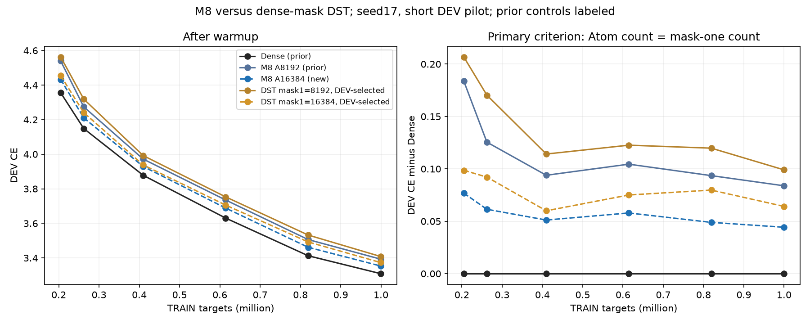
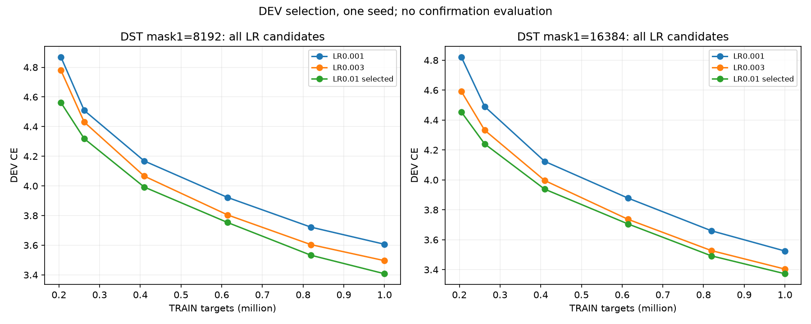
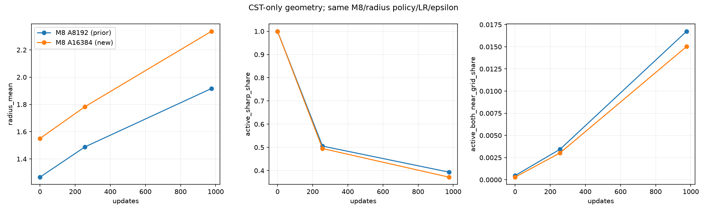
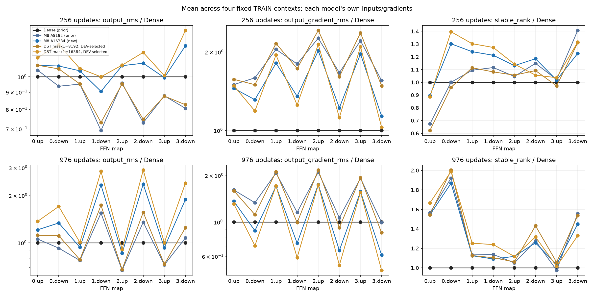

# M8 capacity and active-count-matched masked DST: results

English (canonical) | [日本語](lm-m8-active-count-20261110-results.ja.md)

All seven fresh arms completed on RTX3090. Under the owner's primary criterion,
**CST Atom count equals DST Boolean mask-one count per Linear**. DST remains
dense weights plus a Boolean mask; no COO/CSR implementation was introduced.
M8 A16384 improved short DEV CE from3.392873 to3.353298 versus A8192.
Both M8 counts have slightly lower CE than their count-matched, DEV-selected DST
controls in this pilot. Dense remains lower at3.308980. This is one seed and a
short observation window, not a convergence or equivalence claim.

## Protocol and budget

[Protocol](lm-m8-active-count-20261110.md). Four blocks,width512,FFN512→2048→512,
all eight FFN maps CST/DST; attention,embeddings and tied vocabulary stay Dense.
Unconnected M8, radius bounds[.5,50],envelope tau.003,fraction0,amplitude cap32,
ordinary LR.0003,CST all four field LRs32×,epsilon1e-8,FP32/TF32off stay fixed.
A=c√(d_in d_out),c8/16 means8192/16384 Atoms per map. Seed17,shuffle905,
976 updates/999424 training targets,20M schedule horizon,DEV8192 targets.
Dense and M8 A8192 are SHA-verified prior controls; they were not rerun.

The criterion matches representation units. CST has four raw values per Atom;
DST has one active weight per mask-one position. Biases add10240 scalars in
every arm. Report these raw counts separately. A newly regrown zero-valued DST
weight still counts if its mask is one. Earlier4A DST comparisons remain
[auxiliary under their original criterion](lm-geometry-epsilon-capacity-20261110-results.md).

## Learning curves and final DEV

| Arm | Raw active FFN scalars incl.bias | DEV CE | PPL | Top1 % |
| --- | ---: | ---: | ---: | ---: |
| Dense (prior) | 8,398,848 | 3.308980 | 27.3572 | 37.451 |
| M8 A8192 (prior) | 272,384 | 3.392873 | 29.7513 | 36.951 |
| M8 A16384 | 534,528 | 3.353298 | 28.5969 | 37.073 |
| DST mask1=8192 | 75,776 | 3.408098 | 30.2077 | 36.438 |
| DST mask1=16384 | 141,312 | 3.373216 | 29.1722 | 36.743 |

Doubling M8 Atoms reduces CE by.039575; its Dense gap changes.083893→.044318.
Count-matched CST-minus-DST CE is−.015226 at8192 and−.019918 at16384.
These small differences are descriptive; no multi-seed significance was tested.
Same initialization policy does not mean identical radius distributions: the
amplitude-dependent envelope gives mean initial radius1.266709→1.550377 as A
doubles. Thus this intervention changes A under a fixed policy; it does not
isolate representational capacity from initialization and optimization effects.

[Raw TRAIN losses](assets/lm-m8-active-count-20261110/training.png).

DST uses the unchanged row-balanced RigL-style topology at250/500/750 and
active-fan variance correction. Initial masks/weights are identical across LR
trials within each count. Ordinary weights and data order match the controls.
Selection is minimum final DEV CE within count, tie smaller LR; all six candidates
are retained. Both winners use.01, the largest tested rate. Larger rates remain
unexamined, so this establishes a grid-selected reference rather than a global
DST optimum. Confirmation/test data was not evaluated.

| Mask-one count per map | Sparse LR | Final DEV CE | Selected |
| --- | ---: | ---: | --- |
| 8192 | 0.001 | 3.606840 |  |
| 8192 | 0.003 | 3.496254 |  |
| 8192 | 0.01 | 3.408098 | yes |
| 16384 | 0.001 | 3.525131 |  |
| 16384 | 0.003 | 3.404259 |  |
| 16384 | 0.01 | 3.373216 | yes |

## Geometry and layer signals

Mean final radius is1.916876 for A8192 and2.336523 for A16384; mean fraction
is.141282/.160708. Active means absolute amplitude≥.01. Active sharp-radius
share r<.6 is39.33%/37.17%; both-centers-near-grid share1.67%/1.50%.
Active output/input coordinate moment scales below1e-8 are.69%/.65% and
.76%/.77%, respectively. The capacity improvement occurs without eliminating
geometry attenuation or forcing radii smaller.

At256/976 updates, four fixed TRAIN contexts retain each layer's output RMS,
output-cotangent RMS and feature stable rank. There is no uniform output or
cotangent collapse across the maps. At976,A16384 down-map output RMS is larger
than Dense at all four blocks (about1.34–2.36×), while its CE improves versus
A8192. Stable ranks are also not uniformly below Dense. This does not support
explaining the task gap solely by a uniform vanishing signal, rank collapse or
matching Dense output RMS. Each network has its own intermediate inputs and
cotangents: these are task-conditioned observations, not shared-input map oracles
or causal ablations. Dense's exact contribution to stacking remains unidentified.

## Actual implementation cost

| Arm | Complete-step median ms | Peak allocated MiB | Peak reserved MiB |
| --- | ---: | ---: | ---: |
| Dense (prior) | 29.765 | 948.74 | 1436.00 |
| M8 A8192 (prior) | 212.479 | 969.36 | 1104.00 |
| M8 A16384 | 282.619 | 1059.31 | 1458.00 |
| DST mask1=8192 | 29.938 | 995.82 | 1490.00 |
| DST mask1=16384 | 29.930 | 995.82 | 1490.00 |

Synchronized complete steps include four forward/backward microbatches,clipping
and optimizer/topology work. Exclude first10 steps,input preparation,DEV,probes,
checkpoints and oracles. Reserved memory retains observer allocator history.
DST numbers include dense weight,mask,gradient and optimizer-state storage;
changing the number of active positions does not change those dense tensor shapes.
This small-width LM shows no CST speed or total allocated-memory advantage.
Prior/new-job timing is exploratory. These are measurements of this dense-mask
DST implementation, not claims about COO/CSR or optimized sparse storage.

Actual GPU NVIDIA GeForce RTX3090,25307578368 bytes,CC8.6; Torch2.9.1+cu128,
CUDA12.8. Native/regression preparation took266.858s and all-arm qualification
36.357s, outside step timing; pure compilation time was not isolated.

## Validation and provenance

Corrected library source08e7da4a passed98 native/regression tests,including both
binary cohort-rejection directions. All seven arms passed exact serialized-next-
update/observer checks. Initial/final M8 c16 full-A up/down FP64 reference checks
cover24 tensor/raw-field pairs: maximum absolute error3.81470e-6,relativeL2
2.94980e-7. Every tensor/field satisfies maxabs≤3e-4 AND relativeL2≤1e-4;
zero older componentwise violations. Fourteen checkpoint audits and fourteen
explicit count audits passed,including finite FP32 moments,clocks,inactive DST
weight/moment zeros,row budgets and final DEV reload. CST clocks976,DST973.

The initial metadata-only attempt failed on the C++ cohort guard before learning
(88passed/8failed),failed compact f99dd0bf295ee5533003b351d88add72f244ba984dbe62718d47a9a5396a1bfd.
The corrected attempt passed98 native tests but stopped before learning on a
live-log/archive-manifest mismatch; failed compact65482939650b5845439020a79be52fef751bb5b30c31131d2615296cc492ce84.
The final job uses an immutable view of the verified prior compact,all86 payloads
and2178 source files. Neither failed source nor numerical gate was modified.
The dedicated c16 build changes only conditional host admission and extension
binding; numerical kernels are unchanged.278 other existing runtime files are
byte-identical; ordinary C++ preprocessing and packed-execution AST equivalence
passed, as did shared module/train/audit-body identity checks.

Frozen consumer bb0e9319b9fce066aa22f7a1c227b3d1dd7e9abd;
library08e7da4ae832a30b8361d799e3dde91981baf42b.
Job `lm-m8-active-count-3090-20261110-02`;source archive
48843d03f2d1116d8e21e379f0587f6331464938bda77d157e43d9a56d840fe4;
final compact23e5017e804a8ce3d013f032474995557fa7c8dfb37a59d495810f0de5d2ec18.
Retrieved and verified75 payloads and2213 source file hashes. Raw checkpoints and
retained tensors remain remote. All owned commands finished;GPU idle0%,11MiB;
Hub reservation remains running. No public/default adoption or PR merge.

[Derived data,provenance and asset hashes](lm-m8-active-count-20261110-results.json).
To regenerate, use `scripts/report_lm_m8_active_count.py` with the final retrieved
`--run`,prior retrieved `--control-run`,both selected DST directories as explicit
`--dst-run`,and a new `--output` directory. The script verifies manifests,budgets,
selection,count audits and fixed protocol before plotting.
