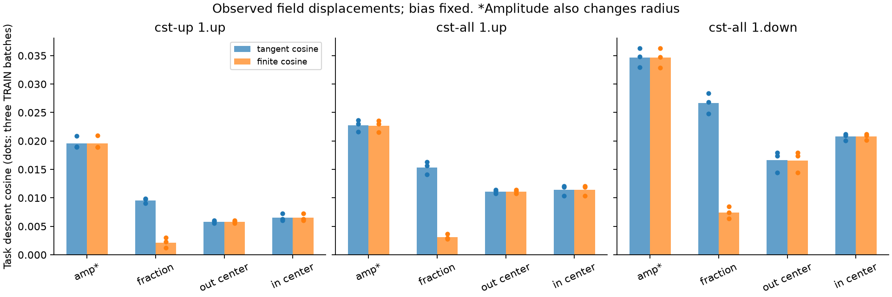
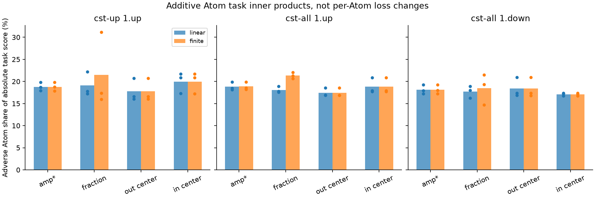
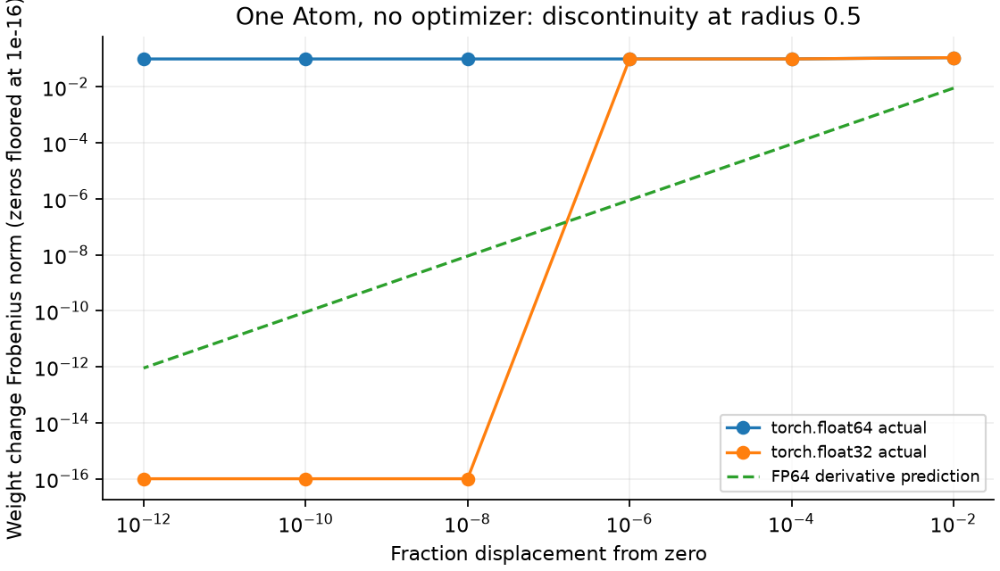
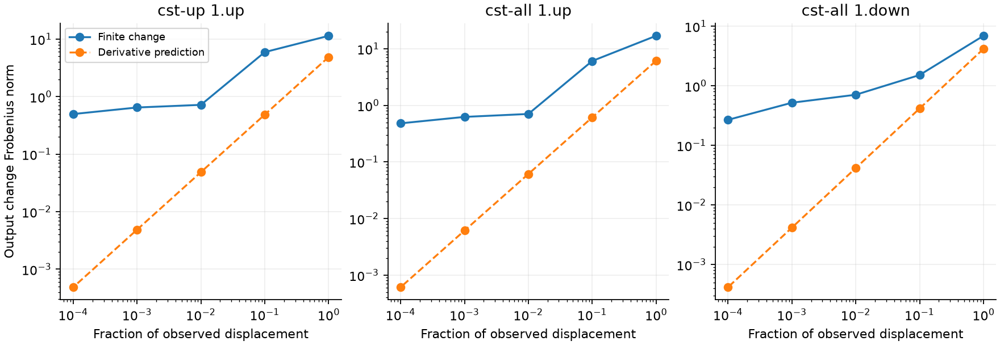
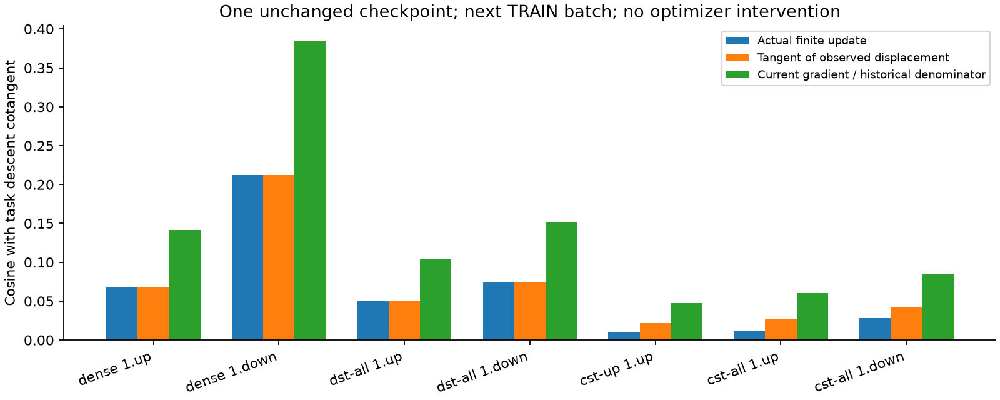

# Atomの局所構造・Adam履歴・半径の経路切替

[English (canonical)](lm-tangent-history-20261109-results.md) | 日本語

**分析完了。改善実験・追加学習は実施していません。**
今回のCST状態で有限更新と微分予測が大きくずれる主因は、半径の割合の更新が
離散的な計算区間の境界を跨ぐことです。振幅・座標は微分予測に近く動きました。
Adam履歴も一致度に影響しますが、Dense・DSTでも起きており、唯一の説明では
ありません。DEV精度差の全体の原因を特定したわけではありません。

## 条件と解釈

幅512・4ブロックのTinyStoriesモデル、step4882・4,999,168 tokens・seed17の
変更していない状態を使います。Dense・DST全体・CST単独up・CST全体から7行列、
元のTRAINバッチ3組・各1024 targetで21回の復元型観測を行いました。
CSTの3行列には追加で9回のフィールド・Atom別観測を実施しました。
入力とタスクcotangentは各観測状態で固定します。Dense教師・追加seed・held-out
選択・LR探索・保持するoptimizer更新・モデル変更はありません。
[プロトコル](lm-tangent-history-20261109.ja.md)と
[機械可読結果](lm-tangent-history-20261109-results.json)を参照してください。

局所出力z、タスクcotangent g、観測変位vについて、微分予測Jvと実際の有限出力
変化を比べます。タスク方向への一致度はcosine(-g,delta z)、予測との一致度は
cosine(Jv,delta z)であり、別の問いです。予測に忠実でもDense同等の学習や高い
タスク一致度を意味しません。

Atom iの局所寄与z_iについて、Atom別スコアは

\[
 s_i=\langle-g,\Delta z_i\rangle,\qquad
 \sum_i s_i=\langle-g,\sum_i\Delta z_i\rangle.
\]

です。これは加算できるタスク射影であり、Atomごとの独立した損失変化の測定では
ありません。負のスコアは正の射影を打ち消します。raw振幅の更新は包絡を通して
物理半径も変えるため、物理半径固定の振幅分析ではありません。フィールド分析では
biasを固定します。

## どのフィールドが微分予測から外れるか

9回の行列・バッチ観測全体の範囲です。

| 個別に動かしたrawフィールド | cosine(Jv,有限変化) | 有限変化ノルム / 予測ノルム |
|---|---:|---:|
| 振幅（誘発される半径変化を含む）|0.99734–0.99978|0.9997–1.0057|
| radius_fraction |0.19055–0.24194|6.92–12.46|
| output_center |0.999962–0.999978|1.0002–1.0016|
| input_center |0.999969–0.999982|0.9990–1.0006|

割合だけの更新で経路が変わるAtomは1.22–1.68%ですが、それらの寄与が線形化誤差の
ほぼ全体を再構成します。比率はノルムであり、加算的な説明分散ではありません。
打消しで僅かに1を超えることがあります。経路非変更Atomの寄与は小さいです。
全ての経路切替が問題ではなく、今回の座標による区間移動は滑らかでした。





## 半径の境界で何が起きるか

固定したreferenceはtile幅Tを選び、局所区間の個数K=ceil(2r/T)+1を決めます。
正規化されたFourier cell massを局所周期P=KTで計算するため、Kを変えると、
計算するcellだけでなくprofile係数と正規化も変わります。滑らかな枝の微分では
整数の経路選択を固定します。枝内でnative/referenceのVJPが正しくても、枝を跨ぐ
連続性の保証にはなりません。

決定的なFP64 CPU再現例は1 Atom、振幅1、割合0、座標7.3/13.7、半径範囲0.5/50、
tau0.003、modes8、base tile1、chart128x256です。割合を1e-12だけ増やすと半径が
0.5から0.5000000000023026になり、Kが2から3へ変わります。重みのFrobenius変化は
0.0994784421ですが、微分予測は9.01546e-13です。**optimizerは使いません。**

逆に0.5へ縮めても同じ0.0994784421の変化があり、微分予測は1.13358e-12です。
従って半径を縮小だけに制限しても十分ではありません。同じ半径で振幅0.1/1/10なら、
拡大・縮小とも跳びは0.00994784/0.09947844/0.99478442となり、振幅が跳びを増幅します。
FP32では極小変位が丸めで消えますが、FP64の不連続がなくなるわけではありません。
この再現例だけで全ての境界を判断することはできません。





## Adam履歴とAtomの局所構造

次のTRAINバッチで、履歴の分母を固定して一次momentを現在の勾配へ置き換えると、
接線のタスク一致度は上がります。

| 行列 | 履歴m/v | 現在g/履歴v | 実際の有限変化の一致度 |
|---|---:|---:|---:|
| Dense1.up |0.06819|0.14180|0.06819|
| Dense1.down |0.21196|0.38502|0.21196|
| DST全体1.up |0.04978|0.10432|0.04978|
| DST全体1.down |0.07385|0.15143|0.07385|
| CST単独1.up |0.02163|0.04789|0.01086|
| CST全体1.up |0.02716|0.06039|0.01107|
| CST全体1.down |0.04193|0.08563|0.02797|

3バッチの交差評価でも、全7行列で分子を現在の勾配にした方が非対角平均の一致度は
高くなりましたが、値は小さく、optimizerの良否・汎化の実験ではありません。
履歴を外すとAtomごとの無限小タスクスコアは非負になります。これは正の対角分母を
用いた勾配方向から期待される性質です。履歴を用いたAtom全フィールドの更新では、
9観測で絶対タスクスコアの14.28–17.55%が不利な寄与でした。いずれもAtomごとに
まとめるoptimizerが必要・優れているという証拠ではありません。



CGLSを256から2048反復へ増やすと、到達できたAtom接線のcosineは、単独up・全体up・
全体downで0.12207/0.13380/0.24290から0.12551/0.13444/0.24896へ上がりました。
**3つとも未収束**で、正規方程式残差は目標0.0001に対して0.00833/0.00177/0.01171です。
これは到達できた下側の値であり、構造的な上限・Atom数の下限・より良いパラメータ
方向が存在しない証拠ではありません。

## 証拠・検証・再現

operatorのcommit0d277ae6dc0ae14fe515c7559f39535ed0238950は未変更です。
実行時のモデル・optimizer importは監査済みconsumer7b89c7dを維持し、分析scriptは
別途固定したconsumer snapshotから実行しています。

| job末尾 | consumer snapshot | 観測数 | 最終compact SHA256 |
|---|---|---:|---|
|01 primary |c242a75ce80fb3432c70b3e9b5ce1bd6729c0beb|21|82062bc33179d000d864056df5f3e8588d484ef6e15bd813d29448cfefb552fd|
|02 extended |a3b07fc7ebdc4a44962723287f30d0c839887327|21|4e0ea6c0bd62c591a56450b0f2e9c042a7210f8f6352aa51fecb9bbf8c8134a0|
|03 fields |80a31ac6f146c1e9924ff51f1739631b64777809|9|5bf11aec807005bd667e64095f67133cc30a56e6aad8155543e981ad93a03c6e|

証拠rootはCST_RESEARCH_EVIDENCE_ROOT/lm-tangent-history-4090-20261109-01、-02、-03です。
最終compactのpayload各8件とsource同一性1988/1988/1989件を検証して回収しました。
元checkpointのhash、Parameters、buffer、optimizer状態・clock、RNGの復元を確認しました。
各jobはRTX4090、Torch2.9.1+cu128/CUDA12.8で新たにnative68テストを通過しています。
計測を挿入した分析は速度・メモリbenchmarkではなく、新しい性能の主張はありません。

ローカル全体272テスト中211成功・61skip、幾何・Atom分析6テスト成功、registry42研究の
検証も成功しました。ローカル回収をsystem Python3.9で起動した際にtarfileのfilter APIで
失敗しました。失敗receiptを保全し、既存venvのPythonで回収を完了しました。GPU再実行は不要でした。

```bash
# 固定operatorとsource/dataを検証した元のbase runを用います。
python scripts/analyze_lm_tangent_history.py --base-run "$BASE_RUN" --output "$NEW_OUTPUT" --extended-analysis
python scripts/analyze_lm_tangent_history.py --base-run "$BASE_RUN" --output "$OTHER_NEW_OUTPUT" --field-analysis-only
python scripts/inspect_radius_routing.py --output "$WITNESS_OUTPUT"
python scripts/report_lm_tangent_history.py --extended-job "$EXTENDED_JOB" --field-job "$FIELD_JOB" --witness "$WITNESS_OUTPUT" --repository .
```

## 設計上の示唆：未実装の案

修正では、区間の個数や階層が変わる境界で表現する重みを連続にし、両側と境界を跨ぐ
微分を確認するべきです。1つの案は評価区間に依存しない半径付き密度を定義し、cellごとに
積分することです。もう1つは有効な隣接表現を重複区間で混ぜ、混合比の微分も含める方法です。
経路の勾配を止める・拡大を禁止する・LRを下げる・経路を固定するだけでは、この条件を
満たすと示したことにはなりません。提案段階であり、修正版operator・学習結果はありません。
