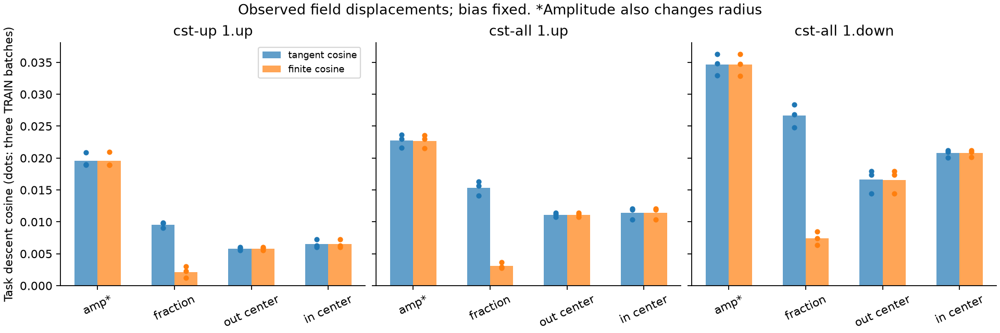
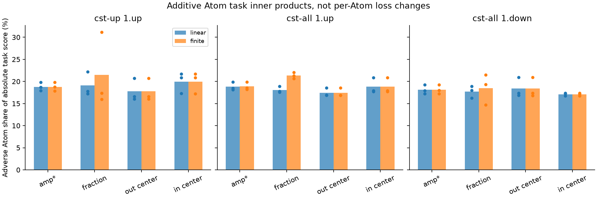
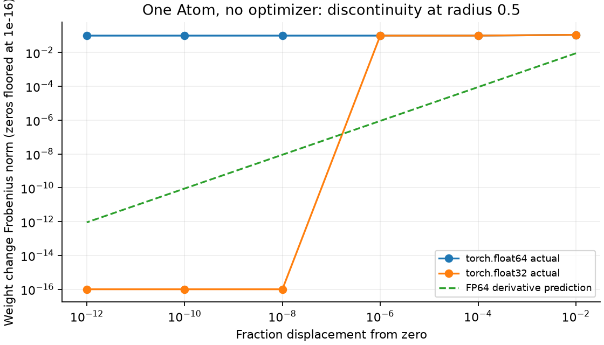
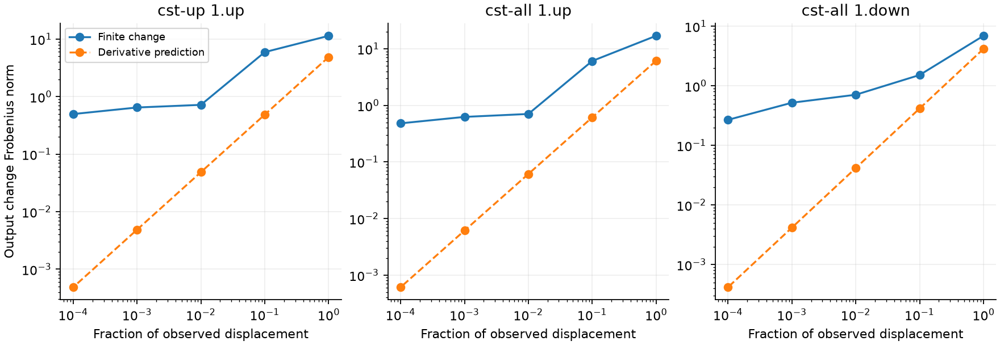
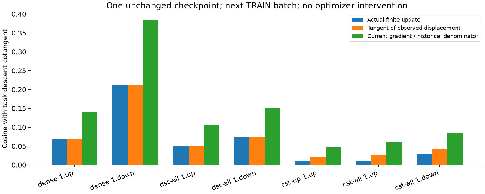

# Local Atom geometry, Adam history and radius routing

English (canonical) | [日本語](lm-tangent-history-20261109-results.ja.md)

**Analysis completed; no improvement experiment or training continuation.**
The largest finite-update/derivative mismatch in these CST states comes from
radius-fraction updates crossing discrete computation-window boundaries.
Amplitude and center changes follow their derivative predictions closely.
Adam history affects alignment too, including Dense and DST; it is not the sole
explanation. These findings do not establish the cause of the entire DEV gap.

## Conditions and interpretation

Use the unchanged width512/four-block TinyStories models at step4882,
4,999,168 tokens, seed17. Dense, DST-all, CST-single-up and CST-all contribute
seven local map states. Three original TRAIN batches of1024 targets each give
21 restored observations; three CST maps give9 further field/Atom observations.
Inputs and task cotangents are held at each observed state. No Dense teacher,
new seed, held-out selection, LR search, retained optimizer update or model change.
See the [protocol](lm-tangent-history-20261109.md) and
[machine-readable evidence](lm-tangent-history-20261109-results.json).

For local output z, task cotangent g and observed parameter displacement v,
compare the derivative prediction Jv and the finite output change. Task alignment
is cosine(-g,delta z). Prediction fidelity is cosine(Jv,delta z): these are
*different* questions. High prediction fidelity does not imply Dense-equivalent
learning or high task alignment.

For Atom i with local contribution z_i, the per-Atom score is

\[
 s_i=\langle-g,\Delta z_i\rangle,\qquad
 \sum_i s_i=\langle-g,\sum_i\Delta z_i\rangle.
\]

This additive task projection is not an independently measured per-Atom loss
change. Negative scores can cancel positive projections. Raw amplitude updates
also change physical radius through the envelope; field isolation does not
hold physical radius fixed. Bias is held fixed in the field analysis.

## Which field breaks the derivative prediction?

Ranges over all9 map/batch observations:

| Isolated raw field | cosine(Jv,finite change) | finite norm / predicted norm |
|---|---:|---:|
| amplitude, including induced radius |0.99734–0.99978|0.9997–1.0057|
| radius_fraction |0.19055–0.24194|6.92–12.46|
| output_center |0.999962–0.999978|1.0002–1.0016|
| input_center |0.999969–0.999982|0.9990–1.0006|

Only1.22–1.68% of Atoms change routing in the fraction-only update, yet their
contribution reconstructs nearly the entire linearization residual. Ratios are
norms, not additive variance percentages; small cancellation can make them
slightly exceed1. The unchanged-Atom contribution is tiny. Not every route
change is equally disruptive: center-window shifts in these observations closely
follow derivative predictions. This does not establish continuity at every
position boundary.





## Why a radius boundary matters

The frozen reference selects tile width T, then K=ceil(2r/T)+1 cells/tiles in a
local window. It evaluates normalized Fourier cell masses with local period
P=KT. Changing K therefore changes the profile coefficients and normalization,
not just which cells are evaluated. The selected smooth-branch derivative
holds this integer routing fixed. Correct native/reference VJPs within a branch
do not prove continuity across branches.

A deterministic FP64 CPU witness uses one Atom, amplitude1, fraction0,
centers7.3/13.7, radius bounds0.5/50, tau0.003, modes8, base tile1, charts128x256.
Changing fraction by1e-12 changes radius0.5 to0.5000000000023026 and K2 to3.
Actual weight Frobenius change is0.0994784421, versus derivative prediction
9.01546e-13. **No optimizer is used.**

The reverse displacement, shrinking back to0.5, gives the same0.0994784421
change, versus predicted1.13358e-12. Restricting radius to decrease is therefore
not sufficient. At the same radii, amplitudes0.1/1/10 yield jumps
0.00994784/0.09947844/0.99478442 in both directions: amplitude amplifies the jump.
FP32 rounds the tiniest displacements away; it does not remove the underlying
FP64 discontinuity. This boundary witness is not a claim about every boundary.

A subsequent CPU FP64 position-window witness also finds center discontinuities.
At fixed radius0.5001 and amplitude1, moving either center from7.5-1e-12 to
7.5+1e-12 changes first tile6 to7, with tile width1 and K3 unchanged. A site
window[6,7,8] becomes[7,8,9]. The dropped site's mass is nonzero; it is reassigned
at the opposite window edge. Actual weight change is0.000921018293 versus a
6.30120e-12 derivative prediction. The input/output-center witnesses agree.
Additional fixed radii0.5/0.75/1.5 and six displacement scales are recorded in
JSON. Smaller errors in the sampled training updates therefore do not mean
center routing is inherently continuous. Both window position and size require
boundary checks; blending only as a function of radius does not repair position
switches. No operator or optimizer was modified.





## Adam history and local Atom geometry

On the next TRAIN batch, replacing the first moment with the current gradient
while holding the historical denominator fixed raises tangent alignment:

| Map | historical m/v | current g/historical v | actual finite alignment |
|---|---:|---:|---:|
| Dense1.up |0.06819|0.14180|0.06819|
| Dense1.down |0.21196|0.38502|0.21196|
| DST-all1.up |0.04978|0.10432|0.04978|
| DST-all1.down |0.07385|0.15143|0.07385|
| CST-single1.up |0.02163|0.04789|0.01086|
| CST-all1.up |0.02716|0.06039|0.01107|
| CST-all1.down |0.04193|0.08563|0.02797|

The three-batch cross-evaluation also shows higher mean off-diagonal alignment
with current-gradient numerators in all seven maps, but values are small and
this is no optimizer-quality or generalization test. Removing history yields
nonnegative infinitesimal per-Atom task scores, as expected from a gradient
with a positive diagonal denominator. Historical combined-Atom updates have
14.28–17.55% adverse absolute task-score share in the9 CST observations. Neither
fact establishes that an Atom-grouped optimizer is necessary or better.



Increasing CGLS from256 to2048 iterations raises reachable Atom-tangent cosine
estimates from0.12207/0.13380/0.24290 to0.12551/0.13444/0.24896 for singleton-up,
all-up/all-down. **All three solves remain nonconverged**, with normal residuals
0.00833/0.00177/0.01171 versus target0.0001. These are reachable lower bounds,
not structural ceilings, evidence of an Atom-count lower bound or proof that
no better parameter-space direction exists.

## Evidence, validation and reproduction

Operator commit0d277ae6dc0ae14fe515c7559f39535ed0238950 is unchanged.
Runtime model/optimizer imports remain at the audited consumer7b89c7d; analysis
scripts execute from separately frozen consumer snapshots.

| Job suffix | consumer snapshot | records | final compact SHA256 |
|---|---|---:|---|
|01 primary |c242a75ce80fb3432c70b3e9b5ce1bd6729c0beb|21|82062bc33179d000d864056df5f3e8588d484ef6e15bd813d29448cfefb552fd|
|02 extended |a3b07fc7ebdc4a44962723287f30d0c839887327|21|4e0ea6c0bd62c591a56450b0f2e9c042a7210f8f6352aa51fecb9bbf8c8134a0|
|03 fields |80a31ac6f146c1e9924ff51f1739631b64777809|9|5bf11aec807005bd667e64095f67133cc30a56e6aad8155543e981ad93a03c6e|

Evidence root: CST_RESEARCH_EVIDENCE_ROOT/lm-tangent-history-4090-20261109-01,
-02 and-03. Final compact retrieval verified8 payload hashes per job and
1988/1988/1989 source-file identities, respectively. Original checkpoint hashes,
Parameters, buffers, optimizer state/clocks and RNG restoration passed. Each
job passed68 fresh native tests on RTX4090, Torch2.9.1+cu128/CUDA12.8. Instrumented
analysis is not a speed/memory benchmark; no new performance claim is made.

Local full suite:272 tests,211 passed,61 skipped; six geometry/Atom tests pass.
Registry validation passes42 studies. A local backup attempt under system
Python3.9 failed on the tarfile filter API; the failure receipt was retained and
retrieval completed using the established venv interpreter. No GPU rerun needed.

```bash
# With the pinned operator and source/data-qualified original base run:
python scripts/analyze_lm_tangent_history.py --base-run "$BASE_RUN" --output "$NEW_OUTPUT" --extended-analysis
python scripts/analyze_lm_tangent_history.py --base-run "$BASE_RUN" --output "$OTHER_NEW_OUTPUT" --field-analysis-only
python scripts/inspect_radius_routing.py --output "$WITNESS_OUTPUT"
python scripts/report_lm_tangent_history.py --extended-job "$EXTENDED_JOB" --field-job "$FIELD_JOB" --witness "$WITNESS_OUTPUT" --repository .
```

## Design implications, not implemented fixes

A repair should make the represented weights continuous across changes in
window count and hierarchy, then check derivatives on both sides and while
crossing. One route defines a single radius-dependent density independently of
the evaluation window and integrates it over cells. Another blends adjacent
valid representations across overlap regions, including the derivative of the
blend weight. Merely stopping gradients through routing, forbidding growth,
reducing LR or freezing routing does not by itself establish this contract.
These are proposals only; no repaired operator or learning result is claimed.
