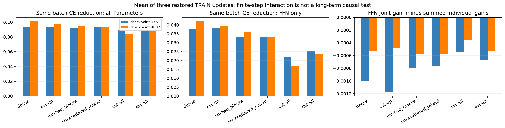
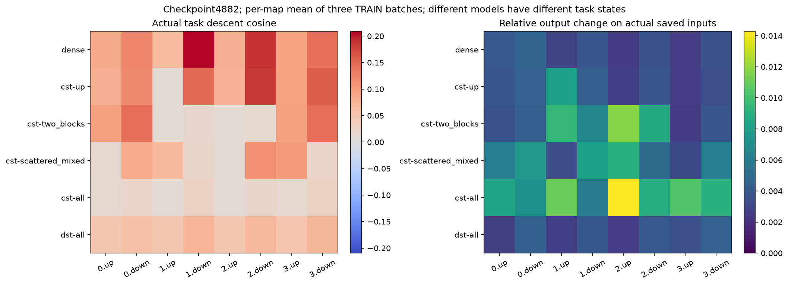
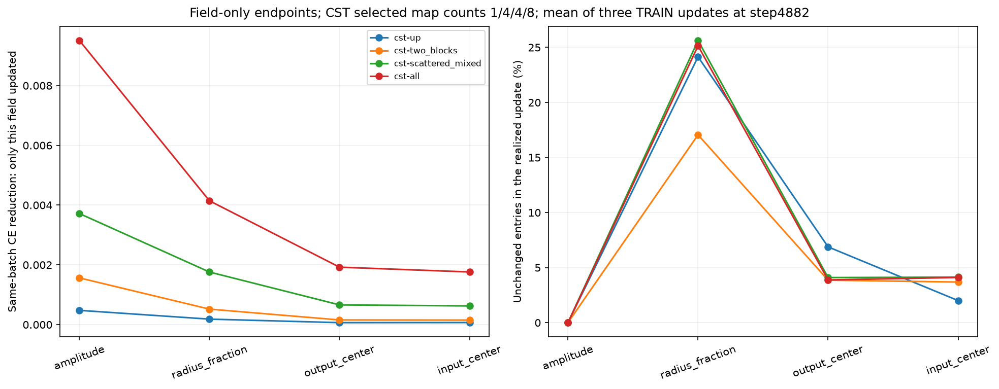

# CSTのタスク更新の癖

[English](lm-task-update-behavior-20261109-results.md) | 日本語

目的は改善設定の選択ではなく、CSTの挙動の記述です。復元型タスク更新probe36組を完了し、
ローカルで証拠を照合しました。出力空間で有効な更新方向、有限stepでの層間干渉、Parameterの
移動を分けて観測しています。最適なoptimizer・Atom数・kernelや、普遍的なCSTの限界を
特定した結果ではありません。

## 観測できたこと

checkpoint4882で3組のTRAIN1024対象を測った平均：

| 測定 | Dense | 全8CST | 全8DST |
|---|---:|---:|---:|
| 8写像平均のタスク下降方向cosine | 0.12421 | 0.01811 | 0.05887 |
| FFNだけ更新した同一batchのCE改善 | 0.042129 | 0.017170 | 0.023685 |
| FFN共同改善－個別改善の和 | -0.000528 | -0.000361 | -0.000535 |

実際の写像入力x、出力z、タスクcotangent gを保存し、optimizer更新後の同じxでdelta_zを
測定。下降cosineは-gとdelta_zの方向の一致度、-sum(g*delta_z)はタスク損失改善の一次近似です。
4microbatchのloss倍率1/4も保持しています。Dense出力・重みの再構成はしません。
モデル間で学習済みxとgが異なる記述的な比較であり、同一状態での関数クラスの能力や、到達可能な
最良の勾配射影を証明するものではありません。低cosineは「役に立たない学習の割合」そのものではありません。

**CSTの実際の写像更新は、大きく出力を変えていても、現在のタスク勾配への一致度が低い**
という違いがあります。単独CST条件でもblock1 upのcosineは0.0086、同位置のDenseは0.0663、
全CSTでは0.0111です。一方、単独CSTのタスクモデル全体はDenseに近い精度を得ています。
この局所的な挙動の差は、CSTを複数重ねたときに初めて生じるわけではありません。
残るDenseが補う可能性はありますが、補償の因果的な切り分けは未実施です。
DSTは同じactive FFN scalar予算でも中間の値ですが、学習済みモデル・パラメータ化・optimizerの
軌跡は異なります。

**この測定では、即時の同時更新による干渉だけが極端に大きいとは言えません。**
FFNの全更新を同時適用した改善量と、各写像だけを更新した改善量の和との差は、どの手法でも
小さな負の値でした。有限stepの非線形な交差効果であり、長期の協調学習を証明するものではありません。
この状態・batch群では「個々には良い更新が、複数CSTを同時更新した瞬間に大きく壊れる」という
単純な説明を支持する大きな干渉は見えません。





**Parameterの多くは動いています。** 全CSTのstep4882で、更新しても値が変わらない割合は
振幅0%、radius_fraction25.1%、output_center3.9%、input_center4.1%でした。
不変な要素には境界・丸め・optimizer履歴なども影響するため、それだけで勾配ゼロやdead parameter
とは判定できません。fieldだけを更新した効果はタスクへの寄与を記述するもので、生の勾配の単位を
直接比較するものではありません。条件間で置換した写像数・位置も違い、絶対CE改善量だけで
fieldの重要性を条件横断で順位付けしません。



**特徴の統計にも違いがあります。** 既存の最終4TRAIN contextでは、GELU前up出力が正となる
割合はDenseのblocks1–3で約.097–.139、全CSTで.437–.466、全DSTで.408–.441でした。
学習される特徴の選択性が異なり、その一部は圧縮したDSTにも共通する可能性があります。
Denseの分布を最適化目標にするものでも、疎性を合わせれば改善するという証明でもありません。
標本共分散のparticipation統計には一様な崩壊がなく、operator rank・表現能力の限界とも区別します。
[先行の信号レポート](lm-composition-20261109-results.ja.md)では、学習中の残差スケール増大も
観測しましたが、ネットワーク全体がゼロへ崩壊する挙動はありません。

未解決の問いは、Atomによる構造が出力変化の方向をどう制約するか、Adam/moment履歴がその中の
方向をどう選ぶか、半径/supportと特徴の並びが選択性にどう関わるか、どのDense部分が単独配置の
成功を支えるか、です。今の測定ではこれらを区別できません。本レポートから修正方法や推奨ハイパー
パラメータは導きません。

## 範囲・対照・復旧

[登録プロトコル](lm-update-interaction-20261109.ja.md)は、固定TinyStoriesモデルの幅512・
4ブロック・8head・context128、seed17、CST8192atoms/写像、tau.003、初期fraction0、cap32、
従来field LR32倍、20M scheduleを使用。Dense、単独up CST、中央連続4 CST、分散交互4 CST、
全8CST、全8DSTをstep976/4882で測定。offset0は実際の次のshuffle batch、32/64は同じ復元clock
で別TRAIN batchを測る診断です。元の17モデルと学習済み51checkpoint監査は変更していません。
36probeにはconfirmation・追加seed・新たな学習軌跡・Dense教師はありません。

RTX4090/Torch2.9.1+cu128/CUDA12.8でnative68件を再検証。Parameter/momentはFP32、TF32無効、
固定levels中間値はFP64。36probeすべてでParameter・buffer・optimizer・CPU/CUDA RNGを復元し、
clockはDense/CSTの976/4882、DSTの973/4863へ戻ることを確認しました。offset0の12ケースでは
計測あり・なしの次stepが完全一致。Dense側の小さな方向有限差分でscore計算を照合。
nativeの許容差は1e-4/4e-3のままです。ローカル266件（205pass・61optional skip）、Ruff、
41studyのmetadata検証を通過。描画時もcompact/sourceのhash、元clock、全probe/再現検証を照合します。

計測用コードの2つの失敗も保全しています。最初はDSTの非永続dense_gradient scratchを不変と
誤判定しました。修正後はscratchをraw dWと照合し、mask等を厳密に保持して全bufferを復元。
2回目はoptimizer状態の共有を検出し、CPU counter/同device momentの読込で再利用snapshotが
変わっていました。現在は毎回deep copyして読み込み、繰り返し復元の回帰テストで保護しています。
最終試行は新しいclock監査fieldを除く36機能測定値を完全再現し、修正後の状態復元も通過。
元checkpointは上書きせず、先行の初期からの学習の証拠には影響していません。

エージェントが依頼を改善作業まで広げて解釈し、field LRの短期継続10条件も起動していました。
ユーザーが分析目的と明確化した時点の確認では、10条件すべてが既に終了していました。
raw log・checkpoint・監査は別に保全し、本挙動分析からは外します。recipeの選択・採用や
追加の改善実験は行いません。結果の削除・隠蔽ではなく、目的の訂正です。

## 証拠と再現

Job:lm-update-interaction-4090-20261109-03。最終compact:
`fe7362f066073d748c0a3c1d1fcad6fd4fe5ac05e5af40e0878e8af2d4e91f46`。
ローカルで30compact files/1976source identities、途中21snapshotを照合。
Operator:`0d277ae6dc0ae14fe515c7559f39535ed0238950`。
Consumer:`5c6f09b69dd06d2fec2a81ca528eb4c10c231071`、固定runtime import:
`7b89c7db7105b4212fa9aee3efbc2870f1b848e3`。
Source archive:`d3c0e18ba9f6db3d95a3bfdc3ba06097875e2ab6140289df17c4a175a7242c8f`。
[JSON](lm-task-update-behavior-20261109-results.json)は分析集計、source/figureのidentityと目的の
訂正を保持。全traceと範囲外の継続結果はignored evidenceに、checkpointはNFSに残します。

```bash
python scripts/plot_lm_update_interaction.py \
  --run "$CST_RESEARCH_EVIDENCE_ROOT/lm-update-interaction-4090-20261109-03" \
  --output output/lm-task-update-behavior
```

job rootへbackup-state.json・source.tar.gz・最終compact・記録された展開先を復元して実行。
このコマンドは分析だけを行います。
