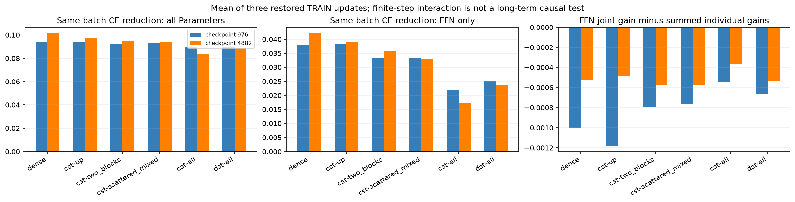
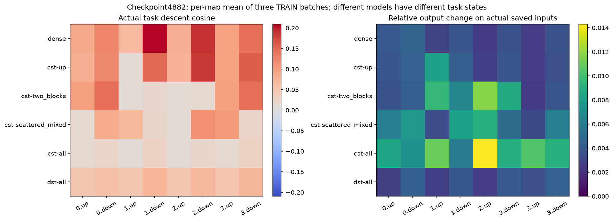
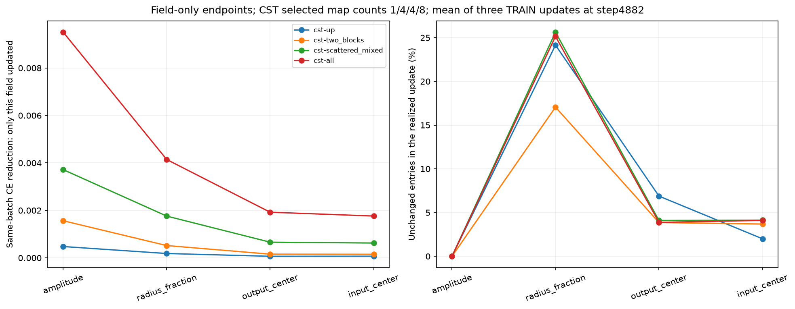

# CST task-update behavior

English (canonical) | [日本語](lm-task-update-behavior-20261109-results.ja.md)

The objective is to describe CST's behavior, not select an improved setting.
Thirty-six restored task-update probes completed and passed local evidence
verification. The observations distinguish useful output-space update direction,
finite-step layer interaction and parameter motion. They do not identify an
optimal optimizer, Atom count or kernel, or establish a universal CST limitation.

## Observations

At checkpoint4882, the mean of three1024-target TRAIN probes is:

| Quantity | Dense | All8 CST | All8 DST |
|---|---:|---:|---:|
| Mean8-map task descent cosine | 0.12421 | 0.01811 | 0.05887 |
| FFN-only same-batch CE reduction | 0.042129 | 0.017170 | 0.023685 |
| FFN joint gain minus sum of individual gains | -0.000528 | -0.000361 | -0.000535 |

For a map's actual input x, save its output z and task cotangent g, apply its
realized optimizer update, then recompute delta_z at that frozen x. The descent
cosine is between -g and delta_z; -sum(g*delta_z) estimates the first-order task
loss reduction. The four accumulated microbatches retain their1/4 loss scaling.
These are actual task gradients, with no Dense output/weight reconstruction.
Different trained models have different x and g; the comparison is descriptive,
not an identical-state proof of function-class capacity or the best attainable
gradient projection. A low cosine is not a literal percentage of useless learning.

**The realized CST map update is less aligned with the current task gradient,
even when it changes the output more.** This difference already exists in the
single-CST model: block1 up cosine0.0086, versus Dense0.0663 and all-CST0.0111.
The singleton task model nevertheless learns near Dense. Thus the local behavior
is not first created when multiple CST maps are stacked. Trainable Dense
complements may help; causal identification of compensation remains unperformed.
DST has an intermediate value despite matched active FFN scalar budgets, but is
a different learned model, parameterization and optimizer trajectory.

**An unusually large immediate interference penalty is not observed here.**
Installing all FFN endpoint updates versus each separately gives small negative
interaction terms in all methods. These are finite-step nonlinear cross-effects,
not proof about long-term coadaptation. Their magnitude does not support the
simple explanation that jointly applying several CST updates immediately ruins
otherwise good updates on these sampled states/batches.





**The Parameters are mostly moving.** For all-CST at4882, unchanged fractions
average0% for amplitude,25.1% for radius_fraction,3.9% for output_center and4.1%
for input_center. A nonmoving entry can reflect a bound, rounding or optimizer
history; it is not itself a zero-gradient/dead-parameter test. Field-only endpoint
effects describe their task contribution, not directly comparable raw gradient
units. Arms replace different numbers/positions of maps; do not rank field
importance across arms using only the absolute total CE gains.



**Feature statistics also differ.** Existing four-context final TRAIN signal
probes show positive pre-GELU up-output fractions about.097–.139 in Dense
blocks1–3, .437–.466 in all-CST and.408–.441 in all-DST. This suggests a difference
in learned feature selectivity, shared partly with the compressed DST model.
It does not make Dense's distribution an optimization target or prove that
matching sparsity would improve CST. Existing sample covariance participation
statistics do not show a uniform collapse and are not operator-rank/capacity
bounds. The [earlier signal report](lm-composition-20261109-results.md) also shows
learned residual-scale growth, without a network-wide collapse toward zero.

These observations leave separate questions: how CST's structured Atom basis
restricts available output changes; how Adam/moment history selects within those
directions; how radius/support and feature order affect selectivity; and which
Dense complements allow the singleton model to succeed. Current measurements
do not distinguish these explanations. No fix or preferred hyperparameter is
inferred from this report.

## Scope, controls and recovery

The [registered protocol](lm-update-interaction-20261109.md) uses the immutable
TinyStories width512/four-block/eight-head/context128 models, seed17, CST8192
atoms/map,tau.003,initial fraction0,cap32,original32x field rates and20M schedule.
Dense, single-up CST, paired-middle4 CST, mixed4 CST, all8 CST and all8 DST are
probed at976/4882. Offset0 is the actual next shuffled batch; offsets32/64 use
other TRAIN batches at the same restored clock. All17 source models and their
51 trained checkpoint audits remain unchanged. There is no confirmation dataset,
additional seed, new learning trajectory or Dense teacher in these36 probes.

Fresh68 native tests passed on RTX4090/Torch2.9.1+cu128/CUDA12.8, FP32 Parameters
and moments, TF32off, with frozen FP64-levels intermediates. All36 probes restore
Parameters,buffers,optimizer and CPU/CUDA RNG. Restored clocks are976/4882 for
Dense/CST and973/4863 for DST. Twelve offset0 cases reproduce instrumented versus
uninstrumented next steps exactly. A small Dense-remainder directional finite
difference checks the score calculation. Native tolerances remain1e-4/4e-3.
Local validation passed266 tests(205passed,61optional skips), Ruff and41-study
metadata checks. The plotting command independently checks the compact/source
hashes, original restored clocks and all probe/replay assertions.

Two measurement-harness failures were preserved. The first incorrectly treated
DST's nonpersistent dense_gradient scratch as immutable; the correction verifies
scratch against raw dW, keeps masks/other buffers exact and restores all buffers.
The second exposed optimizer-state aliasing: loading CPU step counters or
same-device moments can mutate a reused in-memory snapshot during replay tests.
Each load now deep-copies the snapshot, protected by a repeated-restore regression.
The final attempt reproduces all36 prior functional measurements exactly, excluding
the newly added clock-audit field, and passes the corrected state-restoration
checks. Source checkpoint files were never overwritten; the older from-scratch
learning evidence is unaffected.

The agent had also launched ten short field-LR continuations by interpreting the
request as improvement work. The owner clarified analysis-only intent. At the
correction check all ten had already finished; their raw logs/checkpoints and
audits remain preserved separately. They are omitted from this behavior analysis,
no recipe is selected/adopted, and no additional improvement experiment was run.
This is a scope correction, not deletion or concealment of outcomes.

## Evidence and reproduction

Job:lm-update-interaction-4090-20261109-03. Final compact:
`fe7362f066073d748c0a3c1d1fcad6fd4fe5ac05e5af40e0878e8af2d4e91f46`.
Locally verified30compact files/1976source identities, with21 progressive snapshots.
Operator:`0d277ae6dc0ae14fe515c7559f39535ed0238950`.
Consumer:`5c6f09b69dd06d2fec2a81ca528eb4c10c231071`; frozen runtime imports:
`7b89c7db7105b4212fa9aee3efbc2870f1b848e3`.
Source archive:`d3c0e18ba9f6db3d95a3bfdc3ba06097875e2ab6140289df17c4a175a7242c8f`.
The [JSON](lm-task-update-behavior-20261109-results.json) retains analysis aggregates,
source/figure identities and the explicit scope correction. Full traces and the
out-of-scope continuations remain in ignored evidence; checkpoints stay on NFS.

```bash
python scripts/plot_lm_update_interaction.py \
  --run "$CST_RESEARCH_EVIDENCE_ROOT/lm-update-interaction-4090-20261109-03" \
  --output output/lm-task-update-behavior
```

Restore backup-state.json,source.tar.gz,the final compact and its recorded extracted
directory under the job root first. This command performs analysis only.
