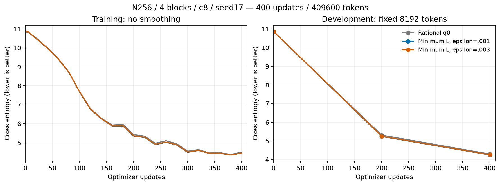
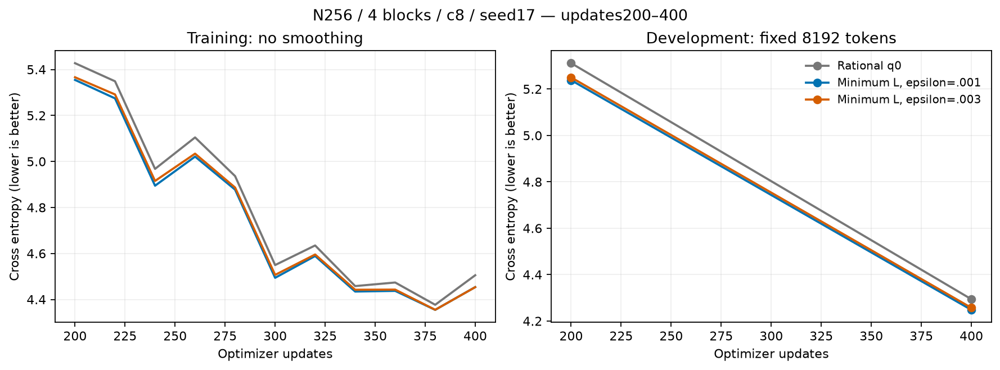
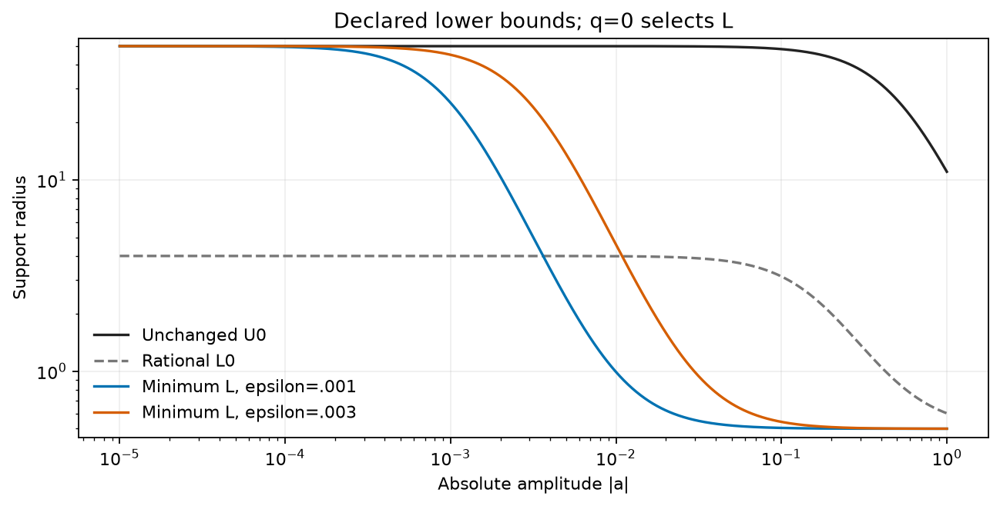
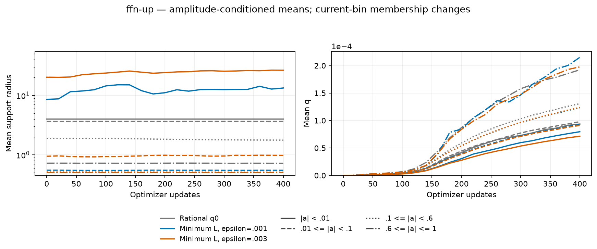
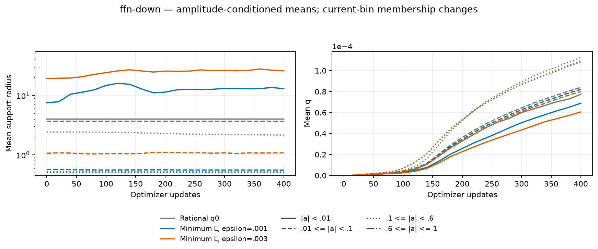
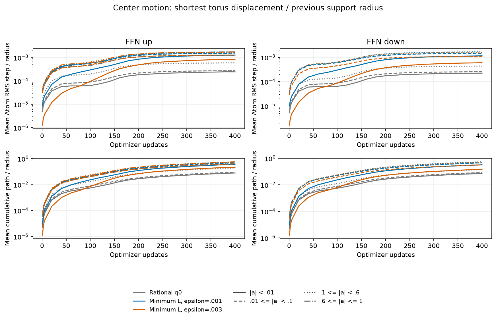

# A100での最小半径へ落ちる下限の結果

[English (canonical)](polar-minimum-a100-20261107-results.md) | 日本語

3条件とも400更新/409600トークンと学習後監査を完了しました。このseed17短期比較では
minimum-001 のDEV CEが最小で、新しい従来対照との差は-0.045949です。最小半径型の2条件は
どちらも対照より低い値でした。短い記述的観測であり、確定した最適値・収束や一般的な
優位性ではありません。ユーザーの最新指示に従い、開始済み比較で終了し、A100で新しい
kernelや移動量依存更新の追加実験は行っていません。

公開設定 `radius_envelope="rational_zero_opening", radius_birth=.5,
zero_opening_scale=epsilon` で、既存実装のまま
`L=.5+(U0-.5)*epsilon²/(a²+epsilon²), U=U0` を表せます。
新しいnative kernel実装は不要でした。ゼロでL=U、離れると最小半径へ近づき、q0では
実半径はLです。[固定した第一段階プロトコル](polar-minimum-a100-20261107.ja.md)は、
幅256、pre-LN4ブロック、FFN4N、8射影、c8/各4096Atom、q0、seed17、context128、
batch2/累積4、LR/データ順序20Mトークン予定、baseLR3e-4/Atom全体LR16倍、FP32/TF32無効、
AdamW(.9,.95)、decay0、clip1です。Attention/埋め込み/出力はDenseで、初期の全8射影の
operator energyを同じDense二次モーメントへ誤差.5%以内に合わせました。

| Condition | DEV CE | DEV PPL | Update ms | Allocated MiB | Reserved MiB |
| --- | ---: | ---: | ---: | ---: | ---: |
| Rational q0 | 4.294037 | 73.2616 | 481.09 | 686.28 | 714 |
| Minimum L, epsilon=.001 | 4.248089 | 69.9715 | 424.37 | 686.28 | 714 |
| Minimum L, epsilon=.003 | 4.257022 | 70.5994 | 420.28 | 686.28 | 714 |

| Condition / direction | Mean radius | Mean q | Weak radius / count |
| --- | ---: | ---: | ---: |
| rational-q0 / up | 2.29085 | 0.0001225 | 3.99717 / 526 |
| rational-q0 / down | 2.85505 | 0.0000993 | 3.99710 / 939 |
| minimum-001 / up | 1.29619 | 0.0001122 | 13.33377 / 997 |
| minimum-001 / down | 2.01981 | 0.0000915 | 12.97694 / 1962 |
| minimum-003 / up | 3.62681 | 0.0001096 | 26.54396 / 1885 |
| minimum-003 / down | 6.72241 | 0.0000863 | 25.95334 / 3854 |

| Condition / direction | Initial amplitude RMS (site mean) | Clipped Atoms /16384 |
| --- | ---: | ---: |
| rational-q0 / up | 0.228017 | 0 |
| rational-q0 / down | 0.117085 | 0 |
| minimum-001 / up | 0.176830 | 0 |
| minimum-001 / down | 0.062323 | 0 |
| minimum-003 / up | 0.177024 | 0 |
| minimum-003 / down | 0.063151 | 0 |

| Condition / direction | Mean Atom RMS step / previous radius | Mean normalized path |
| --- | ---: | ---: |
| rational-q0 / up | 0.000514048 | 0.167423 |
| rational-q0 / down | 0.000354759 | 0.115178 |
| minimum-001 / up | 0.00162813 | 0.515992 |
| minimum-001 / down | 0.0015208 | 0.475467 |
| minimum-003 / up | 0.00149347 | 0.472826 |
| minimum-003 / down | 0.00115587 | 0.349985 |

DEVは固定8192トークンです。更新時間は累積・データ転送を含む同期したoptimizer更新全体の
中央値で、probeとCPUの中心移動量計測は外に置きます。メモリは更新全体のallocated/reserved
ピークで、プロセス全体ではありません。A100 MIG3g.40GB上の計測付き1jobの対照比較であり、
デバイス間や普遍的性能を表しません。総経過時間には準備・評価・診断を含み、初回native
コンパイルと実行前検証はreceipt/logに別途残しています。

半径/qは方向別の4射影をAtom個数で重み付けし、弱振幅は|a|<.01です。初期振幅RMSは
4射影のRMS平均です。bin所属は変化し、空binは欠測です。各条件は初期、1–5、20更新ごと
400までの26時点を保存しています。中心移動量は全更新で観測し、各軸のtorus最短移動距離を
前時点の半径で割り、2軸の比の二乗を平均します。表示値はAtomごとのRMS stepの平均で、
全Atomを一度にRMSした値ではありません。normalized pathは各更新の正規化距離の累積です。
半径変更は分母も変えるため、比が大きいだけで生の座標移動量が増えたとは言えません。
診断は更新やRNGを変えず、移動量依存policy自体は未実装・ユーザー指示で後回しです。

## 検証とソース

Attempt01はnative線形VJPが通りましたが、Torch2.6のAdamW `_init_group` のsignature差で
学習前に停止しました。隔離2.11導入は外部indexのDNS失敗を受け停止し、検証済みruntimeを
提供せず、システム環境も変更していません。Attempt02はTorch2.6.0+cu126を保ち、旧APIの
AMSGrad明示引数をCSTAdamWで吸収しました。実A100のCPU/CUDA・AMSGrad有無・再開の4条件が
標準PyTorch AdamWと一致しました。その後、全recipeで独立求積、実両方向native Y/dX/全Atom VJP、
optimizer moment/再開、4ブロック実タスク/再開が通りました。

学習後も全24射影VJP、DEV3件の厳密再計算、3件の次更新Parameter/optimizer state厳密再開一致、
最終geometry/checkpoint一致が通りました。compact全31ファイルの取得・ハッシュを
検証済みです。原ソース/checkpointはリモートに保持、所有workerは終了、Hubは維持し、
無関係なjobは変更していません。confirmation/生成による選択はありません。

実機はA10080GB PCIe MIG3g.40gb、CC8.0、Python3.12.9、Torch2.6.0+cu126。
operator `7be68e4faf1813dd4b1a677ee432da5e3a8da9bd`、学習consumer
`85c5a3c09d7ee12ff092384e35b67a506b05fc31`。data manifest SHA256は
`5b995103ca95d3c9b62a4e860039683dc734b0a0bb20e232db1b2e45aa690d01`、
archive SHA256は `fb90978eb5ee72dcc762ec93442204b65a673c9f7d665281716d50e6aa3e00c5`です。
[figure/source manifest](assets/polar-minimum-a100-20261107/figure-manifest.json)にraw入力・描画ソース・PNG/SVGの
対応を残しています。再現には測定時ソースと固定プロトコルを使い、描画は
`python scripts/plot_projection_pilot.py --run EVIDENCE --output FIGURES` です。
