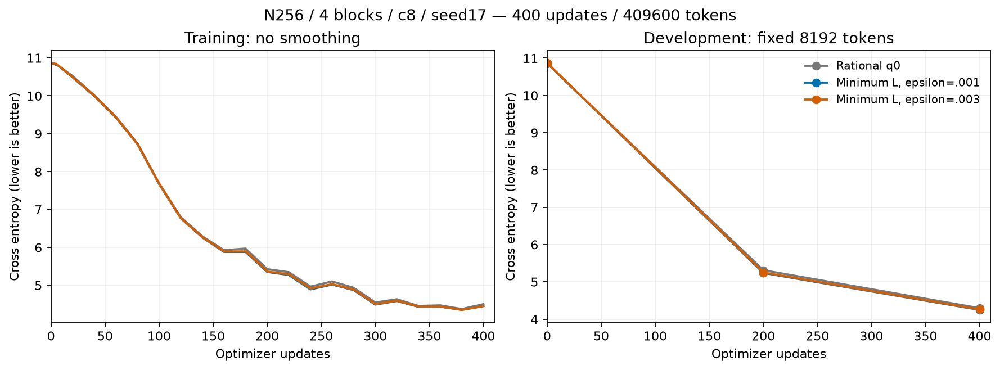
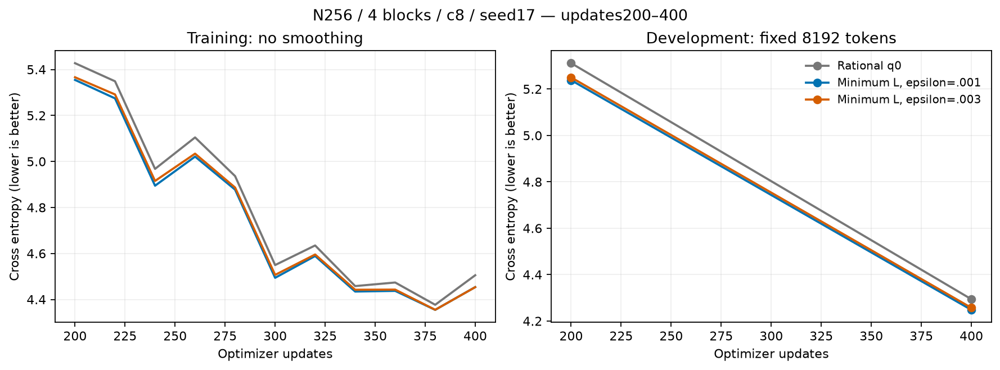
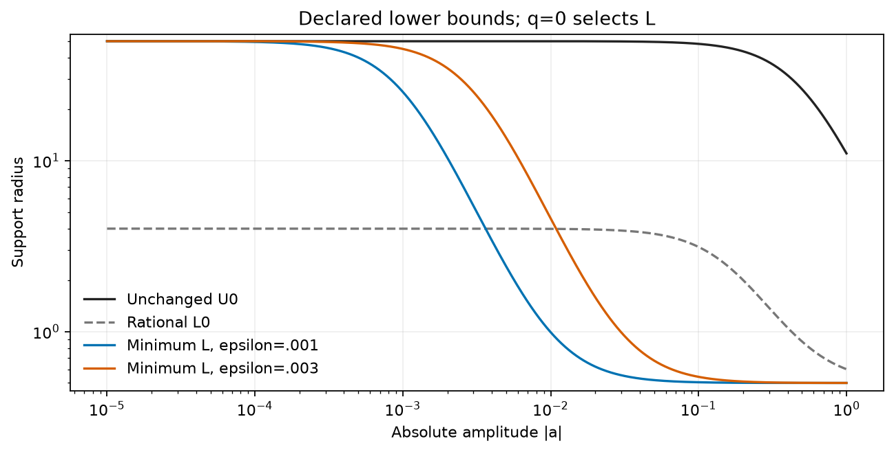
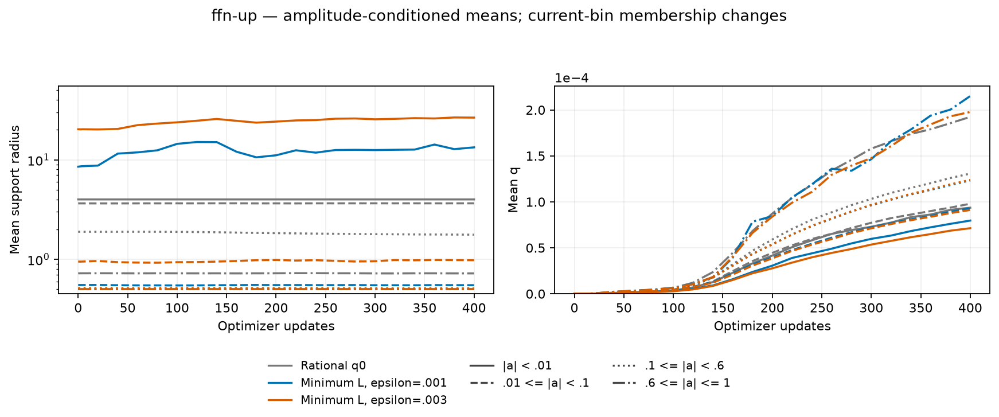
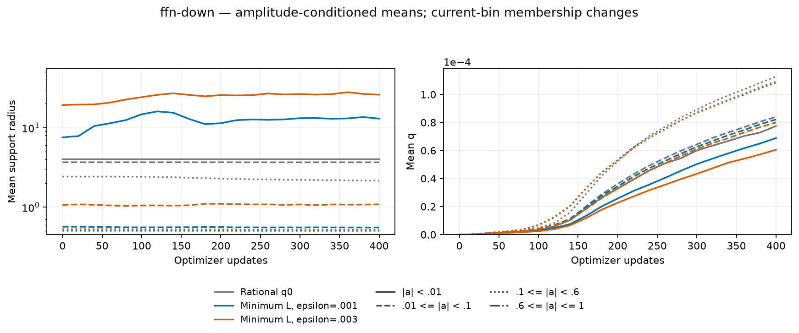
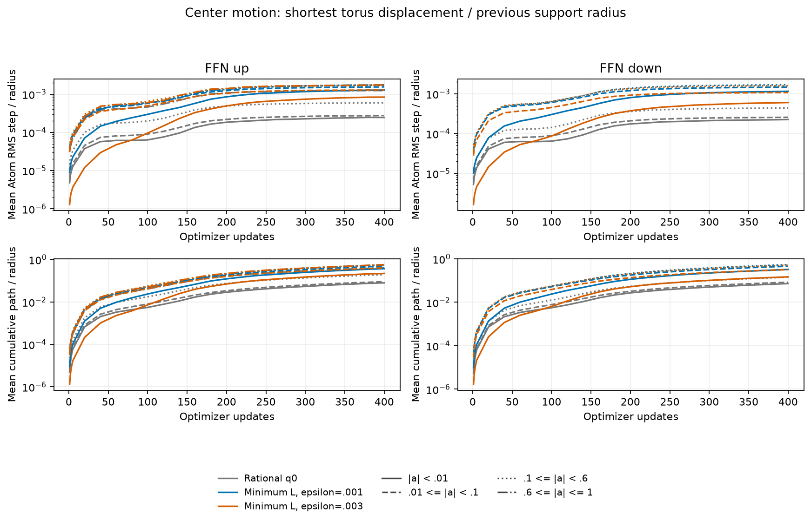

# A100 minimum-based lower-envelope results

English (canonical) | [日本語](polar-minimum-a100-20261107-results.ja.md)

All three arms completed 400 updates/409600 tokens and trained audits. At this
seed17 screening budget, minimum-001 has the lowest DEV CE; its difference to the
fresh rational control is -0.045949. Both minimum-based recipes are lower
than the control here. This is a short descriptive observation, not a confirmed
optimum, convergence result or general advantage. Per the owner's latest
instruction, the launched comparison is complete and no further A100 kernel or
movement-adaptive update experiment was started.

The existing public configuration expresses
`L=.5+(U0-.5)*epsilon²/(a²+epsilon²), U=U0`: set
`radius_envelope="rational_zero_opening", radius_birth=.5, zero_opening_scale=epsilon`.
No new native kernel implementation was needed. At zero L=U; farther away L
approaches the minimum. At q0 the radius is L. Keep the
[fixed first-stage protocol](polar-minimum-a100-20261107.md): N256,four pre-LN
blocks,FFN4N,eight CST sites,c8/4096 Atoms per map,q0,seed17,context128,
batch2/accumulation4,20M-token LR/data-order horizon,baseLR3e-4/whole-Atom LR16,
FP32/TF32off,AdamW(.9,.95),decay0,clip1. Attention/embed/output remain Dense.
All eight initial operator energies match Dense second moments within 0.5%.

| Condition | DEV CE | DEV PPL | Update ms | Allocated MiB | Reserved MiB |
| --- | ---: | ---: | ---: | ---: | ---: |
| Rational q0 | 4.294037 | 73.2616 | 481.09 | 686.28 | 714 |
| Minimum L, epsilon=.001 | 4.248089 | 69.9715 | 424.37 | 686.28 | 714 |
| Minimum L, epsilon=.003 | 4.257022 | 70.5994 | 420.28 | 686.28 | 714 |

| Condition / direction | Mean radius | Mean q | Weak radius / count |
| --- | ---: | ---: | ---: |
| rational-q0 / up | 2.29085 | 0.0001225 | 3.99717 / 526 |
| rational-q0 / down | 2.85505 | 0.0000993 | 3.99710 / 939 |
| minimum-001 / up | 1.29619 | 0.0001122 | 13.33377 / 997 |
| minimum-001 / down | 2.01981 | 0.0000915 | 12.97694 / 1962 |
| minimum-003 / up | 3.62681 | 0.0001096 | 26.54396 / 1885 |
| minimum-003 / down | 6.72241 | 0.0000863 | 25.95334 / 3854 |

| Condition / direction | Initial amplitude RMS (site mean) | Clipped Atoms /16384 |
| --- | ---: | ---: |
| rational-q0 / up | 0.228017 | 0 |
| rational-q0 / down | 0.117085 | 0 |
| minimum-001 / up | 0.176830 | 0 |
| minimum-001 / down | 0.062323 | 0 |
| minimum-003 / up | 0.177024 | 0 |
| minimum-003 / down | 0.063151 | 0 |

| Condition / direction | Mean Atom RMS step / previous radius | Mean normalized path |
| --- | ---: | ---: |
| rational-q0 / up | 0.000514048 | 0.167423 |
| rational-q0 / down | 0.000354759 | 0.115178 |
| minimum-001 / up | 0.00162813 | 0.515992 |
| minimum-001 / down | 0.0015208 | 0.475467 |
| minimum-003 / up | 0.00149347 | 0.472826 |
| minimum-003 / down | 0.00115587 | 0.349985 |

DEV uses 8192 fixed tokens. Update time is the median synchronized full optimizer
update including accumulation/data transfer; probes and CPU center-motion
sampling are outside that timer. Memory is the full-update allocated/reserved
peak, not total process usage. Paired timings here are one instrumented job on
A100 MIG3g.40GB, not a cross-device or universal performance result. Reported wall
time includes setup, evaluation and diagnostics; initial native compilation and
qualification are separately retained in receipts/logs.

Radius/q pool four sites per direction by Atom count. Weak means |a|<.01.
Initial amplitude RMS is the mean of four site RMS values. Bin membership changes
and empty bins are missing. Each arm retains 26 geometry snapshots (0,1–5,every20
through400). Center motion observes every update: the shortest torus displacement
on each axis is divided by that axis's previous radius, and the two squared
ratios are averaged. The displayed statistic is the mean of per-Atom RMS steps,
not the RMS across all Atoms. Normalized path sums per-step normalized distance.
Changing radius changes the denominator: a larger ratio alone does not establish
larger raw coordinate movement. These diagnostics change no update or RNG state.
The movement-dependent policy remains unimplemented/deferred by the owner.

## Verification and source

Attempt 01 passed native linear VJPs but stopped before training at the Torch 2.6
AdamW `_init_group` signature difference. The attempted isolated 2.11 installation
was stopped after external-index DNS failures; it never supplied a qualified
runtime or changed the system environment. Attempt 02 retains Torch 2.6.0+cu126
and fixes the explicit old AMSGrad argument in CSTAdamW. On the actual A100,
four CPU/CUDA, AMSGrad on/off and resume checks matched standard PyTorch AdamW.
Then every recipe passed independent quadrature, actual both-direction native
Y/dX/all-Atom VJPs, optimizer moments/resume and four-block task/resume.

Trained audits passed 24 site VJPs, three exact DEV recomputations and three exact
restored next-task-update Parameter/optimizer states; final geometry matches
checkpoints. All 31 compact files were retrieved and
hash-verified. Source and checkpoints remain intact remotely, all owned workers
are inactive, Hub retained, unrelated jobs untouched. No confirmation or
generation selection was used.

Actual GPU A10080GB PCIe MIG3g.40gb,CC8.0,Python 3.12.9,Torch 2.6.0+cu126.
Operator `7be68e4faf1813dd4b1a677ee432da5e3a8da9bd`; trained consumer
`85c5a3c09d7ee12ff092384e35b67a506b05fc31`. Data manifest SHA256
`5b995103ca95d3c9b62a4e860039683dc734b0a0bb20e232db1b2e45aa690d01`.
Archive SHA256 `fb90978eb5ee72dcc762ec93442204b65a673c9f7d665281716d50e6aa3e00c5`.
[Figure/source manifest](assets/polar-minimum-a100-20261107/figure-manifest.json) binds raw inputs,
plot code and PNG/SVG. Use measured sources and the fixed protocol for reproduction;
render with `python scripts/plot_projection_pilot.py --run EVIDENCE --output FIGURES`.
